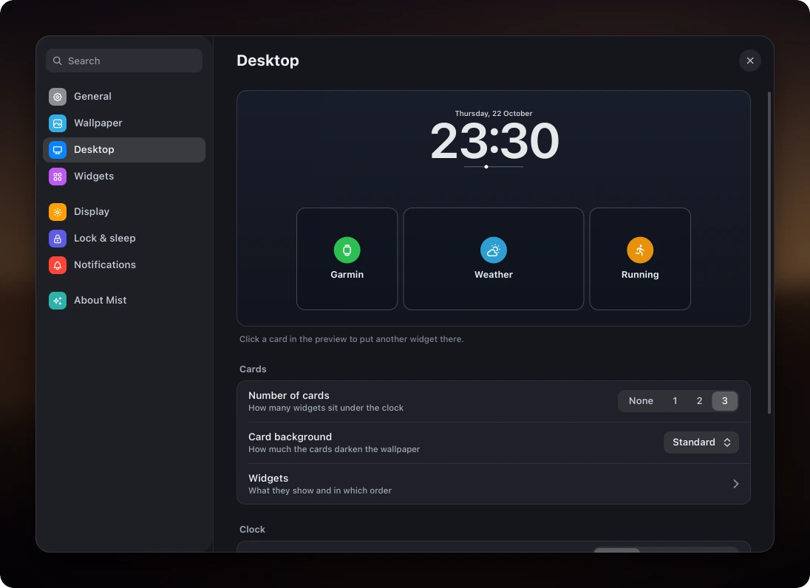

<div align="center">


**A macOS-inspired desktop shell for Wayland, written in Rust and drawn on the CPU.**

[](.github/workflows/ci.yml)
[](https://github.com/wiktor-jozwiak/mist/releases)
[](LICENSE)
[](https://discord.gg/4rRabwQTPE)

[English](README.md) · [Polski](docs/i18n/README.pl.md) · [Deutsch](docs/i18n/README.de.md) ·
[Español](docs/i18n/README.es.md) · [简体中文](docs/i18n/README.zh-CN.md) · [日本語](docs/i18n/README.ja.md)

<br>


<table>
  <tr>
    <td width="50%"></td>
    <td width="50%"></td>
  </tr>
  <tr>
    <td align="center"><sub>Dynamic Island: notifications, volume, rain nowcast, the next event</sub></td>
    <td align="center"><sub>Weather card over a real-time GLSL sky</sub></td>
  </tr>
</table>

</div>

Mist is the bar, dock, Dynamic Island, desktop widgets, launcher, control centre, notifications, lock screen
and polkit agent of one desktop, in a single ~50 MB process that never opens a GPU context. It runs on
Hyprland or on its own compositor, `mist-comp`.

It started as a Quickshell config that used 428 MB and 9.5 % CPU at idle, and was rewritten one surface at a
time around three rules:

- **Draw on the CPU.** `mist-ui` paints `wl_shm` buffers with [tiny-skia] and [swash] and redraws only what
  changed. On NVIDIA every OpenGL context costs 100 to 160 MB before the first pixel; Mist has none.
- **Wait for events.** Everything comes from the compositor socket, D-Bus, `pactl subscribe` and inotify.
  Nothing polls while the screen is idle, and hidden surfaces do no work.
- **One GPU process, only when it shows something.** `mist-wall` draws live wallpapers and the weather sky;
  with a photo wallpaper it exits and `mist-ui` draws the photo.

> [!NOTE]
> Mist is one person's daily desktop (Arch / CachyOS, two monitors, NVIDIA). It is shared because it works,
> not because it is finished: expect to read some code.

## Features

<table>
  <tr>
    <td width="50%"></td>
    <td width="50%"></td>
  </tr>
  <tr>
    <td align="center"><sub>Spotlight: apps, files, commands, emoji, web</sub></td>
    <td align="center"><sub>Settings: every option in one window, applied at once</sub></td>
  </tr>
  <tr>
    <td width="50%"></td>
    <td width="50%"></td>
  </tr>
  <tr>
    <td align="center"><sub>Control centre: network, Bluetooth, phone, sound, night light</sub></td>
    <td align="center"><sub>Calendar: month, agenda, new events</sub></td>
  </tr>
</table>

| | |
|---|---|
| **Top bar** | active app, system tray (StatusNotifierItem + dbusmenu), network, Bluetooth, audio, CPU and memory, clock |
| **Dock** | pinned and running apps, magnification, window picker with live thumbnails |
| **Dynamic Island** | media with an equalizer, timers, phone calls (KDE Connect or ADB), notifications, volume |
| **Desktop** | clock and glass cards: weather, Garmin readiness, running, music, calendar, system, world clocks |
| **Panels** | Spotlight, Start, app switcher, control centre, notification centre, clipboard history, emoji picker, session menu, screenshot toolbar |
| **Settings** | language, weather place, wallpaper, desktop layout, widgets, night light, lock and sleep, notifications |
| **System** | notification server, polkit agent, lock screen (PAM), idle and sleep |
| **Apps** | Mist Files (also the file chooser of every app), Mist Player (libmpv), system settings |
| **Snapping** | Windows 11 style: drag to an edge or corner, Snap Layouts on the green button or `Super + Z`, Snap Assist |
| **Wallpapers** | photos, live GLSL scenes, or a sky that follows the current weather |

**Weather** comes from [Open-Meteo](https://open-meteo.com) without an account: hourly curve, four days,
rain in the next hour, sun and moon. **Garmin readiness** and **running** show your own Garmin Connect data,
synced by `mistd` into a local SQLite file; they stay hidden until you log in once
([guide](docs/guides/garmin.md)).

The interface is in **English, Polski, Deutsch, Español and Français**, following `$LANG` or the choice in
Settings. A language is one JSON file in [native/assets/i18n](native/assets/i18n).

## Benchmarks

<p align="center"></p>

Whole shell at idle, proportional set size, Ryzen 7 5700X + RTX 4060, Hyprland 0.56, two 1080p monitors,
[bench/measure.sh](bench/measure.sh):

| Shell | Toolkit | Memory (PSS) | CPU at idle | GL context |
|---|---|---|---|---|
| **Mist** | Rust, CPU, `wl_shm` | **87 to 106 MB** | 0.6 % (music playing) | `mist-wall` only |
| Mist, `mist-ui` alone | | 36 to 50 MB | 0.6 % | no |
| Noctalia v5 | C++, cairo + EGL | 122 MB | 0.07 % | yes |
| Empty Quickshell (one `PanelWindow`) | Qt Quick | 124 MB | ~0 % | yes |
| Mist on Quickshell (the old QML version) | Qt Quick | 428 MB | 9.5 % | yes |

On `mist-comp` the compositor and the whole shell together idle at **0.04 % CPU and 6 wake-ups a second**
(headless, software renderer). Method, the compositor's numbers and a busy real session:
[docs/BENCHMARKS.md](docs/BENCHMARKS.md).

## mist-comp

Mist's own Wayland compositor, about 12 500 lines of Rust on [Smithay], with a greeter. It runs the same shell
and answers enough of Hyprland's IPC that `hyprctl` and Mist's scripts work unchanged. It is experimental, and
the author's daily session next to Hyprland.

- **Windows:** title bars or the app's own, rounded corners and shadows, glass blur under translucent windows
  and panels, Windows 11 snapping, Overview (`Super + O`), a magnifier, workspace swipe that follows the
  fingers, Win + D to show the desktop.
- **Does no work it can skip:** a monitor redraws only when something on it changed; glass re-blurs only when
  what is behind it moved; a window covered by others gets one frame a second instead of sixty.
- **Session:** DRM / KMS through logind, hotplug, VRR, explicit sync, XWayland, screen sharing through the
  portal, about 45 protocols. After a crash the windows come back on their workspaces; `mist-session restart`
  loads a new build without logging out.
- **Tested:** 50 nested tests on a headless backend, run by CI on the software renderer.

Not there yet: tiling, tearing control, verified direct scan-out on NVIDIA. Configuration:
[docs/CONFIG.md](docs/CONFIG.md#compconf-outputs-mist-comp-only); `mist-comp migrate` converts a Hyprland config.

## Install

Arch: [packaging/arch/PKGBUILD](packaging/arch/PKGBUILD) builds `mist-shell-git`.

```bash
git clone https://github.com/wiktor-jozwiak/mist && cd mist/packaging/arch && makepkg -si
```

From a checkout, anywhere:

```bash
git clone https://github.com/wiktor-jozwiak/mist ~/src/mist
```

```bash
~/src/mist/scripts/mistd/install.sh && ~/src/mist/native/install.sh
```

The first builds `mistd`, the second puts `mist-ui-bin`, `mist-wall-bin` and `mist-comp` in `~/.local/bin`. Prebuilt binaries are
attached to every [release](https://github.com/wiktor-jozwiak/mist/releases).

- **On Hyprland:** load [examples/hyprland/mist.lua](examples/hyprland/mist.lua) from your config and remove
  other bars, notification daemons and polkit agents.
- **On mist-comp:** `native/mist-comp/session/install-session.sh --greeter` adds a Mist session to the login
  screen; Hyprland stays.

<details>
<summary>Dependencies</summary>

<br>

**Build:** `rust`, `pkgconf`, `libxkbcommon`, `pam`, `wayland`, `mesa`; for `mist-comp` also `libinput`,
`libseat`, `libdrm`, `systemd-libs`.

**Runtime:** `pipewire-pulse`, `wireplumber`, `networkmanager`, `wl-clipboard`, `grim`, `slurp`, `polkit`,
`noto-fonts`, `noto-fonts-emoji`. Optional: `ddcutil` (monitor brightness), `kdeconnect` or `android-tools`
(phone). What each one turns on: [docs/CONFIG.md](docs/CONFIG.md#optional-integrations).

**Font:** the UI is drawn for SF Pro, which Mist cannot ship. Without it Mist uses Inter, then Noto Sans.

</details>

## Use

| Key | Action | | Key | Action |
|---|---|---|---|---|
| `Super` | Start | | `Super + A` | notification centre |
| `Super + Space` | Spotlight | | `Super + V` | clipboard history |
| `Super + Tab` | app switcher | | `Super + .` | emoji |
| `Super + I` | control centre | | `Super + L` | lock |
| `Super + Shift + S` | screenshot | | right click on the desktop | settings |

Everything can be scripted: `mist-ui-bin msg mist toggle spotlight`, `mist-ui-bin msg ui stats`. Settings live
in `~/.config/mist/`, every file is described in [docs/CONFIG.md](docs/CONFIG.md); the log is
`~/.cache/mist/ui.log`.

## Develop

```bash
cd native && cargo build --release && cargo test --release
```

Every surface renders offscreen, so changes can be checked without touching the running session:
`mist-ui-bin --pane-png spotlight 1920 1080 out.png`, `mist-ui-bin --desk-png dir`,
`mist-wall-bin --png out.ppm dunes 1920 1080`. `native/mist-comp/tests/run-all.sh` runs the compositor tests
in a nested window. More in [native/README.md](native/README.md) and [CONTRIBUTING.md](CONTRIBUTING.md).

| Path | What |
|---|---|
| `native/mist-ui` | every shell surface |
| `native/mist-wall` | the GPU wallpaper process |
| `native/mist-comp` | the compositor, session and greeter |
| `scripts/mistd` | backends: system stats, phone, calls, clipboard, Garmin sync |
| `shaders/` | wallpaper and sky shaders |
| tag `legacy-qml` | the original Quickshell version |

## Credits

Built on [Smithay], [smithay-client-toolkit], [tiny-skia], [swash], [resvg], [zbus] and [Tabler Icons].
The first version ran on [Quickshell], with [Noctalia] as a reference.

<sub>Mist is not affiliated with Apple. macOS, Dynamic Island, Spotlight and SF Pro are trademarks of Apple Inc.,
named here only to describe the design inspiration.</sub>

[GPL-3.0](LICENSE)

[tiny-skia]: https://github.com/linebender/tiny-skia
[swash]: https://github.com/dfrg/swash
[resvg]: https://github.com/linebender/resvg
[zbus]: https://github.com/dbus2/zbus
[Smithay]: https://github.com/Smithay/smithay
[smithay-client-toolkit]: https://github.com/Smithay/client-toolkit
[Tabler Icons]: https://tabler.io/icons
[Quickshell]: https://quickshell.org
[Noctalia]: https://github.com/noctalia-dev/noctalia
