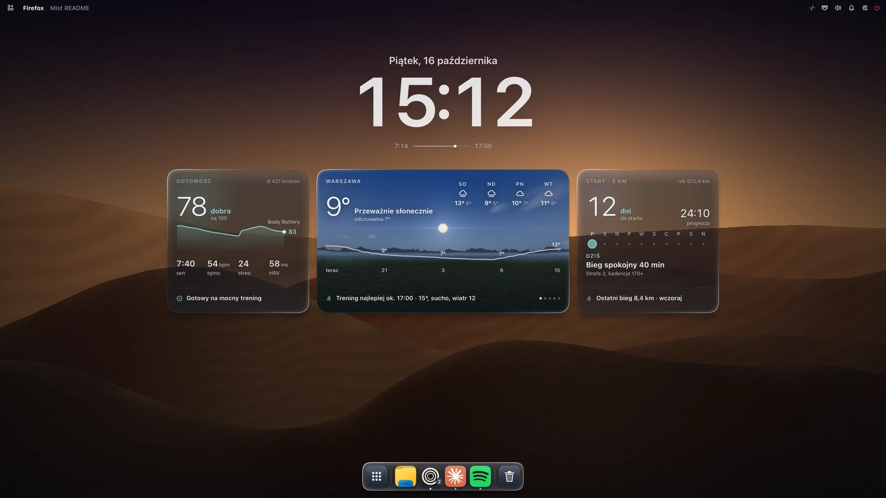

<div align="center">

# Mist

**A macOS-inspired desktop shell for Hyprland, written in Rust and drawn on the CPU.**

Bar, dock, Dynamic Island, desktop widgets, Spotlight-style launcher, control centre, notifications,
lock screen and polkit agent in one ~50 MB process, without a GPU context.

[English](README.md) · [Polski](docs/i18n/README.pl.md) · [Deutsch](docs/i18n/README.de.md) ·
[Español](docs/i18n/README.es.md) · [简体中文](docs/i18n/README.zh-CN.md) · [日本語](docs/i18n/README.ja.md)




<sub>Offscreen render (`mist-ui --desk-png`, `--dock-png`, `--png`, `mist-wall-bin --png`) with demo data.
On a real session Hyprland blurs under the glass.</sub>

</div>

## Why

Most Hyprland shells run on Qt Quick (Quickshell), GTK + GJS (AGS) or a WebView. Each of them opens an
OpenGL context, and on NVIDIA every GL context maps the driver: about **100 to 160 MB per process** before the
first pixel. Mist started as a Quickshell config (428 MB, 9.5 % CPU) and was rewritten surface by surface:

- **CPU-drawn surfaces.** `mist-ui` paints into `wl_shm` buffers with [tiny-skia] and [swash]; Hyprland
  composites and blurs them. Only damaged regions are redrawn.
- **Event-driven.** Data comes from the Hyprland socket, D-Bus, `pactl subscribe`, inotify and long-lived
  `mistd` backends. Nothing polls on a timer while the screen is idle; hidden surfaces do no work.
- **One GPU process, only when needed.** `mist-wall` (EGL, GLSL 150) draws animated wallpapers and the
  weather sky. With a photo wallpaper it exits and `mist-ui` draws the photo itself.

Result on the author's machine: **~87 to 106 MB PSS for the whole shell**, 0.6 % of one core while music plays.
See [docs/BENCHMARKS.md](docs/BENCHMARKS.md).

## Features

| | |
|---|---|
| **Top bar** | active app and title, system tray (StatusNotifierItem host + dbusmenu), network, Bluetooth, audio, CPU / memory meters, clock, calendar popup |
| **Dock** | pinned + running apps, magnification, window picker with live thumbnails (`hyprland_toplevel_export_v1`), click on the active app minimises it |
| **Dynamic Island** | media (MPRIS) with equalizer, timers, calls (KDE Connect / ADB), notifications, volume |
| **Desktop** | clock, sunrise / sunset, glass cards (weather, Garmin readiness, running plan), per-widget settings sheet |
| **Panels** | Spotlight-style search, Start, Cmd+Tab switcher, control centre (paged), notification centre, clipboard history, emoji picker, session menu, wallpaper gallery, screenshot toolbar |
| **System** | notification server, polkit agent, lock screen (`ext-session-lock-v1` + PAM), idle (`ext-idle-notify-v1`, logind), Windows 11-style snap assist |
| **Wallpapers** | photos (CPU) or live GLSL scenes and a real-time weather sky (`mist-wall`) |
| **mist-comp** *(experimental)* | own Smithay compositor + greeter, for running Mist without Hyprland |

## Architecture

```
 Hyprland ── layer-shell ──┬── mist-ui      Rust, CPU (tiny-skia + swash), wl_shm, one process for every surface
                           │      ├── mistd stats | phone | calls | island | clipstore   (event backends)
                           │      └── IPC: mist-ui-bin msg <target> <function> [args]
                           └── mist-wall    Rust, EGL / GLSL 150, only for live wallpapers and the sky
```

| Path | What |
|---|---|
| `native/mist-ui` | all shell surfaces ([native/README.md](native/README.md)) |
| `native/mist-wall` | GPU wallpaper process |
| `native/mist-comp` | experimental Smithay compositor, session and greeter |
| `native/common` | code shared by mist-ui and mist-wall (astronomy, presets) |
| `scripts/mistd` | backends: system stats, phone (KDE Connect, ADB), calls, clipboard store, file manager D-Bus |
| `shaders/` | wallpaper and sky shaders (`.frag` sources, `.qsb` packs read by mist-wall) |
| `*.qml`, `components/` | the original Quickshell version, kept as reference; no longer started |

## Install

Mist is a personal daily driver: it targets Arch / CachyOS, Hyprland 0.55+ with the Lua config, and an
NVIDIA or Mesa GPU. Expect to read code.

**Build dependencies:** `rust` (stable), `pkgconf`, `libxkbcommon`, `pam`, `wayland`, `mesa` (EGL headers);
for `mist-comp` also `libinput`, `libseat`, `libdrm`, `mesa` (gbm), `systemd-libs` (udev).

**Runtime:** `hyprland`, `pipewire` + `pipewire-pulse` (`pactl`, `pw-play`, `parec`), `wireplumber` (`wpctl`),
`networkmanager` (`nmcli`), `wl-clipboard`, `grim`, `slurp`, `polkit`, `qt6-shadertools` (`qsb`, live
wallpapers only), `noto-fonts`, `noto-fonts-emoji`. Optional: `ddcutil` (brightness over DDC/CI),
`kdeconnect` / `android-tools` (phone), `wf-recorder` (screen recording).

**Font:** the UI is designed for SF Pro (variable `SF-Pro.ttf` in `~/.local/share/fonts/SF-Pro/`), which
Apple licenses for its platforms only and Mist does not ship. Without it Mist uses Inter Variable, then
Noto Sans.

```bash
git clone <this repo> ~/.config/quickshell/mist
```

```bash
~/.config/quickshell/mist/scripts/mistd/install.sh
```

```bash
~/.config/quickshell/mist/native/install.sh
```

The clone must live in `~/.config/quickshell/mist` (paths are still fixed there, see
[docs/PUBLISHING.md](docs/PUBLISHING.md)). `native/install.sh` installs `mist-ui-bin`, `mist-wall-bin`,
`mist-comp` and, on the first run, the guard `~/.local/bin/mist-ui` into `~/.local/bin`.

Then add [examples/hyprland/mist.lua](examples/hyprland/mist.lua) to your Hyprland config (autostart,
key bindings, blur rules) and remove other bars, notification daemons and polkit agents.

## Use

| Key | Action |
|---|---|
| `Super` | Start |
| `Super + Space` | Spotlight |
| `Super + Tab` | app switcher |
| `Super + I` | control centre |
| `Super + A` | notification centre |
| `Super + V` | clipboard history |
| `Super + .` | emoji |
| `Super + L` | lock |
| `Print`, `Super + Shift + S` | screenshot (region) |

Everything is scriptable: `mist-ui-bin msg mist toggle spotlight`, `mist-ui-bin msg ui stats`,
`mist-ui-bin msg dock click firefox`. Log: `~/.cache/mist/ui.log`. Settings: `~/.config/mist/`.

## Develop

```bash
cd native && cargo build --release && cargo test --release
```

Checks without touching the running session:

| Command | Output |
|---|---|
| `mist-ui --png out.png '{"app":"Firefox"}'` | the top bar as PNG |
| `mist-ui-bin --desk-png dir` / `--dock-png out.png` | desktop stage + cards / dock |
| `mist-ui --test` | a second bar over the real one on HDMI-A-1 |
| `mist-wall-bin --png out.ppm dunes 1920 1080` | a live wallpaper frame |
| `mist-ui-bin msg ui stats` | wake-ups, paints and paint time per surface |
| `bench/measure.sh 30 mist-ui-bin mist-wall-bin mistd` | idle PSS / CPU of the running shell |

Keep `lto = false` (Arch rustc with system LLVM crashes with LTO). See [CONTRIBUTING.md](CONTRIBUTING.md).

## Status

Daily driver of one person, two monitors, NVIDIA. Everything in the table above is native and used every
day; `mist-comp` is experimental. UI strings are Polish for now (see [docs/PUBLISHING.md](docs/PUBLISHING.md)
for what is missing before a public release: i18n, configurable paths, no Apple assets).

## Credits

[Hyprland], [Smithay] and [smithay-client-toolkit], [tiny-skia], [swash], [resvg], [zbus], [Tabler Icons]
(MIT). The original QML version was built on [Quickshell]; [Noctalia] served as fallback and reference.

*Mist is not affiliated with Apple. macOS, Dynamic Island, Spotlight and SF Pro are trademarks of Apple Inc.;
they are named here only to describe the design inspiration.*

## License

[GPL-3.0](LICENSE).

[tiny-skia]: https://github.com/linebender/tiny-skia
[swash]: https://github.com/dfrg/swash
[resvg]: https://github.com/linebender/resvg
[zbus]: https://github.com/dbus2/zbus
[Hyprland]: https://hyprland.org
[Smithay]: https://github.com/Smithay/smithay
[smithay-client-toolkit]: https://github.com/Smithay/client-toolkit
[Tabler Icons]: https://tabler.io/icons
[Quickshell]: https://quickshell.org
[Noctalia]: https://github.com/noctalia-dev/noctalia
