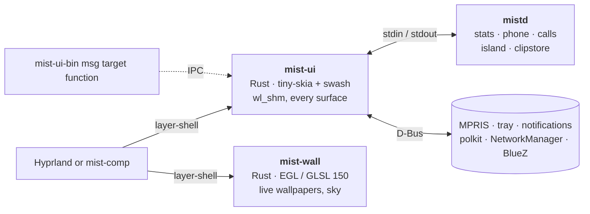

<div align="center">


**A macOS-inspired desktop shell for Hyprland, written in Rust and drawn on the CPU.**

Bar, dock, Dynamic Island, desktop widgets, Spotlight-style launcher, control centre, notifications,
lock screen and polkit agent in one ~50 MB process, without a GPU context.

[](LICENSE)
[](native)
[](https://hyprland.org)
[](.github/workflows/ci.yml)
[](https://discord.gg/4rRabwQTPE)
[](#status)
[](https://github.com/wiktor-jozwiak/mist)

[Features](#features) · [Benchmarks](#benchmarks) · [Install](#install) · [Use](#use) · [Develop](#develop)

[English](README.md) · [Polski](docs/i18n/README.pl.md) · [Deutsch](docs/i18n/README.de.md) ·
[Español](docs/i18n/README.es.md) · [简体中文](docs/i18n/README.zh-CN.md) · [日本語](docs/i18n/README.ja.md)

<br>


<table>
  <tr>
    <td width="50%"></td>
    <td width="50%"></td>
  </tr>
  <tr>
    <td align="center"><sub><b>Dynamic Island</b>: notifications, volume, rain nowcast, the next event</sub></td>
    <td align="center"><sub><b>Weather card</b>: Open-Meteo data over a real-time GLSL sky</sub></td>
  </tr>
</table>

<sub>Offscreen renders with the demo data in <code>docs/demo</code>, rebuilt by
<a href="docs/img/hero.sh">hero.sh</a>, <a href="docs/img/gifs.sh">gifs.sh</a> and
<a href="docs/img/panels.sh">panels.sh</a>. On a real session Hyprland blurs under the glass.</sub>

</div>

<br>

<table>
  <tr>
    <td align="center" width="33%"><h3>~50 MB</h3><sub>every surface of the shell in one process<br><code>mist-ui</code>, PSS at idle</sub></td>
    <td align="center" width="33%"><h3>0 GL contexts</h3><sub>CPU-drawn <code>wl_shm</code> buffers;<br>the GPU only for live wallpapers</sub></td>
    <td align="center" width="33%"><h3>0 timers at idle</h3><sub>Hyprland socket, D-Bus, inotify:<br>hidden surfaces do no work</sub></td>
  </tr>
  <tr>
    <td align="center" width="33%"><h3>0.04 % CPU</h3><sub><code>mist-comp</code> + the shell at idle,<br>6 wake-ups / s</sub></td>
    <td align="center" width="33%"><h3>1 frame / s</h3><sub>for a window hidden behind others<br>(60 → 1 frame callbacks)</sub></td>
    <td align="center" width="33%"><h3>0 blur runs</h3><sub>while nothing behind the glass changes<br>(362 → 0 per 3 s)</sub></td>
  </tr>
</table>

## Why

Most Hyprland shells run on Qt Quick (Quickshell), GTK + GJS (AGS) or a WebView. Each of them opens an
OpenGL context, and on NVIDIA every GL context maps the driver: about **100 to 160 MB per process** before the
first pixel. Mist started as a Quickshell config (428 MB, 9.5 % CPU) and was rewritten surface by surface:

- 🖌️ **CPU-drawn surfaces.** `mist-ui` paints into `wl_shm` buffers with [tiny-skia] and [swash]; Hyprland
  composites and blurs them. Only damaged regions are redrawn.
- ⚡ **Event-driven.** Data comes from the Hyprland socket, D-Bus, `pactl subscribe`, inotify and long-lived
  `mistd` backends. Nothing polls on a timer while the screen is idle; hidden surfaces do no work.
- 🎨 **One GPU process, only when needed.** `mist-wall` (EGL, GLSL 150) draws animated wallpapers and the
  weather sky. With a photo wallpaper it exits and `mist-ui` draws the photo itself. It pauses while the
  monitors are off or the session is locked, and falls back to half resolution on software GL.

<p align="center"></p>

## Benchmarks

<p align="center"></p>

Idle, whole shell, proportional set size (shared pages split between processes), Ryzen 7 5700X + RTX 4060
(driver 615.71), Hyprland 0.56.2, 2 × 1920x1080 (165 + 75 Hz). Measured with [bench/measure.sh](bench/measure.sh).

| Shell | Toolkit | PSS | CPU idle | GL context |
|---|---|---|---|---|
| **Mist native** | Rust, CPU, `wl_shm` | **87 to 106 MB** | 0.6 % (music on) | `mist-wall` only |
| Mist native, `mist-ui` alone | | 36 to 50 MB | 0.6 % | no |
| Noctalia v5 | C++, cairo + EGL | 122 MB | 0.07 % | yes |
| Empty Quickshell (one `PanelWindow`) | Qt Quick | 124 MB | ~0 % | yes |
| Mist on Quickshell (old QML version) | Qt Quick + QML | 428 MB | 9.5 % | yes |

Numbers reported by others (RSS, different machines, not comparable 1:1): Waybar 50 to 66 MB
([Waybar#5186](https://github.com/Alexays/waybar/issues/5186)), Caelestia ~650 MB after a restart
([caelestia-dots/shell#1927](https://github.com/caelestia-dots/shell/issues/1927)).

### The compositor: mist-comp

**Idle**, [bench/comp.sh](bench/comp.sh): headless mist-comp on Mesa's software renderer (llvmpipe, which
accounts for most of the memory and the 34 threads), two 1920x1080 outputs, a throwaway `HOME`, 15 s each.

| State | PSS | CPU (one core) | Wake-ups | Frames |
|---|---|---|---|---|
| mist-comp alone | 125 MB | 0.17 % | 5.7 / s | 0.1 / s |
| mist-comp + the whole shell, idle | 173 MB | **0.04 %** | **6.3 / s** | 3 / s |
| `mist-ui` inside it | 32 MB | 0.33 % | 22.5 / s | 0 |
| pointer moving nonstop | 175 MB | 0.83 % | 163 / s | 60 / s |

**A real, busy session** (2026-10-22, the machine above, NVIDIA, 165 + 75 Hz, 35 minutes after login): Zen with a
page open (272 commits/s), the Claude desktop app streaming text (107 commits/s), kitty, Vesktop.
[bench/measure.sh](bench/measure.sh), 30 s.

| Process | PSS | CPU (one core) |
|---|---|---|
| mist-comp (all compositing, blur, shadows, two monitors) | 231 MB | 14 to 16 % |
| shell: mist-ui + mist-wall (live wallpaper) + mistd | 126 MB | 5.1 % |

This is a load figure, not an idle one: almost all of the compositor's work here follows the two busy
clients. The same session under Hyprland has not been measured yet.

**What the compositor avoids**, nested tests in [native/mist-comp/tests](native/mist-comp/tests) (before → after):

| Situation | Result |
|---|---|
| Glass bar and dock over a window that redraws a small square | blur runs 362 → 0 per 3 s, compositor CPU halved |
| A browser animating behind a maximized window | frame callbacks 60 → 1 per s (back to 60 once it shows) |
| A client animating on one monitor, the other one idle | render passes on the idle one 180 → 0 per 3 s |
| Zen (several surfaces per window) | blur passes per frame 1.92 → 0.96 |
| Panels opening and closing for 60 s | memory levels off (~80 MB on NVIDIA; grew ~4 MB/min before) |
| A client redrawing nonstop under a Mist bar | 0.25 ms of compositor CPU per frame |
| Overview open, magnifier on, pointer still | 0 frames / s |

Method, raw output and caveats: [docs/BENCHMARKS.md](docs/BENCHMARKS.md).

## Features

<table>
  <tr>
    <td width="50%"></td>
    <td width="50%"></td>
  </tr>
  <tr>
    <td align="center"><sub><b>Spotlight</b>: apps, files, commands, emoji, web</sub></td>
    <td align="center"><sub><b>Calendar</b>: month, agenda, new events</sub></td>
  </tr>
  <tr>
    <td width="50%"></td>
    <td width="50%"></td>
  </tr>
  <tr>
    <td align="center"><sub><b>Control centre</b>: network, Bluetooth, phone, sound, night light</sub></td>
    <td align="center"><sub><b>Emoji picker</b>: <code>Super + .</code></sub></td>
  </tr>
</table>

| | |
|---|---|
| 🔝 **Top bar** | active app and title, system tray (StatusNotifierItem host + dbusmenu), network, Bluetooth, audio, CPU / memory meters, clock, calendar popup |
| 🚀 **Dock** | pinned + running apps, magnification, window picker with live thumbnails (`hyprland_toplevel_export_v1`), click on the active app minimises it |
| 🏝️ **Dynamic Island** | media (MPRIS) with equalizer, timers, calls (KDE Connect / ADB), notifications, volume |
| 🖼️ **Desktop** | clock, sunrise / sunset, glass cards (weather, Garmin readiness, running plan), per-widget settings sheet |
| 🔍 **Panels** | Spotlight-style search, Start, Cmd+Tab switcher, control centre (paged), notification centre, clipboard history, emoji picker, session menu, wallpaper gallery, screenshot toolbar |
| 🛡️ **System** | notification server, polkit agent, lock screen (`ext-session-lock-v1` + PAM), idle (`ext-idle-notify-v1`, logind) |
| 🪟 **Snapping** | Windows 11-style: drag to an edge or corner, Snap Layouts flyout on the green button or `Super + Z` (7 layouts), Snap Assist fills the rest, `Super + arrows`; zones with even 8 px gaps, the preview is exactly where the window lands |
| 🌄 **Wallpapers** | photos (CPU) or live GLSL scenes and a real-time weather sky (`mist-wall`) |
| 🧪 **mist-comp** *(experimental)* | own Smithay compositor + greeter, for running Mist without Hyprland: glass blur that re-runs only when what is behind it changes, per-monitor redraws, covered windows throttled to 1 frame/s, Overview (`Super + O`), 1:1 workspace swipe, magnifier, windows restored after a crash or `mist-session restart` |

### Desktop cards

- **Weather**: [Open-Meteo](https://open-meteo.com), no account. Hourly curve, 4 days, rain nowcast, running
  window, clothing tip, sun and moon; the live sky behind the card follows the current conditions.
- **Garmin readiness** and **running**: your own Garmin Connect data through a local InfluxDB. Optional:
  without `influx.json` these cards are not shown. Setup: [docs/guides/garmin.md](docs/guides/garmin.md) ([Polski](docs/guides/garmin.pl.md)).

### Languages and monitors

The interface speaks **Polski, English, Deutsch, Español and Français**. Pick one in *Customise desktop* (right click on
the desktop clock) → Appearance → Language, or set `MIST_LANG=en`. *Automatic* follows `$LANG` and falls back
to English. Translations live in one table, [native/assets/i18n.tsv](native/assets/i18n.tsv): one row per
string, one column per language. A new language is one more column.

The dock, island, desktop and weather sky go on the compositor's first monitor. Another one: `"primary": "DP-3"` in
`~/.config/mist/settings.json`, or `MIST_PRIMARY=DP-3`. The weather place is set in *Customise desktop* → General.

## Architecture



| Path | What |
|---|---|
| `native/mist-ui` | all shell surfaces ([native/README.md](native/README.md)) |
| `native/mist-wall` | GPU wallpaper process |
| `native/mist-comp` | experimental Smithay compositor, session and greeter |
| `native/common` | code shared by mist-ui and mist-wall (astronomy, presets) |
| `scripts/mistd` | backends: system stats, phone (KDE Connect, ADB), calls, clipboard store, file manager D-Bus |
| `shaders/` | wallpaper and sky shaders (`.frag` sources, GLSL 150 in `shaders/glsl` read by mist-wall) |
| tag `legacy-qml` | the original Quickshell (QML) version, kept for reference |

## mist-comp

An experimental Wayland compositor written for Mist on [Smithay] (about 12 000 lines of Rust), with its own
greeter. It runs the same shell as Hyprland does and speaks enough of Hyprland's IPC that `hyprctl`, Mist's
scripts and the shell's window list work unchanged. It is the author's daily session next to Hyprland.

- **Windows:** floating with Mist title bars or the app's own, rounded corners and one soft shadow for every
  window, live glass blur under translucent windows and panels, Windows 11 snapping, Overview
  (`Super + O`, three fingers up), a magnifier (`Super + =` / `Super + -`, up to 8x), workspaces that follow
  three fingers 1:1, window swallowing, open / close / minimize animations.
- **Cost-aware rendering:** only the monitors a client's window is on redraw; glass re-blurs only when what is
  behind it changed; windows covered by opaque windows get one frame callback a second; hidden desktop
  layers are told so (`mistcover`) and stop drawing; a fullscreen game's frames go straight to the screen.
- **Session:** DRM / KMS through libseat and logind, hotplug, VRR for fullscreen, explicit sync, XWayland, a
  greeter for greetd, lock screen, idle, screen casting and screenshots through xdg-desktop-portal-hyprland.
  After a crash `start-mist` restarts it in safe mode and the windows come back on their workspaces;
  `mist-session restart` loads a new build without logging out.
- **Protocols:** about 45, among them xdg-shell, layer-shell, session-lock, idle-notify, linux-dmabuf,
  drm-syncobj, presentation-time, fifo + commit-timing, fractional-scale, cursor-shape, tablet, text-input +
  input-method, pointer-constraints, foreign-toplevel (ext and wlr), ext-workspace, wlr-screencopy,
  wlr-output-management, data-control, xdg-activation, Hyprland's toplevel export and global shortcuts.
- **Watching it:** `hyprctl` answers in its session; its IPC socket answers `stats` (frames, commits,
  wake-ups, blur runs), `passes` (render passes per monitor), `top 5` (who keeps the screen busy), `prof`
  (µs per stage), `mem`. The watchdog logs clients that keep drawing on hidden workspaces or busy-loop.
- **Tested:** 47 nested tests (`native/mist-comp/tests/run-all.sh`) on a headless backend; CI runs them on
  the software renderer and prints the benchmarks in the job summary.

Not there yet: tiling, tearing control (no async page flips in Smithay 0.7), direct scan-out verified on
NVIDIA. Configuration: `comp.conf` in [docs/CONFIG.md](docs/CONFIG.md#compconf-outputs-mist-comp-only);
`mist-comp migrate` converts a Hyprland config.

## Install

> [!NOTE]
> Mist is a personal daily driver: it targets Arch / CachyOS, Hyprland 0.55+ with the Lua config, and an
> NVIDIA or Mesa GPU. Expect to read code.

**Arch (AUR-style package):** [packaging/arch/PKGBUILD](packaging/arch/PKGBUILD) builds `mist-shell-git`
(binaries in `/usr/bin`, files in `/usr/share/mist`).

```bash
git clone https://github.com/wiktor-jozwiak/mist && cd mist/packaging/arch && makepkg -si
```

**From a checkout** (anywhere; `native/install.sh` links `~/.local/share/mist/shell` to it):

```bash
git clone https://github.com/wiktor-jozwiak/mist ~/src/mist
```

```bash
~/src/mist/scripts/mistd/install.sh && ~/src/mist/native/install.sh
```

`native/install.sh` installs `mist-ui-bin`, `mist-wall-bin`, `mist-comp` and, on the first run, the guard
`mist-ui` into `~/.local/bin`. Tagged releases also carry prebuilt binaries.

To run Mist on its own compositor, `native/mist-comp/session/install-session.sh [BRANCH] [--greeter]` updates
the checkout, builds and installs everything and adds a **Mist** session to the login screen (Hyprland stays).

Then add [examples/hyprland/mist.lua](examples/hyprland/mist.lua) to your Hyprland config (autostart,
key bindings, blur rules) and remove other bars, notification daemons and polkit agents.

<details>
<summary><b>Dependencies</b></summary>

<br>

**Build:** `rust` (stable), `pkgconf`, `libxkbcommon`, `pam`, `wayland`, `mesa` (EGL headers);
for `mist-comp` also `libinput`, `libseat`, `libdrm`, `mesa` (gbm), `systemd-libs` (udev).

**Runtime:** `hyprland`, `pipewire` + `pipewire-pulse` (`pactl`, `pw-play`, `parec`), `wireplumber` (`wpctl`),
`networkmanager` (`nmcli`), `wl-clipboard`, `grim`, `slurp`, `polkit`, `noto-fonts`, `noto-fonts-emoji`.
Optional: `ddcutil` (brightness over DDC/CI), `kdeconnect` / `android-tools` (phone), `wf-recorder` (only
`scripts/demo-reel.sh`). What each one turns on: [docs/CONFIG.md](docs/CONFIG.md#optional-integrations).

**Font:** the UI is designed for SF Pro (variable `SF-Pro.ttf` in `~/.local/share/fonts/SF-Pro/`), which
Apple licenses for its platforms only and Mist does not ship. Without it Mist uses Inter Variable, then
Noto Sans.

</details>

## Use

| Key | Action | | Key | Action |
|---|---|---|---|---|
| `Super` | Start | | `Super + A` | notification centre |
| `Super + Space` | Spotlight | | `Super + V` | clipboard history |
| `Super + Tab` | app switcher | | `Super + .` | emoji |
| `Super + I` | control centre | | `Super + L` | lock |
| `Print`, `Super + Shift + S` | screenshot (region) | | | |

Everything is scriptable: `mist-ui-bin msg mist toggle spotlight`, `mist-ui-bin msg ui stats`,
`mist-ui-bin msg dock click firefox`. Log: `~/.cache/mist/ui.log`. Settings: `~/.config/mist/`, every file and
variable in [docs/CONFIG.md](docs/CONFIG.md).

## Develop

```bash
cd native && cargo build --release && cargo test --release
```

<details>
<summary><b>Checks without touching the running session</b></summary>

<br>

| Command | Output |
|---|---|
| `mist-ui --png out.png '{"app":"Firefox"}'` | the top bar as PNG |
| `mist-ui-bin --desk-png dir` / `--dock-png out.png` | desktop stage + cards (+ `layout.json`) / dock |
| `mist-ui-bin --pane-png spotlight 1920 1080 out.png fi` | a panel, settled (`snapfly:3 640 290`: Snap Layouts with zone 3 hot) |
| `mist-ui-bin --island-frames notif out 30 20` | an island demo, frame by frame |
| `mist-ui --test` | a second bar over the real one on HDMI-A-1 |
| `mist-wall-bin --png out.ppm dunes 1920 1080` | a live wallpaper frame (`MIST_WALL_BENCH=N`: ms per frame) |
| `mist-ui-bin msg ui stats` | wake-ups, paints and paint time per surface |
| `native/mist-comp/tests/run-all.sh` | every mist-comp test in a nested compositor (`CI=1`: software renderer) |
| `bench/measure.sh 30 mist-ui-bin mist-wall-bin mistd` | idle PSS / CPU of the running shell |

</details>

Keep `lto = false` (Arch rustc with system LLVM crashes with LTO). See [CONTRIBUTING.md](CONTRIBUTING.md).

## Status

Daily driver of one person, two monitors, NVIDIA, now on `mist-comp` as well as Hyprland. Everything in the
tables above is native and used every day; `mist-comp` is still experimental. [docs/PUBLISHING.md](docs/PUBLISHING.md) lists what is left before a public
release.

## Star History

<a href="https://star-history.com/#wiktor-jozwiak/mist&Date">
 <picture>
   <source media="(prefers-color-scheme: dark)" srcset="https://api.star-history.com/svg?repos=wiktor-jozwiak/mist&type=Date&theme=dark" />
   <source media="(prefers-color-scheme: light)" srcset="https://api.star-history.com/svg?repos=wiktor-jozwiak/mist&type=Date" />
   
 </picture>
</a>

## Credits

[Hyprland], [Smithay] and [smithay-client-toolkit], [tiny-skia], [swash], [resvg], [zbus], [Tabler Icons]
(MIT). The original QML version was built on [Quickshell]; [Noctalia] served as fallback and reference.

<sub><i>Mist is not affiliated with Apple. macOS, Dynamic Island, Spotlight and SF Pro are trademarks of Apple
Inc.; they are named here only to describe the design inspiration.</i></sub>

## License

[GPL-3.0](LICENSE).

[tiny-skia]: https://github.com/linebender/tiny-skia
[swash]: https://github.com/dfrg/swash
[resvg]: https://github.com/linebender/resvg
[zbus]: https://github.com/dbus2/zbus
[Hyprland]: https://hyprland.org
[Smithay]: https://github.com/Smithay/smithay
[smithay-client-toolkit]: https://github.com/Smithay/client-toolkit
[Tabler Icons]: https://tabler.io/icons
[Quickshell]: https://quickshell.org
[Noctalia]: https://github.com/noctalia-dev/noctalia
