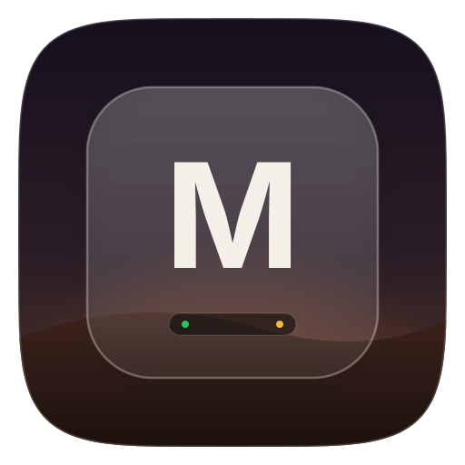
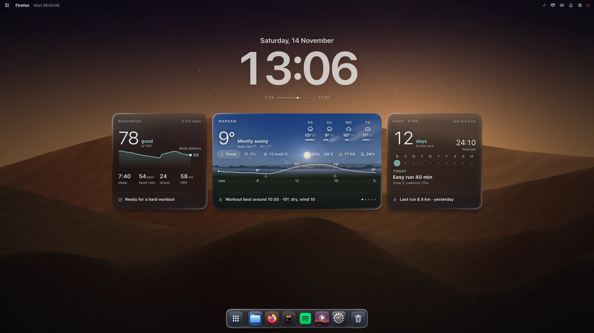
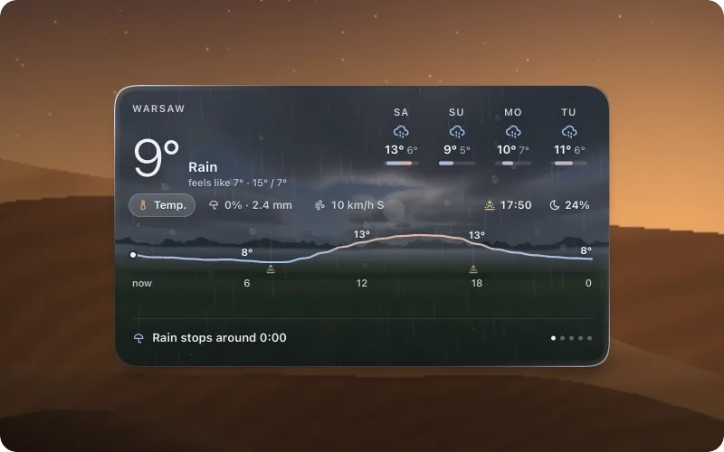
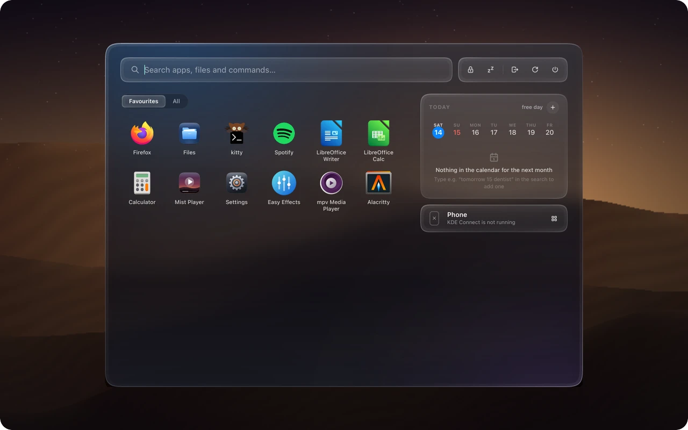
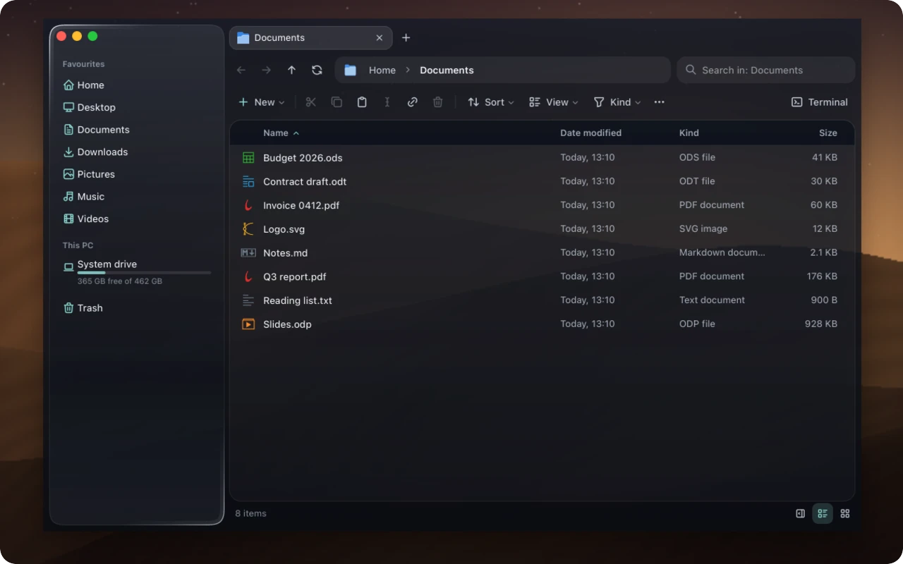
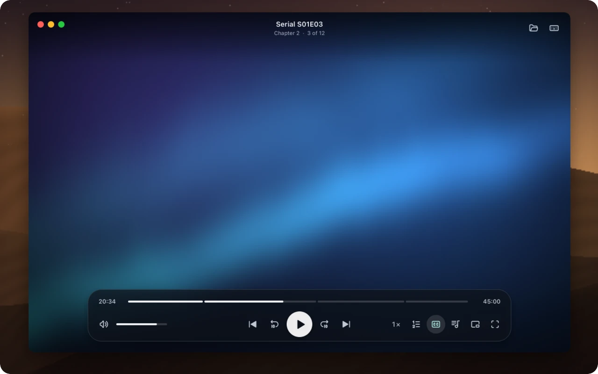
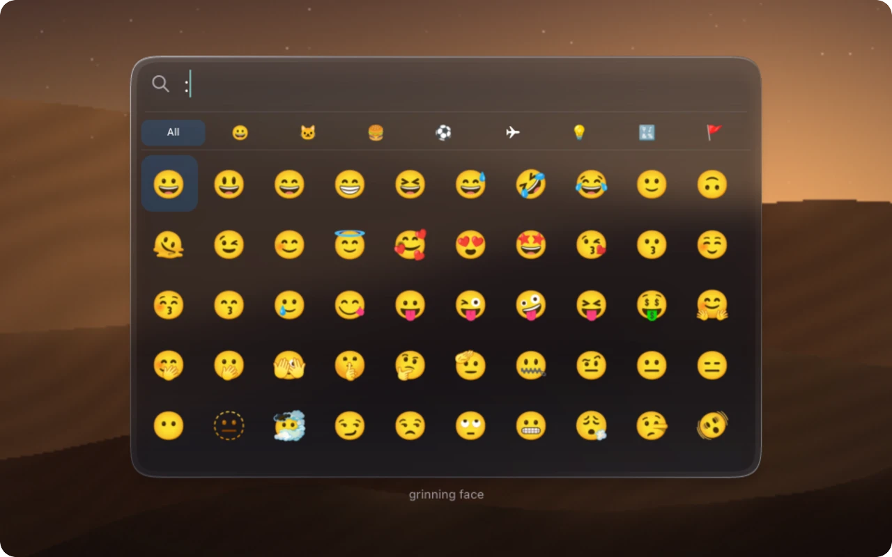
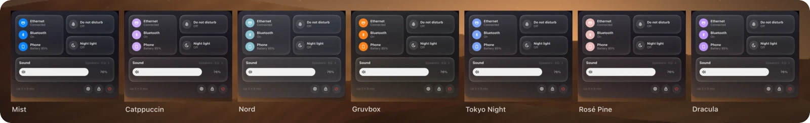

<div align="center">



# Mist

**A Wayland desktop shell and compositor for Linux, written in Rust and drawn on the CPU.**

[](.github/workflows/ci.yml)
[](https://github.com/wiktor-jozwiak/mist/releases)
[](https://github.com/wiktor-jozwiak/mist/stargazers)
[](LICENSE)
[](https://discord.gg/4rRabwQTPE)

[English](README.md) · [Polski](docs/i18n/README.pl.md) · [Deutsch](docs/i18n/README.de.md) ·
[Español](docs/i18n/README.es.md) · [简体中文](docs/i18n/README.zh-CN.md) · [日本語](docs/i18n/README.ja.md)

<br>



<table>
  <tr>
    <td align="center" width="33%"><h3>44 MB</h3><sub>memory of the whole shell at idle</sub></td>
    <td align="center" width="33%"><h3>0</h3><sub>OpenGL contexts in the shell process</sub></td>
    <td align="center" width="33%"><h3>8 / s</h3><sub>wake-ups at idle, no polling</sub></td>
  </tr>
</table>

**[Tour](#tour) · [What you get](#what-you-get) · [Why it is light](#why-it-is-light) · [mist-comp](#mist-comp) ·
[Install](#install) · [Keys](#keys-and-scripting) · [Develop](#develop)**

</div>

Mist is two programs, and each one works without the other:

| | What it is | Where it runs |
|---|---|---|
| **The shell** (`mist-ui`, `mist-wall`) | bar, dock, Dynamic Island, desktop widgets, launcher, control centre, notifications, lock screen, polkit agent, a file manager and a video player, in one process | Hyprland, mist-comp, or [a window](#2-try-it-in-a-window) on the desktop you already use |
| **The compositor** ([`mist-comp`](#mist-comp)) | a Wayland compositor on Smithay, with its own greeter | a login session of its own, next to Hyprland |

The look borrows from macOS on purpose; everything under it is a Linux desktop.

> [!NOTE]
> Mist is one person's daily desktop (Arch / CachyOS, two monitors, NVIDIA). It is shared because it works,
> not because it is finished: expect to read some code.

## Tour

<div align="center">


<sub>Dynamic Island: notifications, volume, rain nowcast, the next event</sub>

<br><br>

<table>
  <tr>
    <td width="50%" align="center"><br><sub>Weather card over a live sky that follows the weather and the hour</sub></td>
    <td width="50%" align="center"><br><sub>Live wallpapers in GLSL, photos, or the sky of the current weather</sub></td>
  </tr>
  <tr>
    <td align="center"><br><sub>Start: apps, files, commands, today and the phone</sub></td>
    <td align="center"><br><sub>Spotlight: apps, files, commands, math, units, time zones, emoji, web</sub></td>
  </tr>
  <tr>
    <td align="center"><br><sub>Mist Files, also the file chooser of every app</sub></td>
    <td align="center"><br><sub>Mist Player on libmpv: chapters, tracks, picture in picture</sub></td>
  </tr>
  <tr>
    <td align="center"><br><sub>Settings: every option in one window, applied at once</sub></td>
    <td align="center"><br><sub>Control centre: network, Bluetooth, phone, sound, night light</sub></td>
  </tr>
  <tr>
    <td align="center"><br><sub>Calendar: the month, the agenda, new events</sub></td>
    <td align="center"><br><sub>Emoji picker with search and categories</sub></td>
  </tr>
</table>



<sub>Mist, Catppuccin, Nord, Gruvbox, Tokyo Night, Rosé Pine, Dracula, or your own JSON file. Glass, windows and accent switch live.</sub>

<br><br>

<table>
  <tr>
    <td align="center" width="33%"><br><b>Mist Files</b><br><sub>tabs, previews, smart search, the system's file chooser</sub></td>
    <td align="center" width="33%"><br><b>Mist Player</b><br><sub>libmpv, MPRIS, picture in picture, frame pacing</sub></td>
    <td align="center" width="33%"><br><b>Settings</b><br><sub>display, sound, network, desktop, widgets, language</sub></td>
  </tr>
</table>

<br>

<a href="https://youtu.be/mwisDtz0Yd0"></a>

<sub>40 s demo, recorded in a headless <code>mist-comp</code> session with demo data · <a href="https://github.com/user-attachments/assets/ed8137a5-daf5-488e-8515-686aa54e6e07">MP4</a></sub>

</div>

## What you get

**The shell**

- **Top bar:** active app, system tray (StatusNotifierItem + dbusmenu), network, Bluetooth, audio, CPU and
  memory, clock.
- **Dock:** pinned and running apps, magnification, a window picker with live thumbnails.
- **Dynamic Island:** media with an equalizer, timers, phone calls, notifications, volume, Caps Lock, and a
  note when a configuration file has a mistake (with the line and column).
- **Panels:** Start, Spotlight, app switcher, control centre, notification centre, calendar, clipboard history,
  emoji picker, session menu. Search fields work like any text field: caret, arrows, Shift and Ctrl+A select.
- **Screenshots:** a region picked over the frozen screen, a toolbar, text from the screen (OCR), a colour picker.
- **Window snapping**, Windows 11 style: drag to an edge or corner, Snap Layouts on the green button or
  `Super + Z`, Snap Assist.
- **Lock screen** on PAM, with its own clock style, blur and dimming.

**The desktop**

- **Clock and glass cards:** weather, Garmin readiness, running, music, calendar, system, world clocks, a note
  with to-dos, the day's progress, Sun and Moon, a photo frame, device batteries. Garmin cards show your own
  Garmin Connect data synced into a local SQLite file and stay hidden until you log in once
  ([guide](docs/guides/garmin.md)).
- **Weather** from [Open-Meteo](https://open-meteo.com), no account: hourly curve, four days, rain in the next
  hour, the Sun's and the Moon's day. The card's sky is drawn live for the weather and the hour you point at,
  over one of five landscapes (fields, a lake, mountains, a city, the sea).
- **Wallpapers:** photos, live GLSL scenes, or the sky of the current weather.
- **Themes:** Mist, Catppuccin, Nord, Gruvbox, Tokyo Night, Rosé Pine, Dracula, or your own JSON file. Glass,
  windows and accent switch live in the shell and in Files, Player and Settings.

**What it replaces**

- **Daemons:** the notification server, the polkit agent, the lock screen, idle and sleep.
- **Apps:** Mist Files, Mist Player, and Settings (display, sound, Bluetooth, network, power, apps, wallpaper,
  desktop and widgets, lock screen, notifications, language).
- **Phone**, through KDE Connect: battery, notifications, texts and contacts in a panel, calls in the island
  (ADB as a fallback for calls).

The interface is in **English, Polski, Deutsch, Español and Français**, following `$LANG` or the choice in
Settings. A language is one JSON file in [native/assets/i18n](native/assets/i18n).

## Why it is light

Mist started as a Quickshell config that used 428 MB and 9.5 % CPU at idle. It was rewritten one surface at a
time around three rules:

- **Draw on the CPU.** `mist-ui` paints `wl_shm` buffers with [tiny-skia] and [swash] and redraws only what
  changed. On NVIDIA every OpenGL context costs 100 to 160 MB before the first pixel; `mist-ui` has none.
- **Wait for events.** State comes from the compositor socket, D-Bus, `pactl subscribe` and inotify, and hidden
  surfaces do no work. The idle shell wakes 8 times a second.
- **One GPU process, only while it shows something.** `mist-wall` draws live wallpapers, the weather card's sky
  and the wallpaper gallery. With a photo wallpaper and none of those it exits, and `mist-ui` draws the photo.

<p align="center"></p>

<details>
<summary><b>The numbers</b>: shells and compositors measured the same way</summary>

<br>

**Shells.** Each one alone in a fresh headless sway on the GPU (RTX 4060, two 1080p outputs), with the
configuration its package ships; 3 runs, median ([bench/shells.sh](bench/shells.sh)). *Idle*: nothing happens
for a minute. *Active*: a workspace switch every 2 s, a window opened every 6 s, a notification every 10 s.
CPU is % of one core.

| Shell | What it draws | Memory (PSS) | GPU memory | CPU idle | CPU active |
|---|---|---|---|---|---|
| swaybar (sway 1.12) | bar | 6 MB | – | 0 % | 0.03 % |
| Waybar 0.15 | bar | 34 MB | – | 0.03 % | 0.38 % |
| **Mist, photo wallpaper** | bar, dock, island, desktop widgets, notifications, wallpaper | **44 MB** | – | 0.14 % | 0.66 % |
| nwg-panel 0.12 | bar | 59 MB | – | 0.09 % | 0.23 % |
| **Mist, live wallpaper** | all of that, the wallpaper a live GLSL scene | 144 MB | 50 MiB | 0.79 % | 1.34 % |
| Ironbar 0.19 | bar | 158 MB | 9 MiB | 0.35 % | 0.42 % |
| Quickshell 0.3, one empty `PanelWindow` | an empty bar | 161 MB | 6 MiB | 0 % | 0 % |
| Noctalia 5.4 | bar, photo wallpaper (and its first-run dialog) | 192 MB | 60 MiB | 0.10 % | 4.01 % |

**Compositors.** Headless on the same GPU at 1920×1080 60 Hz, 5 runs
([bench/compositors.sh](bench/compositors.sh)). With nothing on screen all of them use 0 % CPU.

| Compositor | Memory (PSS) | CPU, a client drawing on the CPU every frame | CPU, a fullscreen OpenGL client | CPU per OpenGL frame |
|---|---|---|---|---|
| **mist-comp** | 128 MB | **2.2 %** | 1.5 % | 0.25 ms |
| weston 15 | 129 MB | 3.3 % | **0.8 %** | **0.13 ms** |
| labwc 0.20 | 137 MB | 8.1 % | 8.9 % | 1.5 ms |
| sway 1.12 | 129 MB | 33.6 % | 8.3 % | 1.4 ms |

Hyprland and niri have no headless mode a script can start, so they are not in the table. Method, every run,
wake-ups, per-process numbers and the earlier live-session measurements:
[docs/BENCHMARKS.md](docs/BENCHMARKS.md).

</details>

## mist-comp

Mist's own Wayland compositor, about 14 000 lines of Rust on [Smithay], with a greeter. It runs the same shell
and answers enough of Hyprland's IPC that `hyprctl` and Mist's scripts work unchanged. It is experimental, and
the author's daily session next to Hyprland.

- **Windows:** title bars or the app's own, rounded corners and shadows, glass blur under translucent windows
  and panels, Overview (`Super + O`), a magnifier, workspace swipe that follows the fingers, Win + D to
  show the desktop.
- **Does no work it can skip:** a monitor redraws only when something on it changed; glass re-blurs only when
  what is behind it moved; a window covered by others gets one frame a second instead of sixty.
- **Session:** DRM / KMS through logind, hotplug, VRR, explicit sync, XWayland, screen sharing through the
  portal, about 45 protocols. After a crash the windows come back on their workspaces; `mist-session restart`
  loads a new build without logging out.
- **Tested:** 66 nested tests on a headless backend, run by CI on the software renderer.

Not there yet: tiling, tearing control, verified direct scan-out on NVIDIA. Configuration:
[docs/CONFIG.md](docs/CONFIG.md#compconf-outputs-mist-comp-only); `mist-comp migrate` converts a Hyprland
config. How to run it, the code and the tests: [native/mist-comp/README.md](native/mist-comp/README.md).

## Install

### 1. Get it

Arch: [packaging/arch/PKGBUILD](packaging/arch/PKGBUILD) builds `mist-shell-git`.

```bash
git clone https://github.com/wiktor-jozwiak/mist && cd mist/packaging/arch && makepkg -si
```

Anywhere else, from a checkout. The first script builds `mistd` (the backends), the second puts `mist-ui-bin`,
`mist-wall-bin`, `mist-comp` and `mist-try` in `~/.local/bin`:

```bash
git clone https://github.com/wiktor-jozwiak/mist ~/src/mist
```

```bash
~/src/mist/scripts/mistd/install.sh && ~/src/mist/native/install.sh
```

Prebuilt binaries are attached to every [release](https://github.com/wiktor-jozwiak/mist/releases).

<details>
<summary>Dependencies</summary>

<br>

**Build:** `rust`, `pkgconf`, `libxkbcommon`, `pam`, `wayland`, `mesa`; for `mist-comp` also `libinput`,
`libseat`, `libdrm`, `systemd-libs`.

**Runtime:** `pipewire-pulse`, `wireplumber`, `networkmanager`, `wl-clipboard`, `grim`, `slurp`, `polkit`,
`noto-fonts`, `noto-fonts-emoji`. Optional: `ddcutil` (monitor brightness), `kdeconnect` or `android-tools`
(phone). What each one turns on: [docs/CONFIG.md](docs/CONFIG.md#optional-integrations).

**Font:** the UI is drawn for SF Pro, which Mist cannot ship. Without it Mist uses Inter, then Noto Sans.

</details>

### 2. Try it in a window

```bash
mist-try
```

The whole desktop (its compositor, bar, dock, island, widgets) in one window on Hyprland, Sway, GNOME or KDE.
It has its own runtime directory and D-Bus session bus, so your notifications, tray and polkit agent stay
where they are; close the window and it is gone. Options: `MIST_TRY_SIZE=1600x1000`, `MIST_TRY_KEYBOARD=de`,
`MIST_THEME=nord`.

### 3. Make it your desktop

- **On Hyprland:** load [examples/hyprland/mist.lua](examples/hyprland/mist.lua) from your config and remove
  other bars, notification daemons and polkit agents.
- **On mist-comp:** `native/mist-comp/session/install-session.sh --greeter` adds a Mist session to the login
  screen; Hyprland stays.

## Keys and scripting

| Key | Action | | Key | Action |
|---|---|---|---|---|
| `Super` | Start | | `Super + A` | notification centre |
| `Super + Space` | Spotlight | | `Super + V` | clipboard history |
| `Super + Tab` | app switcher | | `Super + .` | emoji |
| `Super + I` | control centre | | `Super + L` | lock |
| `Super + Shift + S` | screenshot | | right click on the desktop | settings |

Everything can be scripted: `mist-ui-bin msg mist toggle spotlight`, `mist-ui-bin msg ui stats`. Settings live
in `~/.config/mist/`, every file is described in [docs/CONFIG.md](docs/CONFIG.md); the log is
`~/.cache/mist/ui.log`.

## Develop

```bash
cd native && cargo build --release && cargo test --release
```

Every surface renders offscreen, so changes can be checked without touching the running session:
`mist-ui-bin --pane-png spotlight 1920 1080 out.png`, `mist-ui-bin --desk-png dir`,
`mist-wall-bin --png out.ppm dunes 1920 1080`. `native/mist-comp/tests/run-all.sh` runs the compositor tests
in a nested window. More in [native/README.md](native/README.md) and [CONTRIBUTING.md](CONTRIBUTING.md).

The pictures on this page come from the same offscreen renders, with demo data: `docs/img/hero.sh`,
`docs/img/panels.sh`, `docs/img/gifs.sh`.

| Path | What |
|---|---|
| `native/mist-ui` | every shell surface |
| `native/mist-wall` | the GPU wallpaper process |
| `native/mist-comp` | the compositor, session and greeter |
| `scripts/mistd` | backends: system stats, phone, calls, clipboard, Garmin sync |
| `shaders/` | wallpaper and sky shaders |
| `bench/` | the benchmark harness and its results |
| tag `legacy-qml` | the original Quickshell version |

## Star history

<a href="https://star-history.com/#wiktor-jozwiak/mist&Date">
  <picture>
    <source media="(prefers-color-scheme: dark)" srcset="https://api.star-history.com/svg?repos=wiktor-jozwiak/mist&type=Date&theme=dark">
    <source media="(prefers-color-scheme: light)" srcset="https://api.star-history.com/svg?repos=wiktor-jozwiak/mist&type=Date">
    
  </picture>
</a>

## Credits

Built on [Smithay], [smithay-client-toolkit], [tiny-skia], [swash], [resvg], [zbus] and [Tabler Icons].
The first version ran on [Quickshell], with [Noctalia] as a reference.
AI coding assistants help with the development.

<sub>Mist is not affiliated with Apple. macOS, Dynamic Island, Spotlight and SF Pro are trademarks of Apple Inc.,
named here only to describe the design inspiration.</sub>

[GPL-3.0](LICENSE)

[tiny-skia]: https://github.com/linebender/tiny-skia
[swash]: https://github.com/dfrg/swash
[resvg]: https://github.com/linebender/resvg
[zbus]: https://github.com/dbus2/zbus
[Smithay]: https://github.com/Smithay/smithay
[smithay-client-toolkit]: https://github.com/Smithay/client-toolkit
[Tabler Icons]: https://tabler.io/icons
[Quickshell]: https://quickshell.org
[Noctalia]: https://github.com/noctalia-dev/noctalia
