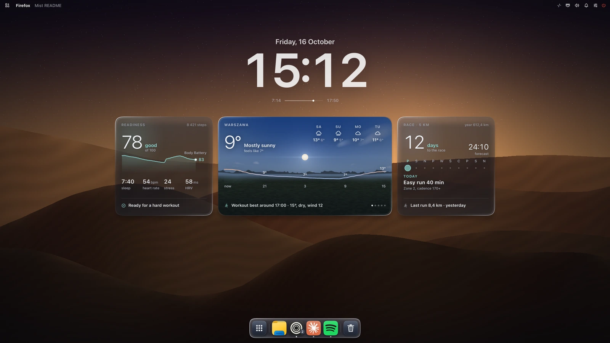
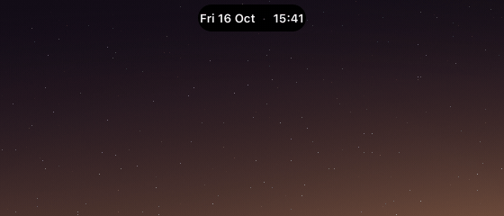
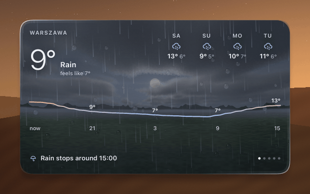
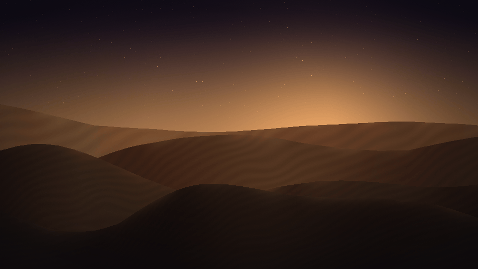
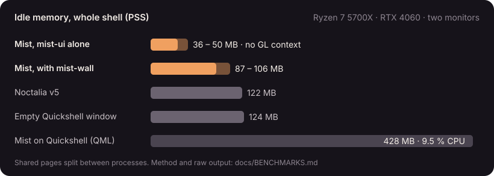
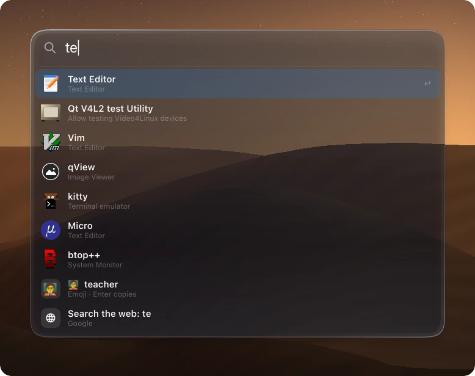
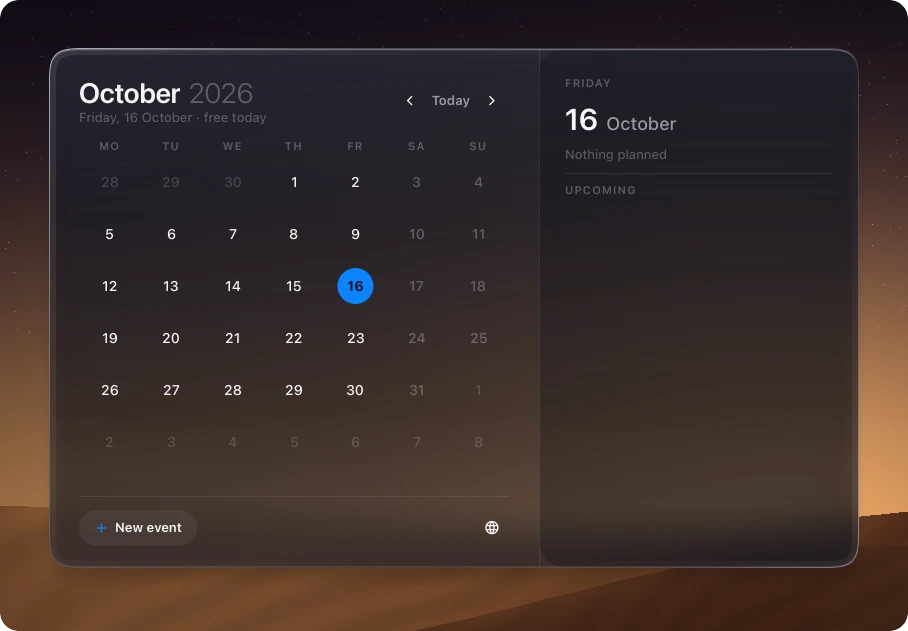
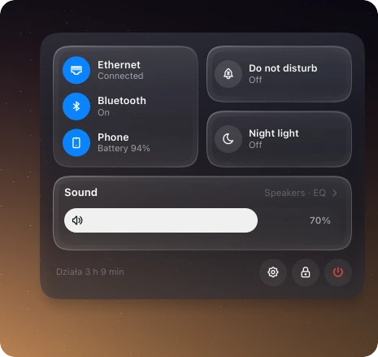
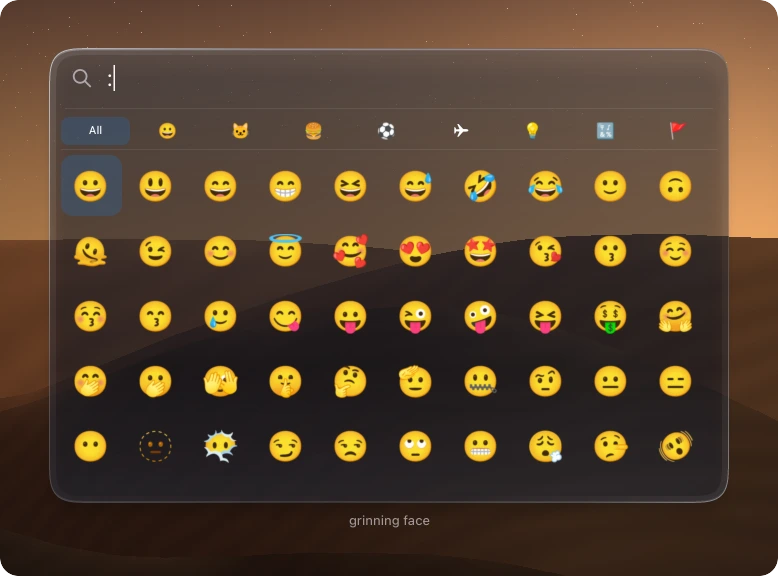
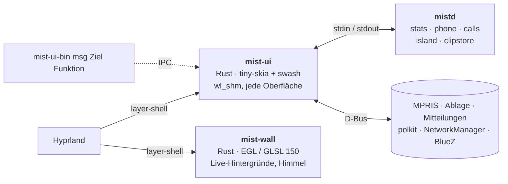

<div align="center">


**Eine von macOS inspirierte Desktop-Shell für Hyprland, geschrieben in Rust und auf der CPU gezeichnet.**

Leiste, Dock, Dynamic Island, Desktop-Widgets, Suche im Stil von Spotlight, Kontrollzentrum, Mitteilungen,
Sperrbildschirm und Polkit-Agent in einem Prozess mit ~50 MB, ohne GPU-Kontext.

[](../../LICENSE)
[](../../native)
[](https://hyprland.org)
[](../../.github/workflows/ci.yml)

[Funktionen](#funktionen) · [Messungen](#messungen) · [Installation](#installation) · [Bedienung](#bedienung) · [Entwicklung](#entwicklung)

[English](../../README.md) · [Polski](README.pl.md) · [Deutsch](README.de.md) ·
[Español](README.es.md) · [简体中文](README.zh-CN.md) · [日本語](README.ja.md)

<br>



<table>
  <tr>
    <td width="50%"></td>
    <td width="50%"></td>
  </tr>
  <tr>
    <td align="center"><sub><b>Dynamic Island</b>: Mitteilungen, Lautstärke, Regen in Kürze, der nächste Termin</sub></td>
    <td align="center"><sub><b>Wetterkarte</b>: Open-Meteo-Daten über einem GLSL-Himmel in Echtzeit</sub></td>
  </tr>
</table>

<sub>Offscreen-Renderings mit den Demodaten aus <code>docs/demo</code>, erzeugt von
<a href="../img/hero.sh">hero.sh</a>, <a href="../img/gifs.sh">gifs.sh</a> und
<a href="../img/panels.sh">panels.sh</a>. In einer echten Sitzung verwischt Hyprland den Hintergrund unter dem Glas.</sub>

</div>

<br>

<table>
  <tr>
    <td align="center" width="33%"><h3>~50 MB</h3><sub>alle Oberflächen der Shell in einem Prozess<br><code>mist-ui</code>, PSS im Leerlauf</sub></td>
    <td align="center" width="33%"><h3>0 GL-Kontexte</h3><sub><code>wl_shm</code>-Puffer, auf der CPU gezeichnet;<br>die GPU nur für Live-Hintergründe</sub></td>
    <td align="center" width="33%"><h3>0 Timer im Leerlauf</h3><sub>Hyprland-Socket, D-Bus, inotify:<br>verborgene Oberflächen tun nichts</sub></td>
  </tr>
</table>

## Warum

Die meisten Hyprland-Shells laufen auf Qt Quick (Quickshell), GTK + GJS (AGS) oder einer WebView. Jede öffnet
einen OpenGL-Kontext, und auf NVIDIA bindet jeder GL-Kontext den Treiber ein: etwa **100 bis 160 MB pro
Prozess**, bevor das erste Pixel erscheint. Mist begann als Quickshell-Konfiguration (428 MB, 9,5 % CPU) und
wurde Oberfläche für Oberfläche neu geschrieben:

- 🖌️ **Auf der CPU gezeichnet.** `mist-ui` malt mit [tiny-skia] und [swash] in `wl_shm`-Puffer; Hyprland setzt
  sie zusammen und verwischt sie. Neu gezeichnet werden nur geänderte Bereiche.
- ⚡ **Ereignisgesteuert.** Die Daten kommen vom Hyprland-Socket, D-Bus, `pactl subscribe`, inotify und
  dauerhaft laufenden `mistd`-Backends. Im Leerlauf fragt kein Timer ab; verborgene Oberflächen tun nichts.
- 🎨 **Ein GPU-Prozess, nur wenn nötig.** `mist-wall` (EGL, GLSL 150) zeichnet animierte Hintergründe und den
  Wetterhimmel. Bei einem Foto beendet er sich und `mist-ui` zeichnet das Foto selbst. Er pausiert, wenn die
  Monitore aus sind oder die Sitzung gesperrt ist, und läuft auf Software-GL mit halber Auflösung.

<p align="center"></p>

## Messungen

<p align="center"></p>

Leerlauf, ganze Shell, PSS (geteilte Seiten auf die Prozesse aufgeteilt), Ryzen 7 5700X + RTX 4060
(Treiber 615.71), Hyprland 0.56.2, 2 × 1920x1080 (165 + 75 Hz). Gemessen mit [bench/measure.sh](../../bench/measure.sh).

| Shell | Toolkit | PSS | CPU im Leerlauf | GL-Kontext |
|---|---|---|---|---|
| **Mist nativ** | Rust, CPU, `wl_shm` | **87 bis 106 MB** | 0,6 % (Musik läuft) | nur `mist-wall` |
| Mist nativ, nur `mist-ui` | | 36 bis 50 MB | 0,6 % | nein |
| Noctalia v5 | C++, cairo + EGL | 122 MB | 0,07 % | ja |
| Leeres Quickshell (ein `PanelWindow`) | Qt Quick | 124 MB | ~0 % | ja |
| Mist auf Quickshell (alte QML-Version) | Qt Quick + QML | 428 MB | 9,5 % | ja |

Zahlen anderer (RSS, andere Rechner, nicht 1:1 vergleichbar): Waybar 50 bis 66 MB
([Waybar#5186](https://github.com/Alexays/waybar/issues/5186)), Caelestia ~650 MB nach einem Neustart
([caelestia-dots/shell#1927](https://github.com/caelestia-dots/shell/issues/1927)). Methode, Rohdaten und
Einschränkungen: [docs/BENCHMARKS.md](../BENCHMARKS.md).

## Funktionen

<table>
  <tr>
    <td width="50%"></td>
    <td width="50%"></td>
  </tr>
  <tr>
    <td align="center"><sub><b>Spotlight</b>: Apps, Dateien, Befehle, Emoji, Web</sub></td>
    <td align="center"><sub><b>Kalender</b>: Monat, Tagesplan, neue Termine</sub></td>
  </tr>
  <tr>
    <td width="50%"></td>
    <td width="50%"></td>
  </tr>
  <tr>
    <td align="center"><sub><b>Kontrollzentrum</b>: Netzwerk, Bluetooth, Telefon, Ton, Nachtlicht</sub></td>
    <td align="center"><sub><b>Emoji</b>: <code>Super + .</code></sub></td>
  </tr>
</table>

| | |
|---|---|
| 🔝 **Obere Leiste** | aktive App und Titel, Systemablage (StatusNotifierItem-Host + dbusmenu), Netzwerk, Bluetooth, Ton, CPU- / Speicheranzeige, Uhr, Kalender |
| 🚀 **Dock** | angeheftete und laufende Apps, Vergrößerung, Fensterauswahl mit Live-Vorschau (`hyprland_toplevel_export_v1`), Klick auf die aktive App minimiert sie |
| 🏝️ **Dynamic Island** | Medien (MPRIS) mit Equalizer, Timer, Anrufe (KDE Connect / ADB), Mitteilungen, Lautstärke |
| 🖼️ **Desktop** | Uhr, Sonnenauf- / -untergang, Glaskarten (Wetter, Garmin-Bereitschaft, Laufplan), Einstellungen je Karte |
| 🔍 **Panels** | Suche im Stil von Spotlight, Start, Cmd+Tab-Umschalter, Kontrollzentrum (Seiten), Mitteilungszentrale, Zwischenablage-Verlauf, Emoji, Sitzungsmenü, Hintergrund-Galerie, Bildschirmfoto-Leiste |
| 🛡️ **System** | Mitteilungsserver, Polkit-Agent, Sperrbildschirm (`ext-session-lock-v1` + PAM), Leerlauf (`ext-idle-notify-v1`, logind), Fenster-Einrasten wie in Windows 11 |
| 🌄 **Hintergründe** | Fotos (CPU) oder Live-Szenen in GLSL und ein Wetterhimmel in Echtzeit (`mist-wall`) |
| 🧪 **mist-comp** *(experimentell)* | eigener Smithay-Compositor + Greeter, um Mist ohne Hyprland zu starten |

### Desktop-Karten

- **Wetter**: [Open-Meteo](https://open-meteo.com), ohne Konto. Stundenkurve, 4 Tage, Regen in der nächsten
  Stunde, Zeitfenster zum Laufen, Kleidungstipp, Sonne und Mond; der Live-Himmel hinter der Karte folgt dem
  aktuellen Wetter.
- **Garmin-Bereitschaft** und **Laufen**: deine eigenen Garmin-Connect-Daten über eine lokale InfluxDB.
  Optional: ohne `influx.json` gibt es diese Karten nicht. Einrichtung: [docs/guides/garmin.md](../guides/garmin.md).

### Sprachen und Monitore

Die Oberfläche spricht **Polnisch, Englisch, Deutsch und Spanisch**. Auswahl unter *Desktop anpassen*
(Rechtsklick auf die Desktop-Uhr) → Darstellung → Sprache oder `MIST_LANG=de`. *Automatisch* folgt `$LANG`,
sonst Englisch. Die Übersetzungen stehen in einer Tabelle, [native/assets/i18n.tsv](../../native/assets/i18n.tsv):
eine Zeile pro Text, eine Spalte pro Sprache. Eine neue Sprache ist eine Spalte mehr.

Dock, Island, Desktop und Wetterhimmel kommen auf den ersten Monitor von Hyprland. Ein anderer:
`"primary": "DP-3"` in `~/.config/mist/settings.json` oder `MIST_PRIMARY=DP-3`. Der Wetterort: *Desktop
anpassen* → Allgemein. Alle Dateien und Variablen: [docs/CONFIG.md](../CONFIG.md).

## Architektur



| Pfad | Was |
|---|---|
| `native/mist-ui` | alle Oberflächen der Shell ([native/README.md](../../native/README.md)) |
| `native/mist-wall` | GPU-Prozess für Hintergründe |
| `native/mist-comp` | experimenteller Smithay-Compositor, Sitzung und Greeter |
| `native/common` | gemeinsamer Code von mist-ui und mist-wall (Astronomie, Presets) |
| `scripts/mistd` | Backends: Systemwerte, Telefon (KDE Connect, ADB), Anrufe, Zwischenablage, D-Bus des Dateimanagers |
| `shaders/` | Shader für Hintergründe und Himmel (`.frag`-Quellen, GLSL 150 in `shaders/glsl` für mist-wall) |
| Tag `legacy-qml` | die ursprüngliche Quickshell-Version (QML), zum Vergleich aufbewahrt |

## Installation

> [!NOTE]
> Mist ist das tägliche Werkzeug einer Person: Ziel sind Arch / CachyOS, Hyprland 0.55+ mit Lua-Konfiguration
> und eine NVIDIA- oder Mesa-GPU. Rechne damit, Code zu lesen.

**Arch (Paket im AUR-Stil):** [packaging/arch/PKGBUILD](../../packaging/arch/PKGBUILD) baut `mist-shell-git`
(Programme in `/usr/bin`, Dateien in `/usr/share/mist`).

```bash
git clone https://github.com/wiktor-jozwiak/mist && cd mist/packaging/arch && makepkg -si
```

**Aus einem Checkout** (beliebiger Ort; `native/install.sh` verlinkt `~/.local/share/mist/shell` dorthin):

```bash
git clone https://github.com/wiktor-jozwiak/mist ~/src/mist
```

```bash
~/src/mist/scripts/mistd/install.sh && ~/src/mist/native/install.sh
```

`native/install.sh` installiert `mist-ui-bin`, `mist-wall-bin`, `mist-comp` und beim ersten Mal den Wächter
`mist-ui` nach `~/.local/bin`. Getaggte Releases enthalten auch fertige Programme.

Dann [examples/hyprland/mist.lua](../../examples/hyprland/mist.lua) in die Hyprland-Konfiguration aufnehmen
(Autostart, Tastenkürzel, Blur-Regeln) und andere Leisten, Mitteilungsdienste und Polkit-Agenten entfernen.

<details>
<summary><b>Abhängigkeiten</b></summary>

<br>

**Bauen:** `rust` (stable), `pkgconf`, `libxkbcommon`, `pam`, `wayland`, `mesa` (EGL-Header);
für `mist-comp` zusätzlich `libinput`, `libseat`, `libdrm`, `mesa` (gbm), `systemd-libs` (udev).

**Laufzeit:** `hyprland`, `pipewire` + `pipewire-pulse` (`pactl`, `pw-play`, `parec`), `wireplumber` (`wpctl`),
`networkmanager` (`nmcli`), `wl-clipboard`, `grim`, `slurp`, `polkit`, `noto-fonts`, `noto-fonts-emoji`.
Optional: `ddcutil` (Helligkeit über DDC/CI), `kdeconnect` / `android-tools` (Telefon), `wf-recorder` (nur
`scripts/demo-reel.sh`). Was jede davon einschaltet: [docs/CONFIG.md](../CONFIG.md#optional-integrations).

**Schrift:** die Oberfläche ist für SF Pro gestaltet (variables `SF-Pro.ttf` in `~/.local/share/fonts/SF-Pro/`),
das Apple nur für seine Plattformen lizenziert und Mist nicht mitliefert. Ohne SF Pro nutzt Mist Inter Variable,
dann Noto Sans.

</details>

## Bedienung

| Taste | Aktion | | Taste | Aktion |
|---|---|---|---|---|
| `Super` | Start | | `Super + A` | Mitteilungszentrale |
| `Super + Space` | Spotlight | | `Super + V` | Zwischenablage-Verlauf |
| `Super + Tab` | App-Umschalter | | `Super + .` | Emoji |
| `Super + I` | Kontrollzentrum | | `Super + L` | sperren |
| `Print`, `Super + Shift + S` | Bildschirmfoto (Bereich) | | | |

Alles ist skriptbar: `mist-ui-bin msg mist toggle spotlight`, `mist-ui-bin msg ui stats`,
`mist-ui-bin msg dock click firefox`. Log: `~/.cache/mist/ui.log`. Einstellungen: `~/.config/mist/`, beschrieben
in [docs/CONFIG.md](../CONFIG.md).

## Entwicklung

```bash
cd native && cargo build --release && cargo test --release
```

<details>
<summary><b>Prüfen, ohne die laufende Sitzung zu berühren</b></summary>

<br>

| Befehl | Ergebnis |
|---|---|
| `mist-ui --png out.png '{"app":"Firefox"}'` | die obere Leiste als PNG |
| `mist-ui-bin --desk-png dir` / `--dock-png out.png` | Desktop-Bühne + Karten (+ `layout.json`) / Dock |
| `mist-ui-bin --pane-png spotlight 1920 1080 out.png fi` | ein Panel nach der Animation |
| `mist-ui-bin --island-frames notif out 30 20` | eine Island-Demo, Bild für Bild |
| `mist-ui --test` | eine zweite Leiste über der echten auf HDMI-A-1 |
| `mist-wall-bin --png out.ppm dunes 1920 1080` | ein Bild eines Live-Hintergrunds (`MIST_WALL_BENCH=N`: ms pro Bild) |
| `mist-ui-bin msg ui stats` | Aufwachen, Zeichnungen und Zeichenzeit je Oberfläche |
| `bench/measure.sh 30 mist-ui-bin mist-wall-bin mistd` | PSS / CPU der laufenden Shell im Leerlauf |

</details>

`lto = false` beibehalten (Archs rustc mit System-LLVM stürzt mit LTO ab). Siehe [CONTRIBUTING.md](../../CONTRIBUTING.md).

## Stand

Tägliches Werkzeug einer Person, zwei Monitore, NVIDIA. Alles aus den Tabellen oben ist nativ und täglich in
Gebrauch; `mist-comp` ist experimentell. [docs/PUBLISHING.md](../PUBLISHING.md) listet, was vor einer
öffentlichen Veröffentlichung noch fehlt.

## Danksagung

[Hyprland], [Smithay] und [smithay-client-toolkit], [tiny-skia], [swash], [resvg], [zbus], [Tabler Icons]
(MIT). Die ursprüngliche QML-Version entstand auf [Quickshell]; [Noctalia] diente als Rückfall und Vorbild.

<sub><i>Mist steht in keiner Verbindung zu Apple. macOS, Dynamic Island, Spotlight und SF Pro sind Marken von
Apple Inc.; sie werden hier nur genannt, um die gestalterische Inspiration zu beschreiben.</i></sub>

## Lizenz

[GPL-3.0](../../LICENSE).

[tiny-skia]: https://github.com/linebender/tiny-skia
[swash]: https://github.com/dfrg/swash
[resvg]: https://github.com/linebender/resvg
[zbus]: https://github.com/dbus2/zbus
[Hyprland]: https://hyprland.org
[Smithay]: https://github.com/Smithay/smithay
[smithay-client-toolkit]: https://github.com/Smithay/client-toolkit
[Tabler Icons]: https://tabler.io/icons
[Quickshell]: https://quickshell.org
[Noctalia]: https://github.com/noctalia-dev/noctalia
