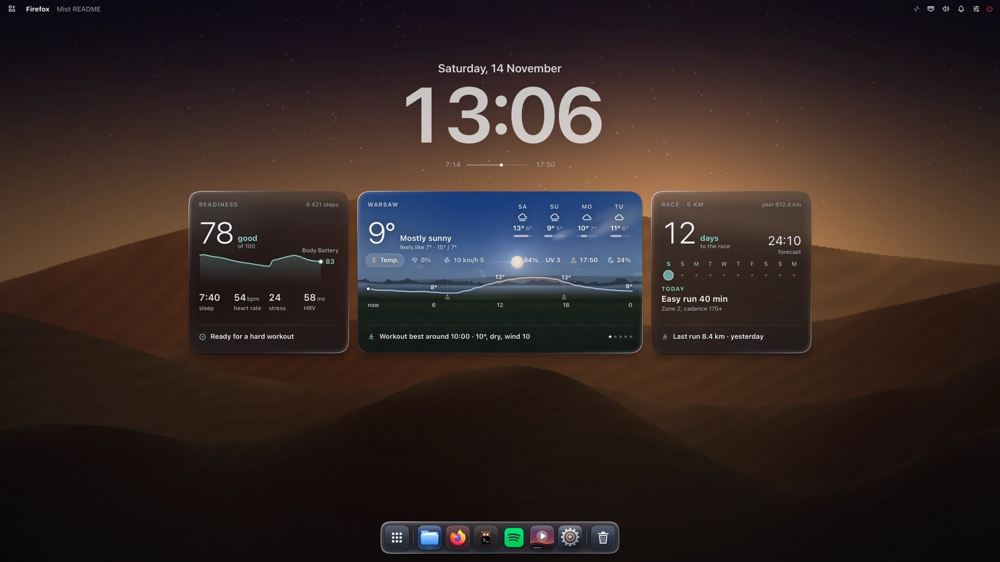
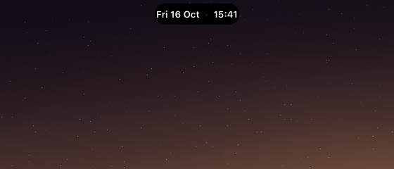
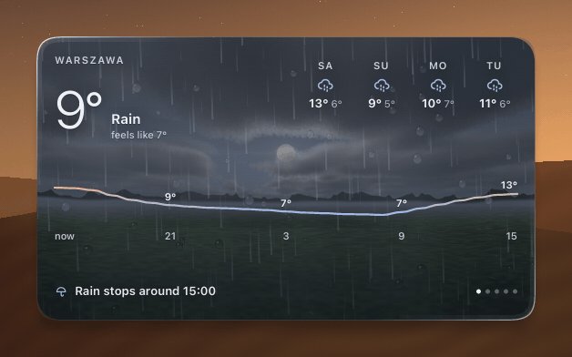

<div align="center">


**Eine von macOS inspirierte Desktop-Shell für Wayland, in Rust geschrieben und auf der CPU gezeichnet.**

[](../../.github/workflows/ci.yml)
[](https://github.com/wiktor-jozwiak/mist/releases)
[](../../LICENSE)
[](https://discord.gg/4rRabwQTPE)

[English](../../README.md) · [Polski](README.pl.md) · [Deutsch](README.de.md) ·
[Español](README.es.md) · [简体中文](README.zh-CN.md) · [日本語](README.ja.md)

<br>



**[Was du bekommst](#was-du-bekommst) · [Warum es leicht ist](#warum-es-leicht-ist) · [mist-comp](#mist-comp) ·
[Installation](#installation) · [Tasten](#tasten-und-skripte) · [Entwicklung](#entwicklung)**

</div>

Mist ist eine ganze Desktop-Shell in einem Prozess: Leiste, Dock, Dynamic Island, Desktop-Widgets, Suche,
Kontrollzentrum, Benachrichtigungen, Sperrbildschirm und Polkit-Agent. Es läuft auf Hyprland oder auf seinem
eigenen Compositor, [`mist-comp`](#mist-comp), und lässt sich auf dem Desktop, den du schon benutzt,
[in einem Fenster ausprobieren](#2-in-einem-fenster-ausprobieren).

> [!NOTE]
> Mist ist der tägliche Desktop einer Person (Arch / CachyOS, zwei Monitore, NVIDIA). Es ist öffentlich, weil
> es funktioniert, nicht weil es fertig ist: Rechne damit, Code zu lesen.

## Was du bekommst

<div align="center">

<table>
  <tr>
    <td width="50%"></td>
    <td width="50%"></td>
  </tr>
  <tr>
    <td align="center"><sub>Dynamic Island: Benachrichtigungen, Lautstärke, Regen in der nächsten Stunde, der nächste Termin</sub></td>
    <td align="center"><sub>Wetterkarte über einem in Echtzeit gezeichneten GLSL-Himmel</sub></td>
  </tr>
  <tr>
    <td width="50%"></td>
    <td width="50%"></td>
  </tr>
  <tr>
    <td align="center"><sub>Spotlight: Apps, Dateien, Befehle, Emoji, Web</sub></td>
    <td align="center"><sub>Einstellungen: jede Option in einem Fenster, sofort angewendet</sub></td>
  </tr>
  <tr>
    <td width="50%"></td>
    <td width="50%"></td>
  </tr>
  <tr>
    <td align="center"><sub>Kontrollzentrum: Netzwerk, Bluetooth, Telefon, Ton, Nachtlicht</sub></td>
    <td align="center"><sub>Kalender: Monat, Agenda, neue Termine</sub></td>
  </tr>
</table>

<a href="https://youtu.be/mwisDtz0Yd0"></a>

<sub>40-s-Demo, aufgenommen in einer headless <code>mist-comp</code>-Sitzung mit Demodaten. Musik: <i>Trap Beat</i> von JonasBlakewood (Pixabay) · <a href="https://github.com/user-attachments/assets/ed8137a5-daf5-488e-8515-686aa54e6e07">MP4</a></sub>

</div>

**Die Shell**

- **Obere Leiste:** aktive App, Systemablage (StatusNotifierItem + dbusmenu), Netzwerk, Bluetooth, Audio, CPU
  und Speicher, Uhr.
- **Dock:** angeheftete und laufende Apps, Vergrößerung, Fensterauswahl mit Live-Vorschau.
- **Dynamic Island:** Medien mit Equalizer, Timer, Anrufe, Benachrichtigungen, Lautstärke.
- **Panels:** Spotlight, Start, App-Umschalter, Kontrollzentrum, Mitteilungszentrale, Zwischenablage, Emoji,
  Sitzungsmenü, Bildschirmfoto-Leiste. Spotlight antwortet beim Tippen: Rechnen (`128*42`), Einheiten
  (`212 f to c`, `2 gb to mb`), Zeitzonen (`tokyo time`).
- **Andocken von Fenstern** wie in Windows 11: an Rand oder Ecke ziehen, Snap Layouts am grünen Knopf oder
  mit `Super + Z`, Snap Assist.

**Der Desktop**

- **Uhr und Glaskarten:** Wetter, Garmin-Bereitschaft, Laufen, Musik, Kalender, System, Weltuhren. Das Wetter
  kommt ohne Konto von [Open-Meteo](https://open-meteo.com): Stundenkurve, vier Tage, Regen in der nächsten
  Stunde, Sonne und Mond. Die Garmin-Karten zeigen deine eigenen Garmin-Connect-Daten, die in eine lokale
  SQLite-Datei synchronisiert werden; sie bleiben verborgen, bis du dich einmal anmeldest
  ([Anleitung](../guides/garmin.md)).
- **Hintergründe:** Fotos, Live-Szenen in GLSL oder ein Himmel, der dem aktuellen Wetter folgt.
- **Themes:** Mist, Catppuccin, Nord, Gruvbox, Tokyo Night, Rosé Pine, Dracula oder eine eigene JSON-Datei.
  Glas, Fenster und Akzentfarbe wechseln live in der Shell und in Files, Player und Einstellungen.

**Was es ersetzt**

- **Dienste:** den Benachrichtigungsserver, den Polkit-Agenten, den Sperrbildschirm (PAM), Leerlauf und
  Ruhezustand.
- **Apps:** Mist Files (auch der Dateiauswahldialog jeder App), Mist Player (libmpv), Einstellungen (Sprache,
  Wetterort, Hintergrund, Desktop-Layout, Widgets, Nachtlicht, Sperre und Ruhezustand, Benachrichtigungen).
- **Telefon** über KDE Connect: Akku, Benachrichtigungen, SMS und Kontakte in einem Panel, Anrufe in der
  Island (ADB als Ausweichweg für Anrufe).

Die Oberfläche spricht **Deutsch, Englisch, Polnisch, Spanisch und Französisch**, nach `$LANG` oder der Wahl in
den Einstellungen. Eine Sprache ist eine JSON-Datei in [native/assets/i18n](../../native/assets/i18n).

## Warum es leicht ist

Angefangen hat Mist als Quickshell-Konfiguration mit 428 MB und 9,5 % CPU im Leerlauf. Es wurde Fläche für
Fläche nach drei Regeln neu geschrieben:

- **Auf der CPU zeichnen.** `mist-ui` malt `wl_shm`-Puffer mit [tiny-skia] und [swash] und zeichnet nur neu,
  was sich geändert hat. Auf NVIDIA kostet jeder OpenGL-Kontext 100 bis 160 MB vor dem ersten Pixel; `mist-ui`
  hat keinen.
- **Auf Ereignisse warten.** Der Zustand kommt aus dem Compositor-Socket, D-Bus, `pactl subscribe` und
  inotify, und verdeckte Flächen arbeiten nicht. Die Shell wacht im Leerlauf 8-mal pro Sekunde auf.
- **Ein GPU-Prozess, nur solange er etwas zeigt.** `mist-wall` zeichnet Live-Hintergründe, den Himmel der
  Wetterkarte und die Hintergrundgalerie. Mit einem Foto als Hintergrund und ohne diese beendet er sich, und
  `mist-ui` zeichnet das Foto.

<p align="center"></p>

**Shells.** Jede allein in einem frischen headless sway auf der GPU (RTX 4060, zwei 1080p-Ausgänge), mit der
Konfiguration aus ihrem Paket; 3 Läufe, Median ([bench/shells.sh](../../bench/shells.sh)). *Leerlauf*: eine
Minute passiert nichts. *Aktiv*: alle 2 s ein Arbeitsflächenwechsel, alle 6 s ein neues Fenster, alle 10 s
eine Benachrichtigung. CPU in % eines Kerns.

| Shell | Was sie zeichnet | Speicher (PSS) | GPU-Speicher | CPU Leerlauf | CPU aktiv |
|---|---|---|---|---|---|
| swaybar (sway 1.12) | Leiste | 6 MB | – | 0 % | 0,03 % |
| Waybar 0.15 | Leiste | 34 MB | – | 0,03 % | 0,38 % |
| **Mist, Foto-Hintergrund** | Leiste, Dock, Island, Desktop-Widgets, Benachrichtigungen, Hintergrund | **44 MB** | – | 0,14 % | 0,66 % |
| nwg-panel 0.12 | Leiste | 59 MB | – | 0,09 % | 0,23 % |
| **Mist, Live-Hintergrund** | all das, der Hintergrund eine Live-Szene in GLSL | 144 MB | 50 MiB | 0,79 % | 1,34 % |
| Ironbar 0.19 | Leiste | 158 MB | 9 MiB | 0,35 % | 0,42 % |
| Quickshell 0.3, ein leeres `PanelWindow` | eine leere Leiste | 161 MB | 6 MiB | 0 % | 0 % |
| Noctalia 5.4 | Leiste, Foto-Hintergrund (und ihr Einrichtungsdialog) | 192 MB | 60 MiB | 0,10 % | 4,01 % |

**Compositoren.** Headless auf derselben GPU, 1920×1080 60 Hz, 5 Läufe
([bench/compositors.sh](../../bench/compositors.sh)). Ohne etwas auf dem Bildschirm brauchen alle 0 % CPU.

| Compositor | Speicher (PSS) | CPU, ein Client, der jedes Bild auf der CPU zeichnet | CPU, ein OpenGL-Client im Vollbild | CPU pro OpenGL-Bild |
|---|---|---|---|---|
| **mist-comp** | 128 MB | **2,2 %** | 1,5 % | 0,25 ms |
| weston 15 | 129 MB | 3,3 % | **0,8 %** | **0,13 ms** |
| labwc 0.20 | 137 MB | 8,1 % | 8,9 % | 1,5 ms |
| sway 1.12 | 129 MB | 33,6 % | 8,3 % | 1,4 ms |

Hyprland und niri haben keinen headless-Modus, den ein Skript starten kann, und fehlen deshalb in der Tabelle.
Methode, jeder Lauf, Aufwachvorgänge, Zahlen pro Prozess und die früheren Messungen in der echten Sitzung:
[docs/BENCHMARKS.md](../BENCHMARKS.md).

## mist-comp

Mists eigener Wayland-Compositor, rund 14 000 Zeilen Rust auf [Smithay], mit Anmeldebildschirm. Er startet
dieselbe Shell und beantwortet genug von Hyprlands IPC, dass `hyprctl` und Mists Skripte unverändert
funktionieren. Er ist experimentell und neben Hyprland die tägliche Sitzung des Autors.

- **Fenster:** Mist-Titelleisten oder die der App, runde Ecken und Schatten, Glasunschärfe unter
  durchscheinenden Fenstern und Panels, Overview (`Super + O`), eine Lupe, Arbeitsflächenwechsel, der den
  Fingern folgt, Win + D zeigt den Desktop.
- **Spart sich, was er auslassen kann:** Ein Monitor zeichnet nur neu, wenn sich darauf etwas geändert hat;
  das Glas wird nur neu weichgezeichnet, wenn sich dahinter etwas bewegt hat; ein verdecktes Fenster bekommt
  ein Bild pro Sekunde statt sechzig.
- **Sitzung:** DRM / KMS über logind, Hotplug, VRR, Explicit Sync, XWayland, Bildschirmfreigabe über das Portal,
  etwa 45 Protokolle. Nach einem Absturz kommen die Fenster auf ihre Arbeitsflächen zurück;
  `mist-session restart` lädt eine neue Version ohne Abmelden.
- **Getestet:** 66 verschachtelte Tests mit Headless-Backend, in der CI auf dem Software-Renderer.

Noch nicht da: Kacheln, Tearing-Steuerung, geprüftes Direct Scan-out auf NVIDIA. Konfiguration:
[docs/CONFIG.md](../CONFIG.md#compconf-outputs-mist-comp-only); `mist-comp migrate` übernimmt eine Hyprland-Konfiguration.

## Installation

### 1. Holen

Arch: [packaging/arch/PKGBUILD](../../packaging/arch/PKGBUILD) baut `mist-shell-git`.

```bash
git clone https://github.com/wiktor-jozwiak/mist && cd mist/packaging/arch && makepkg -si
```

Überall sonst aus einem Klon. Das erste Skript baut `mistd` (die Backends), das zweite legt `mist-ui-bin`,
`mist-wall-bin`, `mist-comp` und `mist-try` nach `~/.local/bin`:

```bash
git clone https://github.com/wiktor-jozwiak/mist ~/src/mist
```

```bash
~/src/mist/scripts/mistd/install.sh && ~/src/mist/native/install.sh
```

Fertige Binärdateien hängen an jedem [Release](https://github.com/wiktor-jozwiak/mist/releases).

<details>
<summary>Abhängigkeiten</summary>

<br>

**Bauen:** `rust`, `pkgconf`, `libxkbcommon`, `pam`, `wayland`, `mesa`; für `mist-comp` zusätzlich `libinput`,
`libseat`, `libdrm`, `systemd-libs`.

**Laufzeit:** `pipewire-pulse`, `wireplumber`, `networkmanager`, `wl-clipboard`, `grim`, `slurp`, `polkit`,
`noto-fonts`, `noto-fonts-emoji`. Optional: `ddcutil` (Monitorhelligkeit), `kdeconnect` oder `android-tools`
(Telefon). Was jedes davon einschaltet: [docs/CONFIG.md](../CONFIG.md#optional-integrations).

**Schrift:** Die Oberfläche ist für SF Pro gezeichnet, die Mist nicht mitliefern darf. Ohne sie nimmt Mist
Inter, dann Noto Sans.

</details>

### 2. In einem Fenster ausprobieren

```bash
mist-try
```

Der ganze Desktop (sein Compositor, Leiste, Dock, Island, Widgets) in einem Fenster unter Hyprland, Sway,
GNOME oder KDE. Er hat ein eigenes Laufzeitverzeichnis und einen eigenen D-Bus-Sitzungsbus, deine
Benachrichtigungen, Systemablage und dein Polkit-Agent bleiben also, wo sie sind; Fenster zu, und er ist weg.
Optionen: `MIST_TRY_SIZE=1600x1000`, `MIST_TRY_KEYBOARD=de`, `MIST_THEME=nord`.

### 3. Zu deinem Desktop machen

- **Unter Hyprland:** [examples/hyprland/mist.lua](../../examples/hyprland/mist.lua) in die eigene Konfiguration
  laden und andere Leisten, Benachrichtigungsdienste und Polkit-Agenten entfernen.
- **Unter mist-comp:** `native/mist-comp/session/install-session.sh --greeter` fügt dem Anmeldebildschirm eine
  Mist-Sitzung hinzu; Hyprland bleibt.

## Tasten und Skripte

| Taste | Aktion | | Taste | Aktion |
|---|---|---|---|---|
| `Super` | Start | | `Super + A` | Mitteilungszentrale |
| `Super + Space` | Spotlight | | `Super + V` | Zwischenablage |
| `Super + Tab` | App-Umschalter | | `Super + .` | Emoji |
| `Super + I` | Kontrollzentrum | | `Super + L` | Sperren |
| `Super + Shift + S` | Bildschirmfoto | | Rechtsklick auf den Desktop | Einstellungen |

Alles ist skriptbar: `mist-ui-bin msg mist toggle spotlight`, `mist-ui-bin msg ui stats`. Die Einstellungen
liegen in `~/.config/mist/`, jede Datei ist in [docs/CONFIG.md](../CONFIG.md) beschrieben; das Log ist
`~/.cache/mist/ui.log`.

## Entwicklung

```bash
cd native && cargo build --release && cargo test --release
```

Jede Fläche lässt sich offscreen rendern, Änderungen sind also prüfbar, ohne die laufende Sitzung anzufassen:
`mist-ui-bin --pane-png spotlight 1920 1080 out.png`, `mist-ui-bin --desk-png dir`,
`mist-wall-bin --png out.ppm dunes 1920 1080`. `native/mist-comp/tests/run-all.sh` führt die Compositor-Tests
in einem verschachtelten Fenster aus. Mehr in [native/README.md](../../native/README.md) und
[CONTRIBUTING.md](../../CONTRIBUTING.md).

| Pfad | Inhalt |
|---|---|
| `native/mist-ui` | alle Flächen der Shell |
| `native/mist-wall` | der GPU-Prozess für Hintergründe |
| `native/mist-comp` | Compositor, Sitzung und Anmeldebildschirm |
| `scripts/mistd` | Backends: Systemwerte, Telefon, Anrufe, Zwischenablage, Garmin-Synchronisierung |
| `shaders/` | Shader für Hintergründe und Himmel |
| `bench/` | die Messwerkzeuge und ihre Ergebnisse |
| Tag `legacy-qml` | die ursprüngliche Quickshell-Version |

## Dank

Gebaut auf [Smithay], [smithay-client-toolkit], [tiny-skia], [swash], [resvg], [zbus] und [Tabler Icons].
Die erste Version lief auf [Quickshell], mit [Noctalia] als Vorbild.

<sub>Mist steht in keiner Verbindung zu Apple. macOS, Dynamic Island, Spotlight und SF Pro sind Marken von Apple Inc.
und werden hier nur genannt, um die Inspiration zu beschreiben.</sub>

[GPL-3.0](../../LICENSE)

[tiny-skia]: https://github.com/linebender/tiny-skia
[swash]: https://github.com/dfrg/swash
[resvg]: https://github.com/linebender/resvg
[zbus]: https://github.com/dbus2/zbus
[Smithay]: https://github.com/Smithay/smithay
[smithay-client-toolkit]: https://github.com/Smithay/client-toolkit
[Tabler Icons]: https://tabler.io/icons
[Quickshell]: https://quickshell.org
[Noctalia]: https://github.com/noctalia-dev/noctalia
