<div align="center">

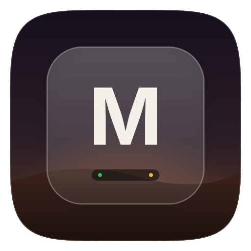

# Mist

**Un entorno de escritorio y un compositor Wayland para Linux, escritos en Rust y dibujados en la CPU.**

[](../../.github/workflows/ci.yml)
[](https://github.com/wiktor-jozwiak/mist/releases)
[](https://github.com/wiktor-jozwiak/mist/stargazers)
[](../../LICENSE)
[](https://discord.gg/4rRabwQTPE)

[English](../../README.md) · [Polski](README.pl.md) · [Deutsch](README.de.md) ·
[Español](README.es.md) · [简体中文](README.zh-CN.md) · [日本語](README.ja.md)

<br>

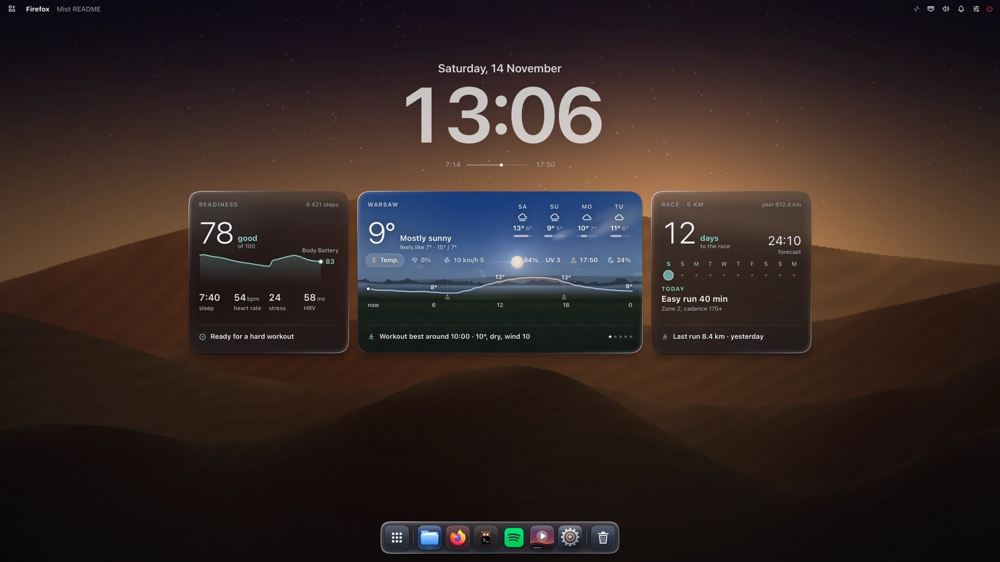

<table>
  <tr>
    <td align="center" width="33%"><h3>44 MB</h3><sub>de memoria para todo el shell en reposo</sub></td>
    <td align="center" width="33%"><h3>0</h3><sub>contextos OpenGL en el proceso del shell</sub></td>
    <td align="center" width="33%"><h3>8 / s</h3><sub>despertares en reposo, sin sondeo</sub></td>
  </tr>
</table>

**[Recorrido](#recorrido) · [Qué ofrece](#qué-ofrece) · [Por qué es ligero](#por-qué-es-ligero) · [mist-comp](#mist-comp) ·
[Instalación](#instalación) · [Teclas](#teclas-y-scripts) · [Desarrollo](#desarrollo)**

</div>

Mist son dos programas, y cada uno funciona sin el otro:

| | Qué es | Dónde funciona |
|---|---|---|
| **El entorno** (`mist-ui`, `mist-wall`) | barra, dock, Dynamic Island, widgets del escritorio, buscador, centro de control, notificaciones, pantalla de bloqueo, agente polkit, un gestor de archivos y un reproductor de vídeo, en un solo proceso | Hyprland, mist-comp o [una ventana](#2-pruébalo-en-una-ventana) en el escritorio que ya usas |
| **El compositor** ([`mist-comp`](#mist-comp)) | un compositor Wayland sobre Smithay, con su propia pantalla de inicio de sesión | una sesión propia, junto a Hyprland |

El aspecto se inspira en macOS a propósito; por debajo es un escritorio Linux.

> [!NOTE]
> Mist es el escritorio diario de una persona (Arch / CachyOS, dos monitores, NVIDIA). Se comparte porque
> funciona, no porque esté terminado: cuenta con leer algo de código.

## Recorrido

<div align="center">


<sub>Dynamic Island: notificaciones, volumen, lluvia en la próxima hora, el próximo evento</sub>

<br><br>

<table>
  <tr>
    <td width="50%" align="center">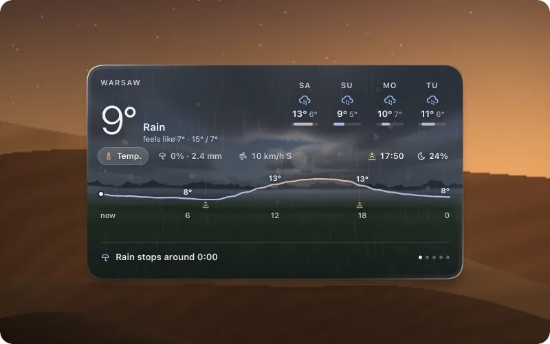<br><sub>Tarjeta del tiempo sobre un cielo en vivo que sigue el tiempo y la hora</sub></td>
    <td width="50%" align="center"><br><sub>Fondos animados en GLSL, fotos o el cielo del tiempo actual</sub></td>
  </tr>
  <tr>
    <td align="center">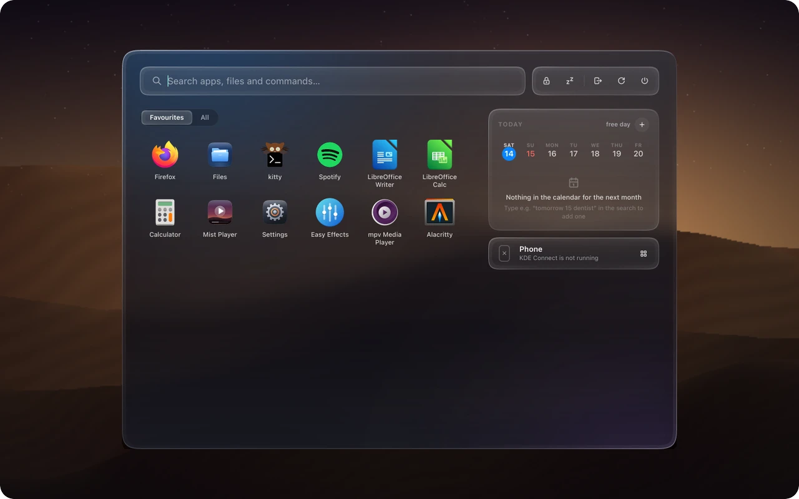<br><sub>Inicio: aplicaciones, archivos, comandos, el día de hoy y el teléfono</sub></td>
    <td align="center">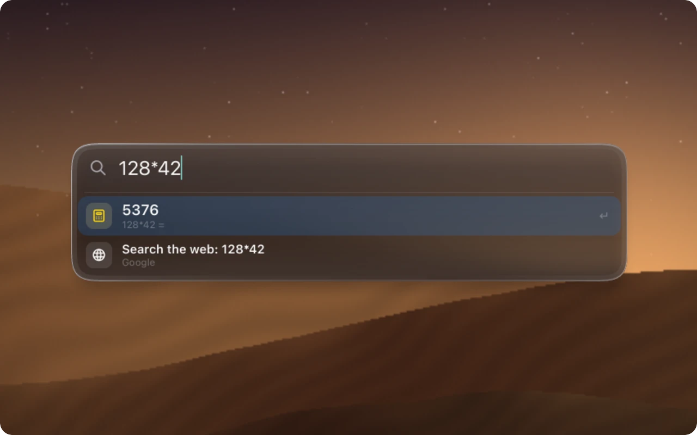<br><sub>Spotlight: aplicaciones, archivos, comandos, cálculos, unidades, husos horarios, emoji, web</sub></td>
  </tr>
  <tr>
    <td align="center">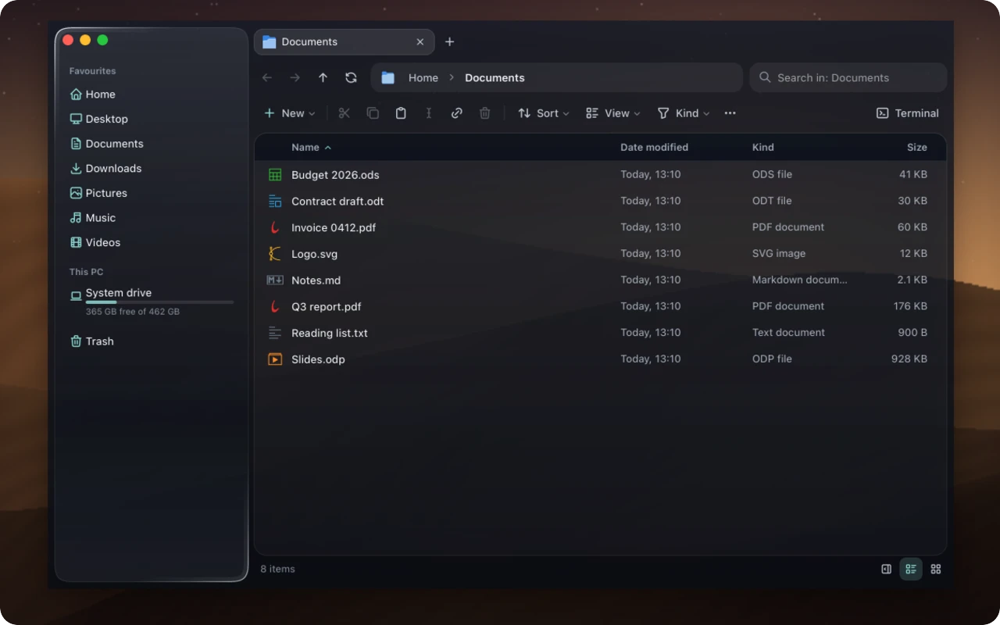<br><sub>Mist Files, también el selector de archivos de cada aplicación</sub></td>
    <td align="center">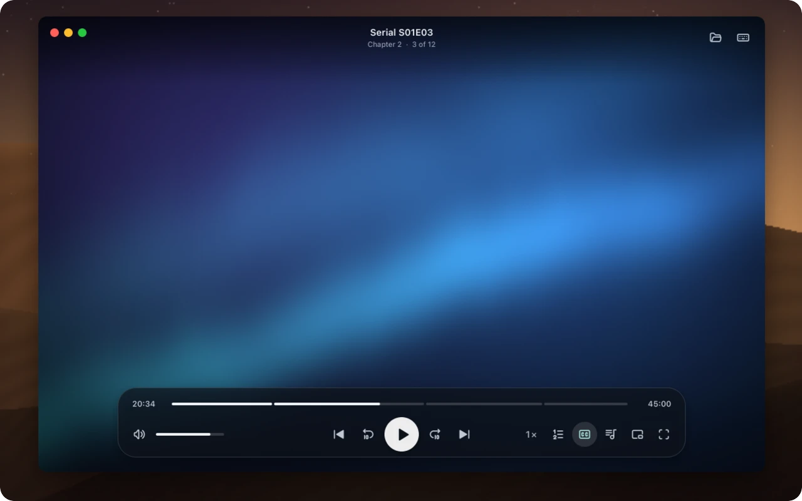<br><sub>Mist Player sobre libmpv: capítulos, pistas, imagen en imagen</sub></td>
  </tr>
  <tr>
    <td align="center">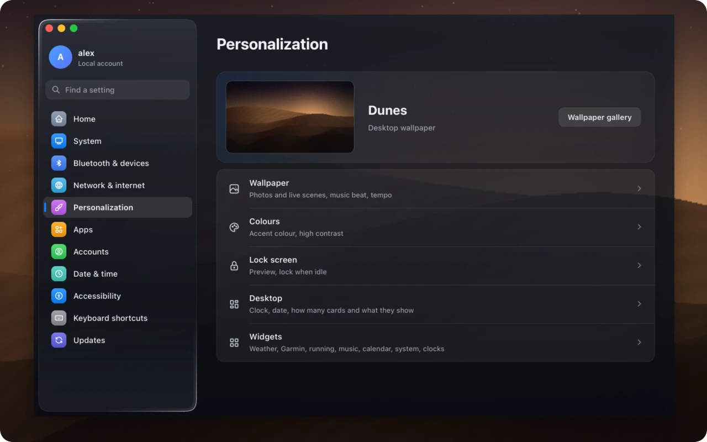<br><sub>Ajustes: todas las opciones en una ventana, aplicadas al instante</sub></td>
    <td align="center">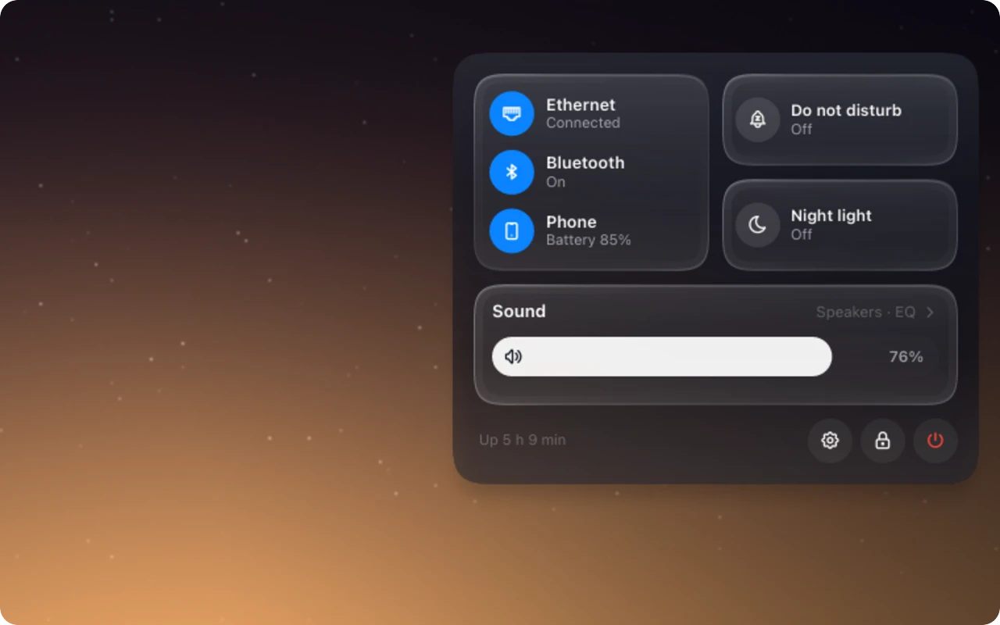<br><sub>Centro de control: red, Bluetooth, teléfono, sonido, luz nocturna</sub></td>
  </tr>
  <tr>
    <td align="center">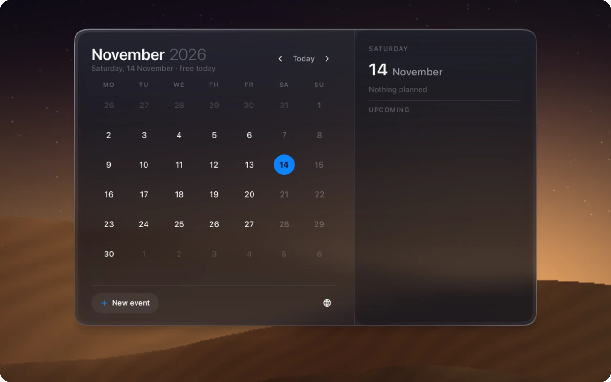<br><sub>Calendario: mes, agenda, eventos nuevos</sub></td>
    <td align="center">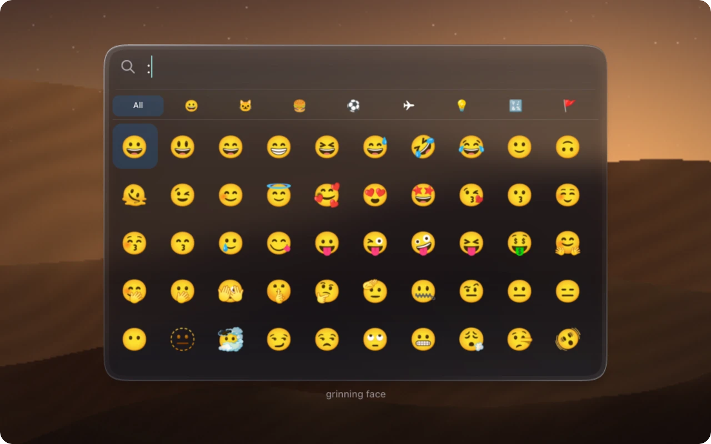<br><sub>Selector de emoji con búsqueda y categorías</sub></td>
  </tr>
</table>

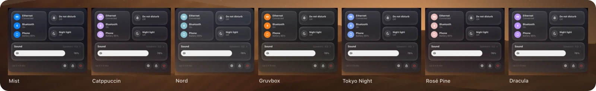

<sub>Mist, Catppuccin, Nord, Gruvbox, Tokyo Night, Rosé Pine, Dracula o tu propio archivo JSON. El vidrio, las ventanas y el acento cambian en vivo.</sub>

<br><br>

<table>
  <tr>
    <td align="center" width="33%">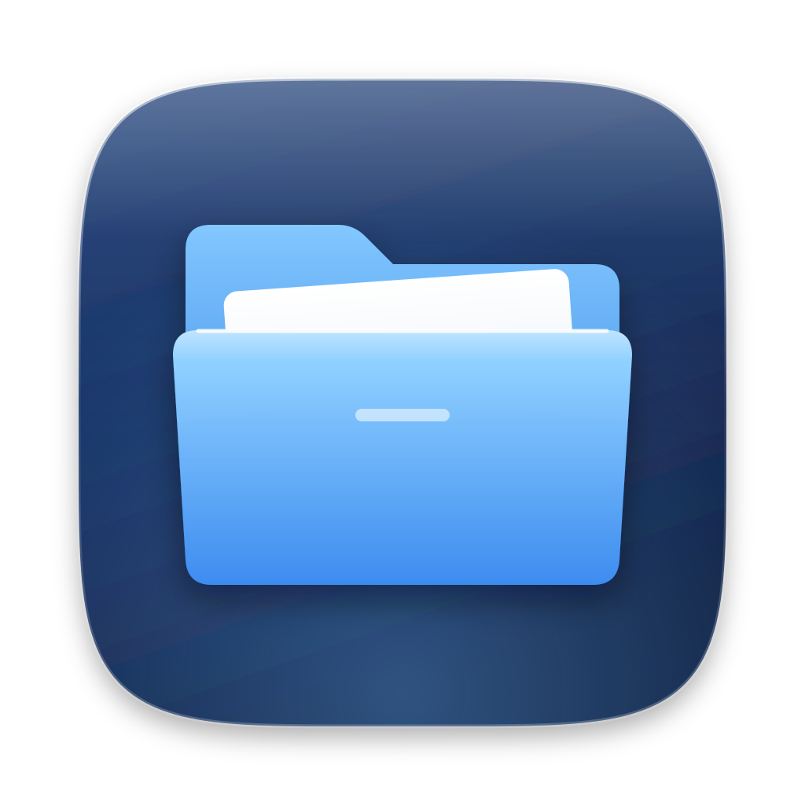<br><b>Mist Files</b><br><sub>pestañas, vista previa, búsqueda inteligente, el selector de archivos del sistema</sub></td>
    <td align="center" width="33%">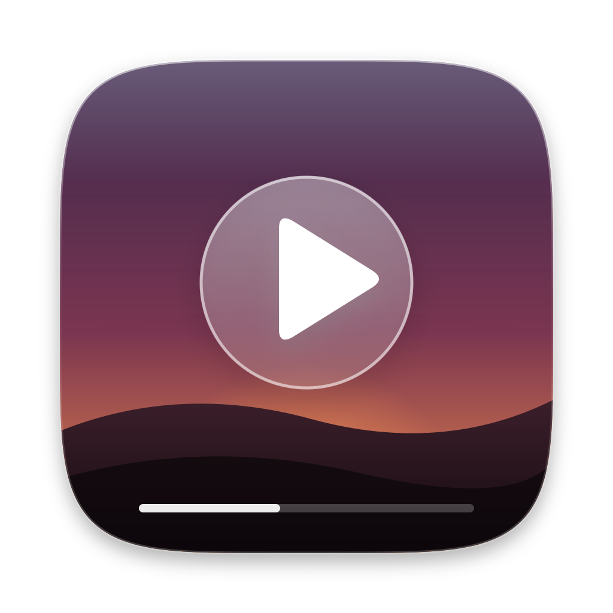<br><b>Mist Player</b><br><sub>libmpv, MPRIS, imagen en imagen, ritmo de fotogramas estable</sub></td>
    <td align="center" width="33%">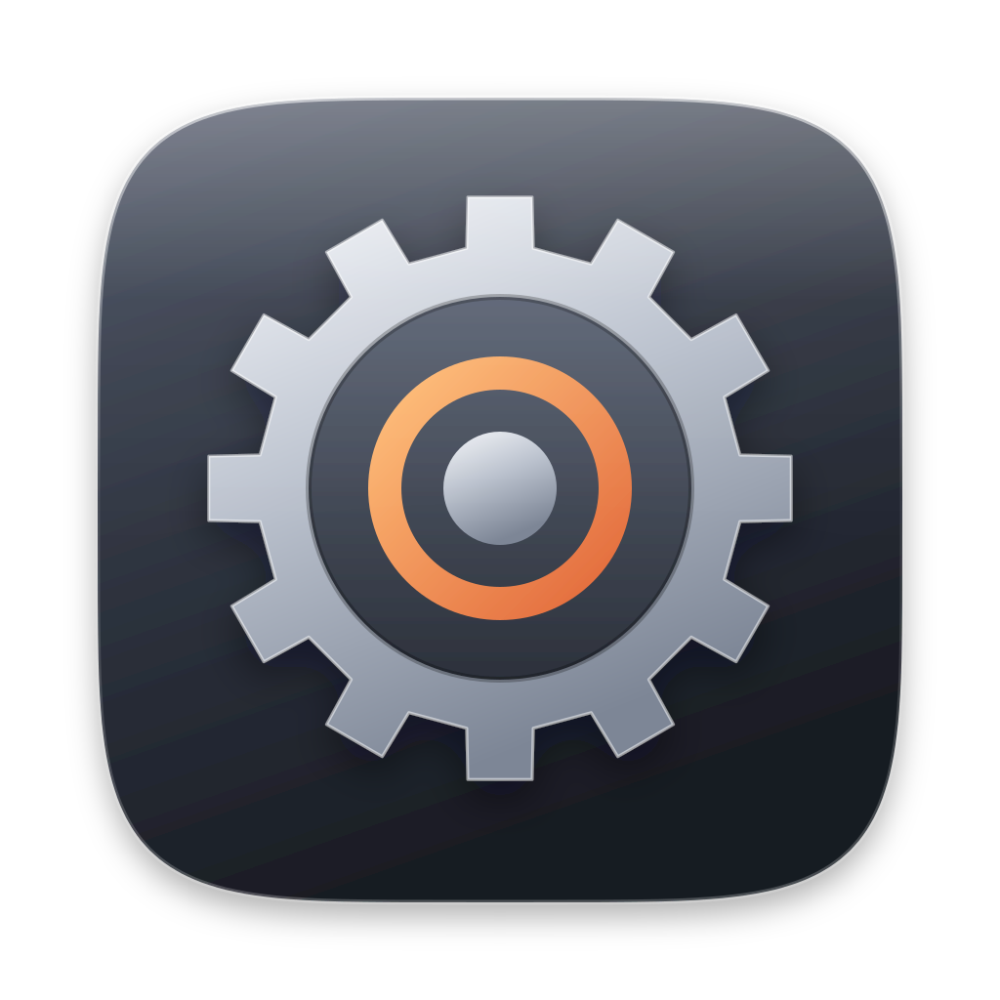<br><b>Ajustes</b><br><sub>pantalla, sonido, red, escritorio, widgets, idioma</sub></td>
  </tr>
</table>

<br>

<a href="https://youtu.be/mwisDtz0Yd0">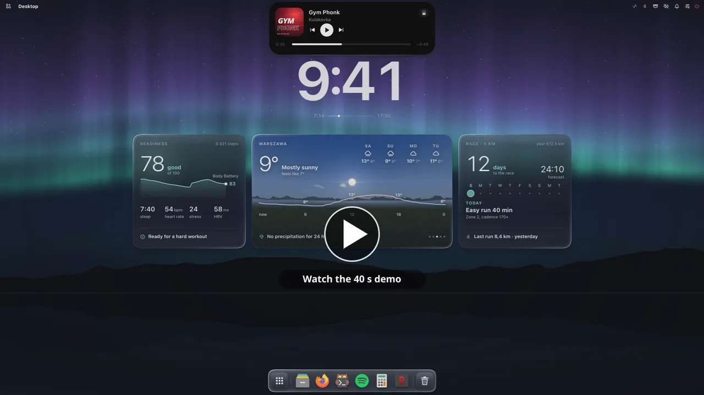</a>

<sub>Demo de 40 s, grabada en una sesión <code>mist-comp</code> sin pantalla con datos de demostración. Música: <i>Trap Beat</i>, de JonasBlakewood (Pixabay) · <a href="https://github.com/user-attachments/assets/ed8137a5-daf5-488e-8515-686aa54e6e07">MP4</a></sub>

</div>

## Qué ofrece

**El entorno**

- **Barra superior:** aplicación activa, bandeja del sistema (StatusNotifierItem + dbusmenu), red, Bluetooth,
  sonido, CPU y memoria, reloj.
- **Dock:** aplicaciones fijadas y abiertas, ampliación, un selector de ventanas con miniaturas en vivo.
- **Dynamic Island:** multimedia con ecualizador, temporizadores, llamadas, notificaciones, volumen, Bloq Mayús
  y un aviso cuando un archivo de configuración tiene un error (con la línea y la columna).
- **Paneles:** Inicio, Spotlight, selector de aplicaciones, centro de control, centro de notificaciones,
  calendario, historial del portapapeles, emoji, menú de sesión. Los campos de búsqueda funcionan como
  cualquier campo de texto: cursor, flechas, selección con Mayús y Ctrl+A.
- **Capturas de pantalla:** una región elegida sobre la pantalla congelada, una barra de herramientas, texto
  de la pantalla (OCR), un cuentagotas de color.
- **Ajuste de ventanas** como en Windows 11: arrastra a un borde o esquina, Snap Layouts en el botón verde o
  `Super + Z`, Snap Assist.
- **Pantalla de bloqueo** sobre PAM, con su propio estilo de reloj, desenfoque y oscurecimiento.

**El escritorio**

- **Reloj y tarjetas de cristal:** tiempo, disposición de Garmin, carrera, música, calendario, sistema, relojes
  del mundo, una nota con tareas, el progreso del día, el Sol y la Luna, un marco de fotos, baterías de
  dispositivos. Las tarjetas de Garmin muestran tus propios datos de Garmin Connect, sincronizados en un
  archivo SQLite local, y siguen ocultas hasta que inicias sesión una vez ([guía](../guides/garmin.md)).
- **Tiempo** de [Open-Meteo](https://open-meteo.com), sin cuenta: curva por horas, cuatro días, lluvia en la
  próxima hora, el día del Sol y de la Luna. El cielo de la tarjeta se dibuja en vivo para el tiempo y la hora
  que señalas, sobre uno de cinco paisajes (campos, un lago, montañas, una ciudad, el mar).
- **Fondos:** fotos, escenas GLSL en vivo o el cielo del tiempo actual.
- **Temas:** Mist, Catppuccin, Nord, Gruvbox, Tokyo Night, Rosé Pine, Dracula o tu propio archivo JSON. El
  cristal, las ventanas y el acento cambian en vivo en el entorno y en Files, Player y Ajustes.

**Qué sustituye**

- **Servicios:** el servidor de notificaciones, el agente polkit, la pantalla de bloqueo, la inactividad y la
  suspensión.
- **Aplicaciones:** Mist Files, Mist Player y Ajustes (pantalla, sonido, Bluetooth, red, energía,
  aplicaciones, fondo, escritorio y widgets, pantalla de bloqueo, notificaciones, idioma).
- **Teléfono** con KDE Connect: batería, notificaciones, SMS y contactos en un panel, llamadas en la isla (ADB
  como alternativa para las llamadas).

La interfaz está en **español, inglés, polaco, alemán y francés**, según `$LANG` o lo elegido en Ajustes. Un
idioma es un archivo JSON en [native/assets/i18n](../../native/assets/i18n).

## Por qué es ligero

Mist empezó como una configuración de Quickshell que usaba 428 MB y un 9,5 % de CPU en reposo. Se reescribió
superficie a superficie siguiendo tres reglas:

- **Dibujar en la CPU.** `mist-ui` pinta búferes `wl_shm` con [tiny-skia] y [swash] y solo redibuja lo que
  cambió. En NVIDIA cada contexto OpenGL cuesta entre 100 y 160 MB antes del primer píxel; `mist-ui` no tiene
  ninguno.
- **Esperar eventos.** El estado llega del socket del compositor, D-Bus, `pactl subscribe` e inotify, y las
  superficies ocultas no trabajan. En reposo el entorno se despierta 8 veces por segundo.
- **Un solo proceso de GPU, y solo mientras muestra algo.** `mist-wall` dibuja los fondos animados, el cielo
  de la tarjeta del tiempo y la galería de fondos. Con una foto de fondo y sin nada de eso se cierra, y la
  foto la dibuja `mist-ui`.

<p align="center">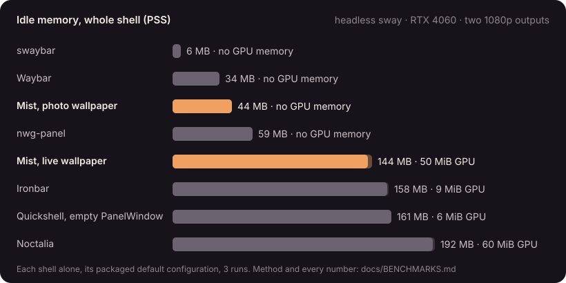</p>

<details>
<summary><b>Los números</b>: shells y compositores medidos igual</summary>

<br>

**Shells.** Cada una sola en un sway sin pantalla recién iniciado sobre la GPU (RTX 4060, dos salidas 1080p),
con la configuración de su paquete; 3 ejecuciones, mediana ([bench/shells.sh](../../bench/shells.sh)).
*En reposo*: no pasa nada durante un minuto. *Activa*: un cambio de escritorio cada 2 s, una ventana nueva
cada 6 s, una notificación cada 10 s. CPU en % de un núcleo.

| Shell | Qué dibuja | Memoria (PSS) | Memoria de GPU | CPU en reposo | CPU activa |
|---|---|---|---|---|---|
| swaybar (sway 1.12) | barra | 6 MB | – | 0 % | 0,03 % |
| Waybar 0.15 | barra | 34 MB | – | 0,03 % | 0,38 % |
| **Mist, foto de fondo** | barra, dock, isla, widgets del escritorio, notificaciones, fondo | **44 MB** | – | 0,14 % | 0,66 % |
| nwg-panel 0.12 | barra | 59 MB | – | 0,09 % | 0,23 % |
| **Mist, fondo animado** | todo eso, con una escena GLSL animada como fondo | 144 MB | 50 MiB | 0,79 % | 1,34 % |
| Ironbar 0.19 | barra | 158 MB | 9 MiB | 0,35 % | 0,42 % |
| Quickshell 0.3, un `PanelWindow` vacío | una barra vacía | 161 MB | 6 MiB | 0 % | 0 % |
| Noctalia 5.4 | barra, foto de fondo (y su diálogo de primer inicio) | 192 MB | 60 MiB | 0,10 % | 4,01 % |

**Compositores.** Sin pantalla en la misma GPU, 1920×1080 60 Hz, 5 ejecuciones
([bench/compositors.sh](../../bench/compositors.sh)). Sin nada en pantalla todos usan un 0 % de CPU.

| Compositor | Memoria (PSS) | CPU, un cliente que dibuja en la CPU cada fotograma | CPU, un cliente OpenGL a pantalla completa | CPU por fotograma OpenGL |
|---|---|---|---|---|
| **mist-comp** | 128 MB | **2,2 %** | 1,5 % | 0,25 ms |
| weston 15 | 129 MB | 3,3 % | **0,8 %** | **0,13 ms** |
| labwc 0.20 | 137 MB | 8,1 % | 8,9 % | 1,5 ms |
| sway 1.12 | 129 MB | 33,6 % | 8,3 % | 1,4 ms |

Hyprland y niri no tienen un modo sin pantalla que un script pueda iniciar, por eso no están en la tabla.
Método, cada ejecución, despertares, cifras por proceso y las mediciones anteriores en la sesión real:
[docs/BENCHMARKS.md](../BENCHMARKS.md).

</details>

## mist-comp

El compositor Wayland propio de Mist, unas 14 000 líneas de Rust sobre [Smithay], con pantalla de inicio de
sesión. Ejecuta el mismo entorno y responde a suficiente IPC de Hyprland como para que `hyprctl` y los scripts
de Mist funcionen sin cambios. Es experimental y es la sesión diaria del autor junto a Hyprland.

- **Ventanas:** barras de título de Mist o las de la aplicación, esquinas redondeadas y sombras, desenfoque de
  cristal bajo ventanas y paneles translúcidos, Overview (`Super + O`), una lupa, cambio de escritorio que
  sigue a los dedos, Win + D muestra el escritorio.
- **No hace el trabajo que puede evitar:** un monitor solo se redibuja si algo cambió en él; el cristal solo
  se vuelve a desenfocar si algo detrás se movió; una ventana tapada recibe un fotograma por segundo en lugar
  de sesenta.
- **Sesión:** DRM / KMS mediante logind, conexión de monitores en caliente, VRR, explicit sync, XWayland,
  compartir pantalla mediante el portal, unos 45 protocolos. Tras un fallo las ventanas vuelven a sus
  escritorios; `mist-session restart` carga una versión nueva sin cerrar sesión.
- **Probado:** 66 pruebas anidadas sobre un backend sin monitor, ejecutadas en la CI con el renderizador por
  software.

Aún no: mosaico, control del tearing, scan-out directo verificado en NVIDIA. Configuración:
[docs/CONFIG.md](../CONFIG.md#compconf-outputs-mist-comp-only); `mist-comp migrate` convierte una configuración de Hyprland.

## Instalación

### 1. Consíguelo

Arch: [packaging/arch/PKGBUILD](../../packaging/arch/PKGBUILD) construye `mist-shell-git`.

```bash
git clone https://github.com/wiktor-jozwiak/mist && cd mist/packaging/arch && makepkg -si
```

En cualquier otro sistema, desde un clon. El primer script compila `mistd` (los backends), el segundo coloca
`mist-ui-bin`, `mist-wall-bin`, `mist-comp` y `mist-try` en `~/.local/bin`:

```bash
git clone https://github.com/wiktor-jozwiak/mist ~/src/mist
```

```bash
~/src/mist/scripts/mistd/install.sh && ~/src/mist/native/install.sh
```

Cada [versión](https://github.com/wiktor-jozwiak/mist/releases) incluye binarios ya compilados.

<details>
<summary>Dependencias</summary>

<br>

**Compilación:** `rust`, `pkgconf`, `libxkbcommon`, `pam`, `wayland`, `mesa`; para `mist-comp` también
`libinput`, `libseat`, `libdrm`, `systemd-libs`.

**Ejecución:** `pipewire-pulse`, `wireplumber`, `networkmanager`, `wl-clipboard`, `grim`, `slurp`, `polkit`,
`noto-fonts`, `noto-fonts-emoji`. Opcional: `ddcutil` (brillo del monitor), `kdeconnect` o `android-tools`
(teléfono). Qué activa cada una: [docs/CONFIG.md](../CONFIG.md#optional-integrations).

**Fuente:** la interfaz está pensada para SF Pro, que Mist no puede incluir. Sin ella usa Inter y después
Noto Sans.

</details>

### 2. Pruébalo en una ventana

```bash
mist-try
```

El escritorio entero (su compositor, barra, dock, isla, widgets) en una ventana sobre Hyprland, Sway, GNOME o
KDE. Tiene su propio directorio de ejecución y su propio bus de sesión D-Bus, así que tus notificaciones, tu
bandeja y tu agente polkit se quedan donde están; cierra la ventana y desaparece. Opciones:
`MIST_TRY_SIZE=1600x1000`, `MIST_TRY_KEYBOARD=de`, `MIST_THEME=nord`.

### 3. Conviértelo en tu escritorio

- **En Hyprland:** carga [examples/hyprland/mist.lua](../../examples/hyprland/mist.lua) desde tu configuración y
  quita otras barras, demonios de notificaciones y agentes polkit.
- **En mist-comp:** `native/mist-comp/session/install-session.sh --greeter` añade una sesión Mist a la pantalla
  de inicio; Hyprland se queda.

## Teclas y scripts

| Tecla | Acción | | Tecla | Acción |
|---|---|---|---|---|
| `Super` | Inicio | | `Super + A` | centro de notificaciones |
| `Super + Space` | Spotlight | | `Super + V` | historial del portapapeles |
| `Super + Tab` | cambiador de aplicaciones | | `Super + .` | emoji |
| `Super + I` | centro de control | | `Super + L` | bloquear |
| `Super + Shift + S` | captura | | clic derecho en el escritorio | ajustes |

Todo se puede automatizar: `mist-ui-bin msg mist toggle spotlight`, `mist-ui-bin msg ui stats`. Los ajustes
están en `~/.config/mist/`, cada archivo se describe en [docs/CONFIG.md](../CONFIG.md); el registro es
`~/.cache/mist/ui.log`.

## Desarrollo

```bash
cd native && cargo build --release && cargo test --release
```

Cada superficie se renderiza fuera de pantalla, así que los cambios se comprueban sin tocar la sesión en marcha:
`mist-ui-bin --pane-png spotlight 1920 1080 out.png`, `mist-ui-bin --desk-png dir`,
`mist-wall-bin --png out.ppm dunes 1920 1080`. `native/mist-comp/tests/run-all.sh` ejecuta las pruebas del
compositor en una ventana anidada. Más en [native/README.md](../../native/README.md) y
[CONTRIBUTING.md](../../CONTRIBUTING.md).

Las imágenes de esta página salen de los mismos renders fuera de pantalla, con datos de demostración:
`docs/img/hero.sh`, `docs/img/panels.sh`, `docs/img/gifs.sh`.

| Ruta | Qué |
|---|---|
| `native/mist-ui` | todas las superficies del entorno |
| `native/mist-wall` | el proceso de fondos en GPU |
| `native/mist-comp` | compositor, sesión y pantalla de inicio |
| `scripts/mistd` | backends: estadísticas del sistema, teléfono, llamadas, portapapeles, sincronización de Garmin |
| `shaders/` | shaders de fondos y cielo |
| `bench/` | las herramientas de medición y sus resultados |
| etiqueta `legacy-qml` | la versión original en Quickshell |

## Historial de estrellas

<a href="https://star-history.com/#wiktor-jozwiak/mist&Date">
  <picture>
    <source media="(prefers-color-scheme: dark)" srcset="https://api.star-history.com/svg?repos=wiktor-jozwiak/mist&type=Date&theme=dark">
    <source media="(prefers-color-scheme: light)" srcset="https://api.star-history.com/svg?repos=wiktor-jozwiak/mist&type=Date">
    
  </picture>
</a>

## Créditos

Construido sobre [Smithay], [smithay-client-toolkit], [tiny-skia], [swash], [resvg], [zbus] y [Tabler Icons].
La primera versión funcionaba sobre [Quickshell], con [Noctalia] como referencia.
Los asistentes de programación con IA ayudan en el desarrollo.

<sub>Mist no está afiliado a Apple. macOS, Dynamic Island, Spotlight y SF Pro son marcas de Apple Inc., citadas
aquí solo para describir la inspiración del diseño.</sub>

[GPL-3.0](../../LICENSE)

[tiny-skia]: https://github.com/linebender/tiny-skia
[swash]: https://github.com/dfrg/swash
[resvg]: https://github.com/linebender/resvg
[zbus]: https://github.com/dbus2/zbus
[Smithay]: https://github.com/Smithay/smithay
[smithay-client-toolkit]: https://github.com/Smithay/client-toolkit
[Tabler Icons]: https://tabler.io/icons
[Quickshell]: https://quickshell.org
[Noctalia]: https://github.com/noctalia-dev/noctalia
