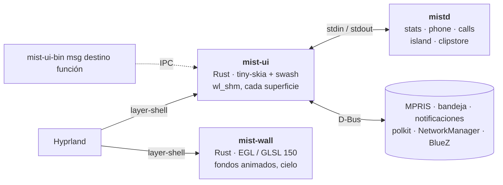

<div align="center">


**Un shell de escritorio para Hyprland inspirado en macOS, escrito en Rust y dibujado en la CPU.**

Barra, dock, Dynamic Island, widgets de escritorio, buscador al estilo Spotlight, centro de control,
notificaciones, pantalla de bloqueo y agente polkit en un solo proceso de ~50 MB, sin contexto de GPU.

[](../../LICENSE)
[](../../native)
[](https://hyprland.org)
[](../../.github/workflows/ci.yml)

[Funciones](#funciones) · [Mediciones](#mediciones) · [Instalación](#instalación) · [Uso](#uso) · [Desarrollo](#desarrollo)

[English](../../README.md) · [Polski](README.pl.md) · [Deutsch](README.de.md) ·
[Español](README.es.md) · [简体中文](README.zh-CN.md) · [日本語](README.ja.md)

<br>


<table>
  <tr>
    <td width="50%"></td>
    <td width="50%"></td>
  </tr>
  <tr>
    <td align="center"><sub><b>Dynamic Island</b>: notificaciones, volumen, lluvia inminente, el próximo evento</sub></td>
    <td align="center"><sub><b>Tarjeta del tiempo</b>: datos de Open-Meteo sobre un cielo GLSL en tiempo real</sub></td>
  </tr>
</table>

<sub>Renders fuera de pantalla con los datos de demostración de <code>docs/demo</code>, generados por
<a href="../img/hero.sh">hero.sh</a>, <a href="../img/gifs.sh">gifs.sh</a> y
<a href="../img/panels.sh">panels.sh</a>. En una sesión real Hyprland desenfoca lo que hay bajo el cristal.</sub>

</div>

<br>

<table>
  <tr>
    <td align="center" width="33%"><h3>~50 MB</h3><sub>todas las superficies del shell en un proceso<br><code>mist-ui</code>, PSS en reposo</sub></td>
    <td align="center" width="33%"><h3>0 contextos GL</h3><sub>búferes <code>wl_shm</code> dibujados en la CPU;<br>la GPU solo para fondos animados</sub></td>
    <td align="center" width="33%"><h3>0 temporizadores en reposo</h3><sub>socket de Hyprland, D-Bus, inotify:<br>las superficies ocultas no trabajan</sub></td>
  </tr>
</table>

## Por qué

La mayoría de los shells de Hyprland funcionan sobre Qt Quick (Quickshell), GTK + GJS (AGS) o una WebView. Cada
uno abre un contexto OpenGL, y en NVIDIA cada contexto GL mapea el driver: unos **100 a 160 MB por proceso**
antes del primer píxel. Mist empezó como una configuración de Quickshell (428 MB, 9,5 % de CPU) y se reescribió
superficie a superficie:

- 🖌️ **Superficies dibujadas en la CPU.** `mist-ui` pinta en búferes `wl_shm` con [tiny-skia] y [swash];
  Hyprland las compone y las desenfoca. Solo se redibujan las zonas que cambian.
- ⚡ **Guiado por eventos.** Los datos llegan del socket de Hyprland, D-Bus, `pactl subscribe`, inotify y
  backends `mistd` de larga vida. En reposo nada consulta con un temporizador; las superficies ocultas no trabajan.
- 🎨 **Un solo proceso de GPU, solo cuando hace falta.** `mist-wall` (EGL, GLSL 150) dibuja los fondos
  animados y el cielo del tiempo. Con una foto de fondo termina y `mist-ui` dibuja la foto. Se pausa con los
  monitores apagados o la sesión bloqueada, y con GL por software baja a media resolución.

<p align="center"></p>

## Mediciones

<p align="center"></p>

En reposo, shell completo, PSS (páginas compartidas repartidas entre procesos), Ryzen 7 5700X + RTX 4060
(driver 615.71), Hyprland 0.56.2, 2560x1440 + 1920x1080. Medido con [bench/measure.sh](../../bench/measure.sh).

| Shell | Toolkit | PSS | CPU en reposo | Contexto GL |
|---|---|---|---|---|
| **Mist nativo** | Rust, CPU, `wl_shm` | **87 a 106 MB** | 0,6 % (con música) | solo `mist-wall` |
| Mist nativo, solo `mist-ui` | | 36 a 50 MB | 0,6 % | no |
| Noctalia v5 | C++, cairo + EGL | 122 MB | 0,07 % | sí |
| Quickshell vacío (un `PanelWindow`) | Qt Quick | 124 MB | ~0 % | sí |
| Mist sobre Quickshell (versión QML antigua) | Qt Quick + QML | 428 MB | 9,5 % | sí |

Cifras publicadas por otros (RSS, otras máquinas, no comparables 1:1): Waybar 50 a 66 MB
([Waybar#5186](https://github.com/Alexays/waybar/issues/5186)), Caelestia ~650 MB tras reiniciar
([caelestia-dots/shell#1927](https://github.com/caelestia-dots/shell/issues/1927)). Método, datos en bruto y
salvedades: [docs/BENCHMARKS.md](../BENCHMARKS.md).

## Funciones

<table>
  <tr>
    <td width="50%"></td>
    <td width="50%"></td>
  </tr>
  <tr>
    <td align="center"><sub><b>Spotlight</b>: apps, archivos, comandos, emoji, web</sub></td>
    <td align="center"><sub><b>Calendario</b>: mes, agenda, eventos nuevos</sub></td>
  </tr>
  <tr>
    <td width="50%"></td>
    <td width="50%"></td>
  </tr>
  <tr>
    <td align="center"><sub><b>Centro de control</b>: red, Bluetooth, teléfono, sonido, luz nocturna</sub></td>
    <td align="center"><sub><b>Emoji</b>: <code>Super + .</code></sub></td>
  </tr>
</table>

| | |
|---|---|
| 🔝 **Barra superior** | app activa y título, bandeja del sistema (host StatusNotifierItem + dbusmenu), red, Bluetooth, audio, indicadores de CPU / memoria, reloj, calendario |
| 🚀 **Dock** | apps fijadas y abiertas, magnificación, selector de ventanas con miniaturas en vivo (`hyprland_toplevel_export_v1`), un clic en la app activa la minimiza |
| 🏝️ **Dynamic Island** | multimedia (MPRIS) con ecualizador, temporizadores, llamadas (KDE Connect / ADB), notificaciones, volumen |
| 🖼️ **Escritorio** | reloj, salida / puesta del sol, tarjetas de cristal (tiempo, disposición de Garmin, plan de carrera), ajustes de cada tarjeta |
| 🔍 **Paneles** | buscador al estilo Spotlight, Inicio, selector Cmd+Tab, centro de control (por páginas), centro de notificaciones, historial del portapapeles, emoji, menú de sesión, galería de fondos, barra de capturas |
| 🛡️ **Sistema** | servidor de notificaciones, agente polkit, pantalla de bloqueo (`ext-session-lock-v1` + PAM), inactividad (`ext-idle-notify-v1`, logind), ajuste de ventanas al estilo Windows 11 |
| 🌄 **Fondos** | fotos (CPU) o escenas GLSL animadas y un cielo del tiempo en tiempo real (`mist-wall`) |
| 🧪 **mist-comp** *(experimental)* | compositor propio con Smithay + greeter, para usar Mist sin Hyprland |

### Tarjetas del escritorio

- **Tiempo**: [Open-Meteo](https://open-meteo.com), sin cuenta. Curva por horas, 4 días, lluvia en la próxima
  hora, ventana para correr, consejo de ropa, sol y luna; el cielo en vivo tras la tarjeta sigue el tiempo actual.
- **Disposición de Garmin** y **carrera**: tus propios datos de Garmin Connect a través de una InfluxDB local.
  Opcionales: sin `influx.json` estas tarjetas no aparecen. Configuración: [docs/guides/garmin.md](../guides/garmin.md).

### Idiomas y monitores

La interfaz habla **polaco, inglés, alemán y español**. Elígelo en *Personalizar escritorio* (clic derecho en el
reloj del escritorio) → Apariencia → Idioma, o con `MIST_LANG=es`. *Automático* sigue `$LANG` y si no, inglés.
Las traducciones están en una tabla, [native/assets/i18n.tsv](../../native/assets/i18n.tsv): una fila por texto,
una columna por idioma. Un idioma nuevo es una columna más.

El dock, la isla, el escritorio y el cielo del tiempo van al primer monitor de Hyprland. Otro:
`"primary": "DP-3"` en `~/.config/mist/settings.json` o `MIST_PRIMARY=DP-3`. El lugar del tiempo: *Personalizar
escritorio* → General. Todos los archivos y variables: [docs/CONFIG.md](../CONFIG.md).

## Arquitectura



| Ruta | Qué |
|---|---|
| `native/mist-ui` | todas las superficies del shell ([native/README.md](../../native/README.md)) |
| `native/mist-wall` | proceso de fondos en la GPU |
| `native/mist-comp` | compositor experimental con Smithay, sesión y greeter |
| `native/common` | código compartido por mist-ui y mist-wall (astronomía, presets) |
| `scripts/mistd` | backends: estadísticas del sistema, teléfono (KDE Connect, ADB), llamadas, portapapeles, D-Bus del gestor de archivos |
| `shaders/` | shaders de fondos y cielo (fuentes `.frag`, GLSL 150 en `shaders/glsl` que lee mist-wall) |
| etiqueta `legacy-qml` | la versión original sobre Quickshell (QML), guardada como referencia |

## Instalación

> [!NOTE]
> Mist es la herramienta diaria de una persona: apunta a Arch / CachyOS, Hyprland 0.55+ con configuración en
> Lua y una GPU NVIDIA o Mesa. Cuenta con leer código.

**Arch (paquete al estilo AUR):** [packaging/arch/PKGBUILD](../../packaging/arch/PKGBUILD) construye
`mist-shell-git` (binarios en `/usr/bin`, archivos en `/usr/share/mist`).

```bash
git clone https://github.com/wiktor-jozwiak/mist && cd mist/packaging/arch && makepkg -si
```

**Desde un checkout** (en cualquier sitio; `native/install.sh` enlaza `~/.local/share/mist/shell` a él):

```bash
git clone https://github.com/wiktor-jozwiak/mist ~/src/mist
```

```bash
~/src/mist/scripts/mistd/install.sh && ~/src/mist/native/install.sh
```

`native/install.sh` instala `mist-ui-bin`, `mist-wall-bin`, `mist-comp` y, la primera vez, el guardián
`mist-ui` en `~/.local/bin`. Las versiones etiquetadas incluyen también binarios compilados.

Después añade [examples/hyprland/mist.lua](../../examples/hyprland/mist.lua) a tu configuración de Hyprland
(arranque, atajos, reglas de desenfoque) y quita otras barras, demonios de notificaciones y agentes polkit.

<details>
<summary><b>Dependencias</b></summary>

<br>

**Compilación:** `rust` (stable), `pkgconf`, `libxkbcommon`, `pam`, `wayland`, `mesa` (cabeceras EGL);
para `mist-comp` también `libinput`, `libseat`, `libdrm`, `mesa` (gbm), `systemd-libs` (udev).

**Ejecución:** `hyprland`, `pipewire` + `pipewire-pulse` (`pactl`, `pw-play`, `parec`), `wireplumber` (`wpctl`),
`networkmanager` (`nmcli`), `wl-clipboard`, `grim`, `slurp`, `polkit`, `noto-fonts`, `noto-fonts-emoji`.
Opcionales: `ddcutil` (brillo por DDC/CI), `kdeconnect` / `android-tools` (teléfono), `wf-recorder` (solo
`scripts/demo-reel.sh`). Qué activa cada una: [docs/CONFIG.md](../CONFIG.md#optional-integrations).

**Fuente:** la interfaz está diseñada para SF Pro (`SF-Pro.ttf` variable en `~/.local/share/fonts/SF-Pro/`),
que Apple licencia solo para sus plataformas y Mist no incluye. Sin ella Mist usa Inter Variable y luego Noto Sans.

</details>

## Uso

| Tecla | Acción | | Tecla | Acción |
|---|---|---|---|---|
| `Super` | Inicio | | `Super + A` | centro de notificaciones |
| `Super + Space` | Spotlight | | `Super + V` | historial del portapapeles |
| `Super + Tab` | selector de apps | | `Super + .` | emoji |
| `Super + I` | centro de control | | `Super + L` | bloquear |
| `Print`, `Super + Shift + S` | captura (región) | | | |

Todo se puede automatizar: `mist-ui-bin msg mist toggle spotlight`, `mist-ui-bin msg ui stats`,
`mist-ui-bin msg dock click firefox`. Registro: `~/.cache/mist/ui.log`. Ajustes: `~/.config/mist/`, descritos en
[docs/CONFIG.md](../CONFIG.md).

## Desarrollo

```bash
cd native && cargo build --release && cargo test --release
```

<details>
<summary><b>Comprobaciones sin tocar la sesión en marcha</b></summary>

<br>

| Comando | Resultado |
|---|---|
| `mist-ui --png out.png '{"app":"Firefox"}'` | la barra superior en PNG |
| `mist-ui-bin --desk-png dir` / `--dock-png out.png` | escena del escritorio + tarjetas (+ `layout.json`) / dock |
| `mist-ui-bin --pane-png spotlight 1920 1080 out.png fi` | un panel, ya asentado |
| `mist-ui-bin --island-frames notif out 30 20` | una demo de la isla, fotograma a fotograma |
| `mist-ui --test` | una segunda barra sobre la real en HDMI-A-1 |
| `mist-wall-bin --png out.ppm dunes 1920 1080` | un fotograma de un fondo animado (`MIST_WALL_BENCH=N`: ms por fotograma) |
| `mist-ui-bin msg ui stats` | despertares, pintados y tiempo de pintado por superficie |
| `bench/measure.sh 30 mist-ui-bin mist-wall-bin mistd` | PSS / CPU en reposo del shell en marcha |

</details>

Mantén `lto = false` (el rustc de Arch con el LLVM del sistema falla con LTO). Ver [CONTRIBUTING.md](../../CONTRIBUTING.md).

## Estado

Herramienta diaria de una persona, dos monitores, NVIDIA. Todo lo de las tablas es nativo y se usa a diario;
`mist-comp` es experimental. [docs/PUBLISHING.md](../PUBLISHING.md) enumera lo que falta antes de una versión
pública.

## Créditos

[Hyprland], [Smithay] y [smithay-client-toolkit], [tiny-skia], [swash], [resvg], [zbus], [Tabler Icons]
(MIT). La versión QML original se hizo sobre [Quickshell]; [Noctalia] sirvió de respaldo y referencia.

<sub><i>Mist no está afiliado a Apple. macOS, Dynamic Island, Spotlight y SF Pro son marcas de Apple Inc.; se
nombran aquí solo para describir la inspiración del diseño.</i></sub>

## Licencia

[GPL-3.0](../../LICENSE).

[tiny-skia]: https://github.com/linebender/tiny-skia
[swash]: https://github.com/dfrg/swash
[resvg]: https://github.com/linebender/resvg
[zbus]: https://github.com/dbus2/zbus
[Hyprland]: https://hyprland.org
[Smithay]: https://github.com/Smithay/smithay
[smithay-client-toolkit]: https://github.com/Smithay/client-toolkit
[Tabler Icons]: https://tabler.io/icons
[Quickshell]: https://quickshell.org
[Noctalia]: https://github.com/noctalia-dev/noctalia
