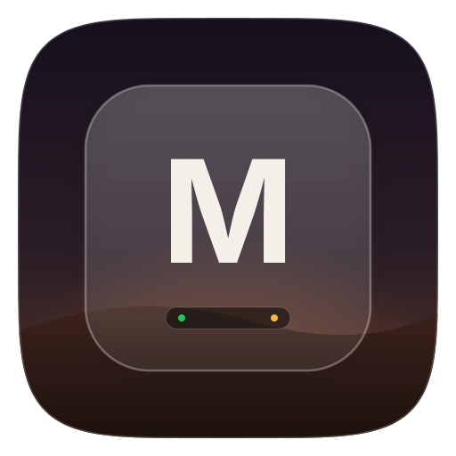
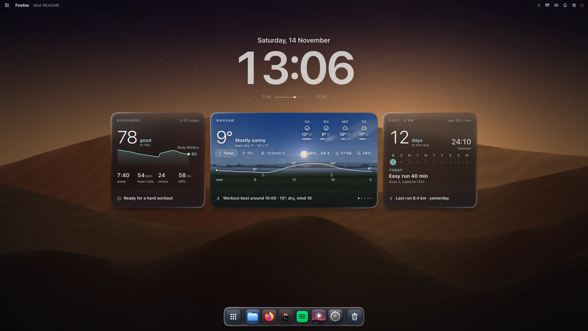
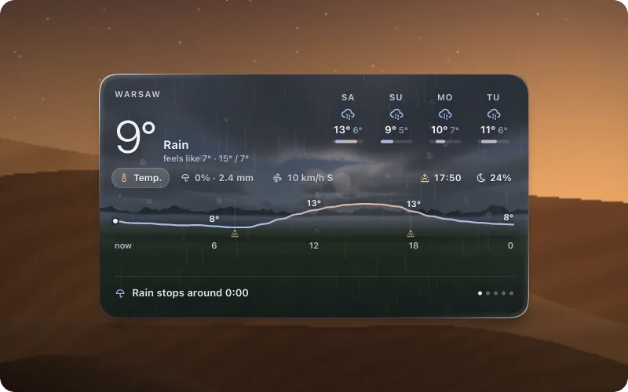
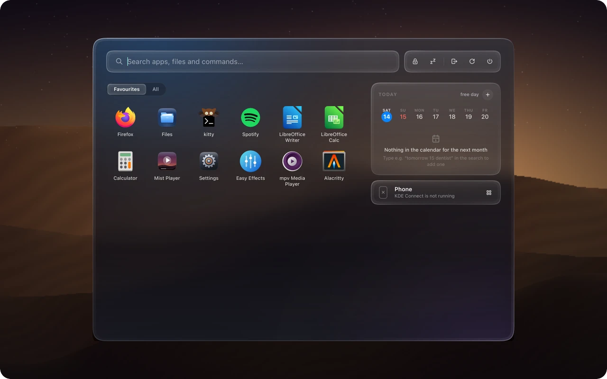
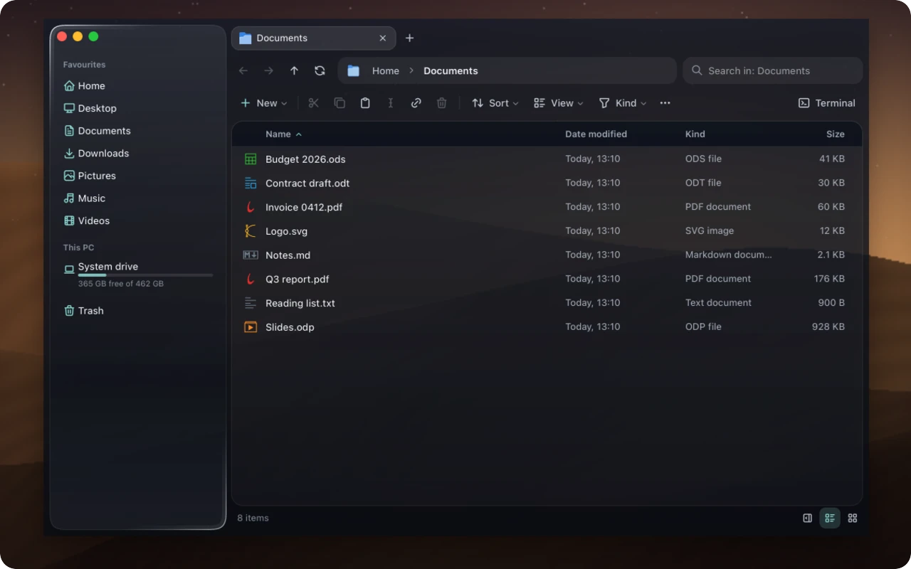
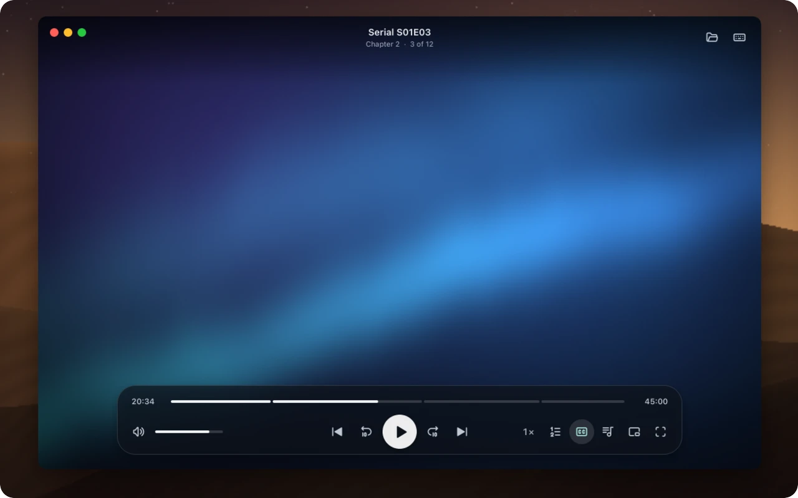
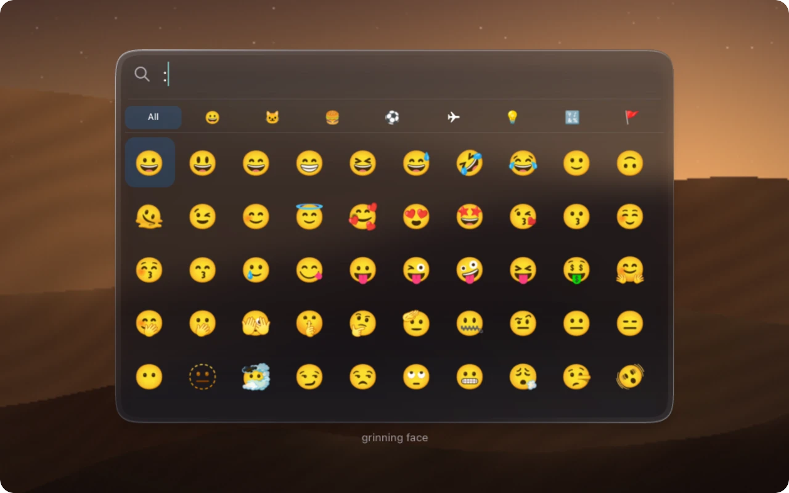
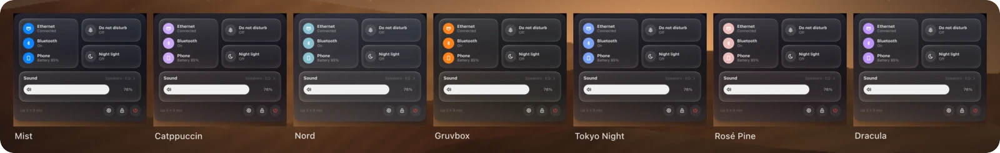

<div align="center">



# Mist

**Linux 用の Wayland デスクトップシェルとコンポジター。Rust で書かれ、CPU で描画します。**

[](../../.github/workflows/ci.yml)
[](https://github.com/wiktor-jozwiak/mist/releases)
[](https://github.com/wiktor-jozwiak/mist/stargazers)
[](../../LICENSE)
[](https://discord.gg/4rRabwQTPE)

[English](../../README.md) · [Polski](README.pl.md) · [Deutsch](README.de.md) ·
[Español](README.es.md) · [简体中文](README.zh-CN.md) · [日本語](README.ja.md)

<br>



<table>
  <tr>
    <td align="center" width="33%"><h3>44 MB</h3><sub>アイドル時のシェル全体のメモリ</sub></td>
    <td align="center" width="33%"><h3>0</h3><sub>シェルプロセス内の OpenGL コンテキスト</sub></td>
    <td align="center" width="33%"><h3>8 / s</h3><sub>アイドル時のウェイクアップ、ポーリングなし</sub></td>
  </tr>
</table>

**[ツアー](#ツアー) · [できること](#できること) · [軽い理由](#軽い理由) · [mist-comp](#mist-comp) ·
[インストール](#インストール) · [キー](#キーとスクリプト) · [開発](#開発)**

</div>

Mist はふたつのプログラムで、どちらも単独で使えます：

| | 何か | どこで動くか |
|---|---|---|
| **シェル**（`mist-ui`、`mist-wall`） | バー、Dock、Dynamic Island、デスクトップウィジェット、検索、コントロールセンター、通知、ロック画面、polkit エージェント、ファイルマネージャー、動画プレーヤーをひとつのプロセスで | Hyprland、mist-comp、またはいま使っているデスクトップ上の[ウィンドウ](#2-ウィンドウの中で試す) |
| **コンポジター**（[`mist-comp`](#mist-comp)） | Smithay ベースの Wayland コンポジター、専用のログイン画面つき | Hyprland と並ぶ独立したログインセッション |

見た目は意図して macOS を参考にしています。中身は Linux のデスクトップです。

> [!NOTE]
> Mist はひとりの日常のデスクトップです（Arch / CachyOS、デュアルモニター、NVIDIA）。完成したからではなく、
> 動くから公開しています。コードを読む覚悟をしてください。

## ツアー

<div align="center">


<sub>Dynamic Island：通知、音量、1 時間以内の雨、次の予定</sub>

<br><br>

<table>
  <tr>
    <td width="50%" align="center"><br><sub>天気と時刻に合わせて動くライブの空の上の天気カード</sub></td>
    <td width="50%" align="center"><br><sub>GLSL のライブ壁紙、写真、または現在の天気の空</sub></td>
  </tr>
  <tr>
    <td align="center"><br><sub>スタート：アプリ、ファイル、コマンド、今日の予定と電話</sub></td>
    <td align="center"><br><sub>Spotlight：アプリ、ファイル、コマンド、計算、単位、タイムゾーン、絵文字、ウェブ</sub></td>
  </tr>
  <tr>
    <td align="center"><br><sub>Mist Files、すべてのアプリのファイル選択ダイアログでもあります</sub></td>
    <td align="center"><br><sub>libmpv ベースの Mist Player：チャプター、トラック、ピクチャーインピクチャー</sub></td>
  </tr>
  <tr>
    <td align="center"><br><sub>設定：すべての項目がひとつのウィンドウに、すぐに反映</sub></td>
    <td align="center"><br><sub>コントロールセンター：ネットワーク、Bluetooth、電話、サウンド、夜間モード</sub></td>
  </tr>
  <tr>
    <td align="center"><br><sub>カレンダー：月表示、予定一覧、新しい予定</sub></td>
    <td align="center"><br><sub>検索とカテゴリ付きの絵文字ピッカー</sub></td>
  </tr>
</table>



<sub>Mist、Catppuccin、Nord、Gruvbox、Tokyo Night、Rosé Pine、Dracula、または自作の JSON ファイル。ガラス、ウィンドウ、アクセントはその場で切り替わります。</sub>

<br><br>

<table>
  <tr>
    <td align="center" width="33%"><br><b>Mist Files</b><br><sub>タブ、プレビュー、スマート検索、システムのファイル選択</sub></td>
    <td align="center" width="33%"><br><b>Mist Player</b><br><sub>libmpv、MPRIS、ピクチャーインピクチャー、安定したフレーム間隔</sub></td>
    <td align="center" width="33%"><br><b>設定</b><br><sub>ディスプレイ、サウンド、ネットワーク、デスクトップ、ウィジェット、言語</sub></td>
  </tr>
</table>

<br>

<a href="https://youtu.be/mwisDtz0Yd0"></a>

<sub>40 秒のデモ。ヘッドレスの <code>mist-comp</code> セッションでデモデータを使って録画。音楽：JonasBlakewood の <i>Trap Beat</i>（Pixabay） · <a href="https://github.com/user-attachments/assets/ed8137a5-daf5-488e-8515-686aa54e6e07">MP4</a></sub>

</div>

## できること

**シェル**

- **トップバー：** アクティブなアプリ、システムトレイ（StatusNotifierItem + dbusmenu）、ネットワーク、Bluetooth、
  サウンド、CPU とメモリ、時計。
- **Dock：** ピン留めと実行中のアプリ、拡大表示、ライブサムネイル付きのウィンドウ選択。
- **Dynamic Island：** イコライザー付きのメディア、タイマー、通話、通知、音量、Caps Lock、設定ファイルに
  誤りがあるときのお知らせ（行と列つき）。
- **パネル：** スタート、Spotlight、アプリスイッチャー、コントロールセンター、通知センター、カレンダー、
  クリップボード履歴、絵文字、セッションメニュー。検索欄は普通のテキスト欄と同じく、カーソル、矢印キー、
  Shift と Ctrl+A での選択が使えます。
- **スクリーンショット：** 止めた画面の上で範囲を選択、ツールバー、画面の文字認識（OCR）、カラーピッカー。
- **ウィンドウのスナップ**（Windows 11 風）：端や角へドラッグ、緑のボタンか `Super + Z` で Snap Layouts、Snap Assist。
- **ロック画面** は PAM で動き、時計のスタイル、ぼかし、暗さを設定できます。

**デスクトップ**

- **時計とガラスのカード：** 天気、Garmin のコンディション、ランニング、音楽、カレンダー、システム、世界時計、
  ToDo 付きメモ、一日の進み具合、太陽と月、フォトフレーム、デバイスのバッテリー。Garmin のカードは自分の
  Garmin Connect のデータをローカルの SQLite ファイルに同期して表示し、一度ログインするまでは表示されません
  （[ガイド](../guides/garmin.md)）。
- **天気** は [Open-Meteo](https://open-meteo.com) から、アカウント不要：1 時間ごとのグラフ、4 日間、次の 1 時間の雨、
  太陽と月の一日。カードの空は天気と指した時刻に合わせてライブで描かれ、5 つの風景（畑、湖、山、街、海）の
  どれかの上に広がります。
- **壁紙：** 写真、ライブの GLSL シーン、または今の天気の空。
- **テーマ：** Mist、Catppuccin、Nord、Gruvbox、Tokyo Night、Rosé Pine、Dracula、または自分の JSON ファイル。
  ガラス、ウィンドウ、アクセントはシェルと Files、Player、設定でその場で切り替わります。

**置き換えるもの**

- **デーモン：** 通知サーバー、polkit エージェント、ロック画面、アイドルとスリープ。
- **アプリ：** Mist Files、Mist Player、設定（ディスプレイ、サウンド、Bluetooth、ネットワーク、電源、アプリ、
  壁紙、デスクトップとウィジェット、ロック画面、通知、言語）。
- **電話**（KDE Connect 経由）：バッテリー、通知、パネルでの SMS と連絡先、アイランドでの着信（着信は ADB を
  予備として使えます）。

UI は**英語、ポーランド語、ドイツ語、スペイン語、フランス語**に対応し、`$LANG` か設定での選択に従います。
言語は [native/assets/i18n](../../native/assets/i18n) の JSON ファイルひとつです。

## 軽い理由

Mist ははじめ、アイドル時に 428 MB と CPU 9.5 % を使う Quickshell の設定でした。そこから次の三つの原則で、
画面ごとに書き直されました。

- **CPU で描く。** `mist-ui` は [tiny-skia] と [swash] で `wl_shm` バッファに描き、変わった部分だけを再描画
  します。NVIDIA では OpenGL コンテキストひとつが最初のピクセルの前に 100〜160 MB を使いますが、`mist-ui` は
  ひとつも持ちません。
- **イベントを待つ。** 状態はコンポジターのソケット、D-Bus、`pactl subscribe`、inotify から届き、隠れた画面は
  何もしません。アイドル時のシェルの起床は毎秒 8 回です。
- **GPU プロセスはひとつだけ、何かを表示している間だけ。** `mist-wall` が動く壁紙、天気カードの空、壁紙
  ギャラリーを描きます。写真の壁紙でそのどれもないときは終了し、写真は `mist-ui` が描きます。

<p align="center"></p>

<details>
<summary><b>数値</b>：同じ方法で測ったシェルとコンポジター</summary>

<br>

**シェル。** それぞれを単独で、GPU 上の新しいヘッドレス sway（RTX 4060、1080p 出力 2 つ）で、パッケージ付属の
設定のまま実行。3 回の中央値（[bench/shells.sh](../../bench/shells.sh)）。*アイドル*：1 分間何も起きない。
*アクティブ*：2 秒ごとにワークスペース切り替え、6 秒ごとに新しいウィンドウ、10 秒ごとに通知。CPU は 1 コアに
対する % です。

| シェル | 描画するもの | メモリ (PSS) | GPU メモリ | CPU アイドル | CPU アクティブ |
|---|---|---|---|---|---|
| swaybar (sway 1.12) | バー | 6 MB | – | 0 % | 0.03 % |
| Waybar 0.15 | バー | 34 MB | – | 0.03 % | 0.38 % |
| **Mist、写真の壁紙** | バー、Dock、アイランド、デスクトップウィジェット、通知、壁紙 | **44 MB** | – | 0.14 % | 0.66 % |
| nwg-panel 0.12 | バー | 59 MB | – | 0.09 % | 0.23 % |
| **Mist、動く壁紙** | 上記すべて、壁紙は動く GLSL シーン | 144 MB | 50 MiB | 0.79 % | 1.34 % |
| Ironbar 0.19 | バー | 158 MB | 9 MiB | 0.35 % | 0.42 % |
| Quickshell 0.3、空の `PanelWindow` ひとつ | 空のバー | 161 MB | 6 MiB | 0 % | 0 % |
| Noctalia 5.4 | バー、写真の壁紙（と初回起動ダイアログ） | 192 MB | 60 MiB | 0.10 % | 4.01 % |

**コンポジター。** 同じ GPU 上でヘッドレス、1920×1080 60 Hz、5 回
（[bench/compositors.sh](../../bench/compositors.sh)）。画面に何もないときはどれも CPU 0 % です。

| コンポジター | メモリ (PSS) | CPU、毎フレーム CPU で描くクライアント | CPU、全画面の OpenGL クライアント | OpenGL 1 フレームあたりの CPU |
|---|---|---|---|---|
| **mist-comp** | 128 MB | **2.2 %** | 1.5 % | 0.25 ms |
| weston 15 | 129 MB | 3.3 % | **0.8 %** | **0.13 ms** |
| labwc 0.20 | 137 MB | 8.1 % | 8.9 % | 1.5 ms |
| sway 1.12 | 129 MB | 33.6 % | 8.3 % | 1.4 ms |

Hyprland と niri にはスクリプトから起動できるヘッドレスモードがないため、表にありません。方法、各回の結果、
起床回数、プロセスごとの数値、以前の実セッションでの計測は [docs/BENCHMARKS.md](../BENCHMARKS.md) にあります。

</details>

## mist-comp

Mist 独自の Wayland コンポジターで、[Smithay] の上に書かれた約 14 000 行の Rust、ログイン画面付きです。同じ
シェルを動かし、`hyprctl` と Mist のスクリプトがそのまま動くだけの Hyprland IPC に応答します。実験的ですが、
Hyprland と並ぶ作者の日常のセッションです。

- **ウィンドウ：** Mist のタイトルバーまたはアプリ自身のもの、角丸と影、半透明のウィンドウやパネルの下の
  ガラスぼかし、Overview（`Super + O`）、拡大鏡、指に追従するワークスペース切り替え、Win + D でデスクトップ
  表示。
- **省ける仕事はしない：** モニターは、その上で何かが変わったときだけ再描画します。ガラスは、背後のものが
  動いたときだけぼかし直します。他のウィンドウに隠れたウィンドウには、毎秒 60 フレームではなく 1 フレーム
  だけ送ります。
- **セッション：** logind 経由の DRM / KMS、ホットプラグ、VRR、explicit sync、XWayland、ポータル経由の画面共有、
  約 45 のプロトコル。クラッシュ後はウィンドウが元のワークスペースに戻ります。`mist-session restart` は
  ログアウトせずに新しいビルドを読み込みます。
- **テスト：** ヘッドレスバックエンド上のネストしたテスト 66 件を、CI でソフトウェアレンダラーを使って実行。

未対応：タイル型配置、ティアリング制御、NVIDIA での検証済みダイレクトスキャンアウト。設定は
[docs/CONFIG.md](../CONFIG.md#compconf-outputs-mist-comp-only)。`mist-comp migrate` で Hyprland の設定を変換できます。

## インストール

### 1. 入手する

Arch：[packaging/arch/PKGBUILD](../../packaging/arch/PKGBUILD) が `mist-shell-git` をビルドします。

```bash
git clone https://github.com/wiktor-jozwiak/mist && cd mist/packaging/arch && makepkg -si
```

それ以外の環境ではクローンから。最初のスクリプトが `mistd`（バックエンド）をビルドし、次のスクリプトが
`mist-ui-bin`、`mist-wall-bin`、`mist-comp`、`mist-try` を `~/.local/bin` に置きます：

```bash
git clone https://github.com/wiktor-jozwiak/mist ~/src/mist
```

```bash
~/src/mist/scripts/mistd/install.sh && ~/src/mist/native/install.sh
```

ビルド済みバイナリは各[リリース](https://github.com/wiktor-jozwiak/mist/releases)に添付されています。

<details>
<summary>依存関係</summary>

<br>

**ビルド：** `rust`、`pkgconf`、`libxkbcommon`、`pam`、`wayland`、`mesa`。`mist-comp` にはさらに `libinput`、
`libseat`、`libdrm`、`systemd-libs`。

**実行時：** `pipewire-pulse`、`wireplumber`、`networkmanager`、`wl-clipboard`、`grim`、`slurp`、`polkit`、
`noto-fonts`、`noto-fonts-emoji`。任意：`ddcutil`（モニターの明るさ）、`kdeconnect` または `android-tools`
（電話）。それぞれが有効にする機能：[docs/CONFIG.md](../CONFIG.md#optional-integrations)。

**フォント：** UI は SF Pro を前提に描かれていますが、Mist には同梱できません。ない場合は Inter、次に
Noto Sans を使います。

</details>

### 2. ウィンドウの中で試す

```bash
mist-try
```

デスクトップ全体（コンポジター、バー、Dock、アイランド、ウィジェット）が、Hyprland、Sway、GNOME、KDE の上の
ひとつのウィンドウで動きます。専用のランタイムディレクトリと D-Bus セッションバスを持つので、いまの通知、
トレイ、polkit エージェントはそのままです。ウィンドウを閉じれば何も残りません。オプション：
`MIST_TRY_SIZE=1600x1000`、`MIST_TRY_KEYBOARD=de`、`MIST_THEME=nord`。

### 3. 自分のデスクトップにする

- **Hyprland の場合：** 自分の設定から [examples/hyprland/mist.lua](../../examples/hyprland/mist.lua) を読み込み、
  他のバー、通知デーモン、polkit エージェントを外します。
- **mist-comp の場合：** `native/mist-comp/session/install-session.sh --greeter` がログイン画面に Mist の
  セッションを追加します。Hyprland はそのまま残ります。

## キーとスクリプト

| キー | 動作 | | キー | 動作 |
|---|---|---|---|---|
| `Super` | スタート | | `Super + A` | 通知センター |
| `Super + Space` | Spotlight | | `Super + V` | クリップボード履歴 |
| `Super + Tab` | アプリ切り替え | | `Super + .` | 絵文字 |
| `Super + I` | コントロールセンター | | `Super + L` | ロック |
| `Super + Shift + S` | スクリーンショット | | デスクトップを右クリック | 設定 |

すべてスクリプトから操作できます：`mist-ui-bin msg mist toggle spotlight`、`mist-ui-bin msg ui stats`。設定は
`~/.config/mist/` にあり、各ファイルは [docs/CONFIG.md](../CONFIG.md) で説明されています。ログは
`~/.cache/mist/ui.log` です。

## 開発

```bash
cd native && cargo build --release && cargo test --release
```

どの画面もオフスクリーンで描画できるので、動いているセッションに触れずに変更を確認できます：
`mist-ui-bin --pane-png spotlight 1920 1080 out.png`、`mist-ui-bin --desk-png dir`、
`mist-wall-bin --png out.ppm dunes 1920 1080`。`native/mist-comp/tests/run-all.sh` はコンポジターのテストを
ネストしたウィンドウで実行します。詳しくは [native/README.md](../../native/README.md) と
[CONTRIBUTING.md](../../CONTRIBUTING.md) へ。

このページの画像は同じオフスクリーン描画から、デモデータで作られています：`docs/img/hero.sh`、`docs/img/panels.sh`、`docs/img/gifs.sh`。

| パス | 内容 |
|---|---|
| `native/mist-ui` | シェルのすべての画面 |
| `native/mist-wall` | GPU の壁紙プロセス |
| `native/mist-comp` | コンポジター、セッション、ログイン画面 |
| `scripts/mistd` | バックエンド：システム情報、電話、通話、クリップボード、Garmin 同期 |
| `shaders/` | 壁紙と空のシェーダー |
| `bench/` | ベンチマークのツールと結果 |
| タグ `legacy-qml` | 最初の Quickshell 版 |

## スター履歴

<a href="https://star-history.com/#wiktor-jozwiak/mist&Date">
  <picture>
    <source media="(prefers-color-scheme: dark)" srcset="https://api.star-history.com/svg?repos=wiktor-jozwiak/mist&type=Date&theme=dark">
    <source media="(prefers-color-scheme: light)" srcset="https://api.star-history.com/svg?repos=wiktor-jozwiak/mist&type=Date">
    
  </picture>
</a>

## クレジット

[Smithay]、[smithay-client-toolkit]、[tiny-skia]、[swash]、[resvg]、[zbus]、[Tabler Icons] の上に作られています。
最初のバージョンは [Quickshell] 上で動き、[Noctalia] を参考にしました。
AI コーディングアシスタントが開発を手伝っています。

<sub>Mist は Apple とは無関係です。macOS、Dynamic Island、Spotlight、SF Pro は Apple Inc. の商標であり、デザインの
着想元を説明するためにのみ言及しています。</sub>

[GPL-3.0](../../LICENSE)

[tiny-skia]: https://github.com/linebender/tiny-skia
[swash]: https://github.com/dfrg/swash
[resvg]: https://github.com/linebender/resvg
[zbus]: https://github.com/dbus2/zbus
[Smithay]: https://github.com/Smithay/smithay
[smithay-client-toolkit]: https://github.com/Smithay/client-toolkit
[Tabler Icons]: https://tabler.io/icons
[Quickshell]: https://quickshell.org
[Noctalia]: https://github.com/noctalia-dev/noctalia
