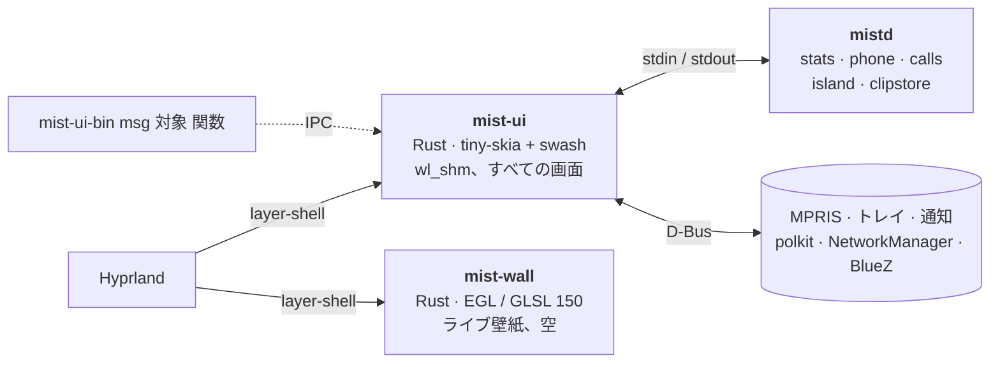

<div align="center">


**macOS に着想を得た Hyprland 用デスクトップシェル。Rust で書かれ、CPU で描画します。**

バー、Dock、Dynamic Island、デスクトップウィジェット、Spotlight 風の検索、コントロールセンター、通知、
ロック画面、polkit エージェントを、GPU コンテキストなしの約 50 MB の 1 プロセスで。

[](../../LICENSE)
[](../../native)
[](https://hyprland.org)
[](../../.github/workflows/ci.yml)

[機能](#機能) · [計測](#計測) · [インストール](#インストール) · [使い方](#使い方) · [開発](#開発)

[English](../../README.md) · [Polski](README.pl.md) · [Deutsch](README.de.md) ·
[Español](README.es.md) · [简体中文](README.zh-CN.md) · [日本語](README.ja.md)

<br>


<table>
  <tr>
    <td width="50%"></td>
    <td width="50%"></td>
  </tr>
  <tr>
    <td align="center"><sub><b>Dynamic Island</b>: 通知、音量、直近の雨、次の予定</sub></td>
    <td align="center"><sub><b>天気カード</b>: リアルタイムの GLSL の空に重ねた Open-Meteo のデータ</sub></td>
  </tr>
</table>

<sub><code>docs/demo</code> のデモデータによるオフスクリーン描画で、
<a href="../img/hero.sh">hero.sh</a>、<a href="../img/gifs.sh">gifs.sh</a>、
<a href="../img/panels.sh">panels.sh</a> で再生成できます。実際のセッションでは Hyprland がガラスの下をぼかします。</sub>

</div>

<br>

<table>
  <tr>
    <td align="center" width="33%"><h3>~50 MB</h3><sub>シェルのすべての画面を 1 プロセスで<br><code>mist-ui</code>、アイドル時の PSS</sub></td>
    <td align="center" width="33%"><h3>GL コンテキスト 0</h3><sub>CPU で描く <code>wl_shm</code> バッファ。<br>GPU はライブ壁紙だけ</sub></td>
    <td align="center" width="33%"><h3>アイドル時タイマー 0</h3><sub>Hyprland ソケット、D-Bus、inotify。<br>隠れた画面は何もしない</sub></td>
  </tr>
</table>

## なぜ

Hyprland 用シェルの多くは Qt Quick（Quickshell）、GTK + GJS（AGS）、WebView の上で動きます。どれも OpenGL
コンテキストを開き、NVIDIA では GL コンテキストごとにドライバがマップされます。最初のピクセルの前に
**1 プロセスあたり約 100〜160 MB** です。Mist は Quickshell の設定（428 MB、CPU 9.5 %）として始まり、
画面ごとに書き直されました。

- 🖌️ **CPU で描画。** `mist-ui` は [tiny-skia] と [swash] で `wl_shm` バッファに描き、Hyprland が合成してぼかします。
  描き直すのは変化した領域だけです。
- ⚡ **イベント駆動。** データは Hyprland ソケット、D-Bus、`pactl subscribe`、inotify、常駐する `mistd`
  バックエンドから届きます。画面が止まっている間はタイマーで何も問い合わせず、隠れた画面は何もしません。
- 🎨 **GPU プロセスは 1 つ、必要なときだけ。** `mist-wall`（EGL、GLSL 150）がアニメーション壁紙と天気の空を描きます。
  写真の壁紙では終了し、写真は `mist-ui` が描きます。モニターがオフのときやロック中は一時停止し、
  ソフトウェア GL では半分の解像度で描きます。

<p align="center"></p>

## 計測

<p align="center"></p>

アイドル、シェル全体、PSS（共有ページはプロセス間で按分）、Ryzen 7 5700X + RTX 4060（ドライバ 615.71）、
Hyprland 0.56.2、2 × 1920x1080 (165 + 75 Hz)。[bench/measure.sh](../../bench/measure.sh) で計測。

| シェル | ツールキット | PSS | アイドル CPU | GL コンテキスト |
|---|---|---|---|---|
| **Mist ネイティブ** | Rust、CPU、`wl_shm` | **87〜106 MB** | 0.6 %（音楽再生中） | `mist-wall` のみ |
| Mist ネイティブ、`mist-ui` 単体 | | 36〜50 MB | 0.6 % | なし |
| Noctalia v5 | C++、cairo + EGL | 122 MB | 0.07 % | あり |
| 空の Quickshell（`PanelWindow` 1 つ） | Qt Quick | 124 MB | ~0 % | あり |
| Quickshell 上の Mist（旧 QML 版） | Qt Quick + QML | 428 MB | 9.5 % | あり |

他の人が報告した数値（RSS、別のマシン、1:1 では比較できません）: Waybar 50〜66 MB
（[Waybar#5186](https://github.com/Alexays/waybar/issues/5186)）、Caelestia 再起動後 ~650 MB
（[caelestia-dots/shell#1927](https://github.com/caelestia-dots/shell/issues/1927)）。方法、生データ、注意点:
[docs/BENCHMARKS.md](../BENCHMARKS.md)。

## 機能

<table>
  <tr>
    <td width="50%"></td>
    <td width="50%"></td>
  </tr>
  <tr>
    <td align="center"><sub><b>Spotlight</b>: アプリ、ファイル、コマンド、絵文字、Web</sub></td>
    <td align="center"><sub><b>カレンダー</b>: 月表示、予定一覧、新しい予定</sub></td>
  </tr>
  <tr>
    <td width="50%"></td>
    <td width="50%"></td>
  </tr>
  <tr>
    <td align="center"><sub><b>コントロールセンター</b>: ネットワーク、Bluetooth、電話、サウンド、夜間モード</sub></td>
    <td align="center"><sub><b>絵文字</b>: <code>Super + .</code></sub></td>
  </tr>
</table>

| | |
|---|---|
| 🔝 **トップバー** | アクティブなアプリとタイトル、システムトレイ（StatusNotifierItem ホスト + dbusmenu）、ネットワーク、Bluetooth、オーディオ、CPU / メモリ表示、時計、カレンダー |
| 🚀 **Dock** | ピン留めと実行中のアプリ、拡大表示、ライブサムネイル付きのウィンドウ選択（`hyprland_toplevel_export_v1`）、アクティブなアプリのクリックで最小化 |
| 🏝️ **Dynamic Island** | イコライザー付きのメディア（MPRIS）、タイマー、着信（KDE Connect / ADB）、通知、音量 |
| 🖼️ **デスクトップ** | 時計、日の出 / 日の入り、ガラスのカード（天気、Garmin のコンディション、ランニング計画）、カードごとの設定 |
| 🔍 **パネル** | Spotlight 風の検索、スタート、Cmd+Tab スイッチャー、コントロールセンター（ページ切替）、通知センター、クリップボード履歴、絵文字、セッションメニュー、壁紙ギャラリー、スクリーンショットツールバー |
| 🛡️ **システム** | 通知サーバー、polkit エージェント、ロック画面（`ext-session-lock-v1` + PAM）、アイドル（`ext-idle-notify-v1`、logind）、Windows 11 風のウィンドウスナップ |
| 🌄 **壁紙** | 写真（CPU）、または GLSL のライブシーンとリアルタイムの天気の空（`mist-wall`） |
| 🧪 **mist-comp** *（実験的）* | Smithay ベースの独自コンポジター + グリーター。Hyprland なしで Mist を動かすため |

### デスクトップのカード

- **天気**: [Open-Meteo](https://open-meteo.com)、アカウント不要。時間ごとのグラフ、4 日間、直近の雨、
  ランニングに良い時間帯、服装のヒント、太陽と月。カードの背後のライブの空は現在の天気に合わせて変わります。
- **Garmin のコンディション** と **ランニング**: ローカルの InfluxDB 経由で自分の Garmin Connect のデータを表示。
  任意: `influx.json` がなければこれらのカードは表示されません。設定: [docs/guides/garmin.md](../guides/garmin.md)。

### 言語とモニター

UI は **ポーランド語、英語、ドイツ語、スペイン語** に対応しています。*デスクトップをカスタマイズ*（デスクトップの
時計を右クリック）→ 外観 → 言語、または `MIST_LANG=en` で選びます。*自動* は `$LANG` に従い、なければ英語です。
翻訳は 1 つの表 [native/assets/i18n.tsv](../../native/assets/i18n.tsv) にあり、1 行が 1 つの文字列、1 列が 1 言語です。
新しい言語は列を 1 つ足すだけです。

Dock、Island、デスクトップ、天気の空は Hyprland の最初のモニターに表示されます。別のモニターにするには
`~/.config/mist/settings.json` に `"primary": "DP-3"`、または `MIST_PRIMARY=DP-3`。天気の場所:
*デスクトップをカスタマイズ* → 一般。すべてのファイルと変数: [docs/CONFIG.md](../CONFIG.md)。

## アーキテクチャ



| パス | 内容 |
|---|---|
| `native/mist-ui` | シェルのすべての画面（[native/README.md](../../native/README.md)） |
| `native/mist-wall` | GPU の壁紙プロセス |
| `native/mist-comp` | 実験的な Smithay コンポジター、セッション、グリーター |
| `native/common` | mist-ui と mist-wall の共通コード（天文計算、プリセット） |
| `scripts/mistd` | バックエンド: システム情報、電話（KDE Connect、ADB）、着信、クリップボード保存、ファイルマネージャーの D-Bus |
| `shaders/` | 壁紙と空のシェーダー（`.frag` ソース、mist-wall が読む `shaders/glsl` の GLSL 150） |
| タグ `legacy-qml` | 元の Quickshell（QML）版。参考として保存 |

## インストール

> [!NOTE]
> Mist は 1 人の日常環境です。対象は Arch / CachyOS、Lua 設定の Hyprland 0.55+、NVIDIA または Mesa の GPU です。
> コードを読むつもりでどうぞ。

**Arch（AUR 風パッケージ）:** [packaging/arch/PKGBUILD](../../packaging/arch/PKGBUILD) が `mist-shell-git` を
ビルドします（プログラムは `/usr/bin`、ファイルは `/usr/share/mist`）。

```bash
git clone https://github.com/wiktor-jozwiak/mist && cd mist/packaging/arch && makepkg -si
```

**チェックアウトから**（どこでも可。`native/install.sh` が `~/.local/share/mist/shell` をそこへリンクします）:

```bash
git clone https://github.com/wiktor-jozwiak/mist ~/src/mist
```

```bash
~/src/mist/scripts/mistd/install.sh && ~/src/mist/native/install.sh
```

`native/install.sh` は `mist-ui-bin`、`mist-wall-bin`、`mist-comp`、初回にはガードの `mist-ui` を
`~/.local/bin` にインストールします。タグ付きリリースにはビルド済みのプログラムもあります。

次に [examples/hyprland/mist.lua](../../examples/hyprland/mist.lua) を Hyprland の設定に加え（自動起動、
キーバインド、ぼかしのルール）、他のバー、通知デーモン、polkit エージェントを外してください。

<details>
<summary><b>依存関係</b></summary>

<br>

**ビルド:** `rust`（stable）、`pkgconf`、`libxkbcommon`、`pam`、`wayland`、`mesa`（EGL ヘッダー）。
`mist-comp` にはさらに `libinput`、`libseat`、`libdrm`、`mesa`（gbm）、`systemd-libs`（udev）。

**実行:** `hyprland`、`pipewire` + `pipewire-pulse`（`pactl`、`pw-play`、`parec`）、`wireplumber`（`wpctl`）、
`networkmanager`（`nmcli`）、`wl-clipboard`、`grim`、`slurp`、`polkit`、`noto-fonts`、`noto-fonts-emoji`。
任意: `ddcutil`（DDC/CI での明るさ調整）、`kdeconnect` / `android-tools`（電話）、`wf-recorder`
（`scripts/demo-reel.sh` のみ）。それぞれで有効になるもの: [docs/CONFIG.md](../CONFIG.md#optional-integrations)。

**フォント:** UI は SF Pro（可変フォント `SF-Pro.ttf` を `~/.local/share/fonts/SF-Pro/` に）向けにデザインされています。
Apple は自社プラットフォームでの利用しか認めていないため、Mist には同梱していません。ない場合は
Inter Variable、次に Noto Sans を使います。

</details>

## 使い方

| キー | 動作 | | キー | 動作 |
|---|---|---|---|---|
| `Super` | スタート | | `Super + A` | 通知センター |
| `Super + Space` | Spotlight | | `Super + V` | クリップボード履歴 |
| `Super + Tab` | アプリ切り替え | | `Super + .` | 絵文字 |
| `Super + I` | コントロールセンター | | `Super + L` | ロック |
| `Print`、`Super + Shift + S` | スクリーンショット（範囲） | | | |

すべてスクリプトから操作できます: `mist-ui-bin msg mist toggle spotlight`、`mist-ui-bin msg ui stats`、
`mist-ui-bin msg dock click firefox`。ログ: `~/.cache/mist/ui.log`。設定: `~/.config/mist/`、詳細は
[docs/CONFIG.md](../CONFIG.md)。

## 開発

```bash
cd native && cargo build --release && cargo test --release
```

<details>
<summary><b>動作中のセッションに触れずに確認する</b></summary>

<br>

| コマンド | 出力 |
|---|---|
| `mist-ui --png out.png '{"app":"Firefox"}'` | トップバーの PNG |
| `mist-ui-bin --desk-png dir` / `--dock-png out.png` | デスクトップのステージ + カード（+ `layout.json`）/ Dock |
| `mist-ui-bin --pane-png spotlight 1920 1080 out.png fi` | アニメーション後のパネル |
| `mist-ui-bin --island-frames notif out 30 20` | Island のデモを 1 フレームずつ |
| `mist-ui --test` | HDMI-A-1 の本物のバーの上に 2 本目のバー |
| `mist-wall-bin --png out.ppm dunes 1920 1080` | ライブ壁紙の 1 フレーム（`MIST_WALL_BENCH=N`: 1 フレームの ms） |
| `mist-ui-bin msg ui stats` | 画面ごとの起床回数、描画回数、描画時間 |
| `bench/measure.sh 30 mist-ui-bin mist-wall-bin mistd` | 動作中シェルのアイドル時 PSS / CPU |

</details>

`lto = false` のままにしてください（Arch の rustc とシステムの LLVM は LTO でクラッシュします）。
[CONTRIBUTING.md](../../CONTRIBUTING.md) も参照。

## 状況

1 人の日常環境、モニター 2 台、NVIDIA。上の表はすべてネイティブで毎日使っています。`mist-comp` は実験的です。
公開リリースまでに残っていること: [docs/PUBLISHING.md](../PUBLISHING.md)。

## クレジット

[Hyprland]、[Smithay] と [smithay-client-toolkit]、[tiny-skia]、[swash]、[resvg]、[zbus]、[Tabler Icons]（MIT）。
元の QML 版は [Quickshell] で作られ、[Noctalia] を予備と手本にしました。

<sub><i>Mist は Apple とは関係ありません。macOS、Dynamic Island、Spotlight、SF Pro は Apple Inc. の商標で、
ここではデザインの着想を説明するためにだけ挙げています。</i></sub>

## ライセンス

[GPL-3.0](../../LICENSE)。

[tiny-skia]: https://github.com/linebender/tiny-skia
[swash]: https://github.com/dfrg/swash
[resvg]: https://github.com/linebender/resvg
[zbus]: https://github.com/dbus2/zbus
[Hyprland]: https://hyprland.org
[Smithay]: https://github.com/Smithay/smithay
[smithay-client-toolkit]: https://github.com/Smithay/client-toolkit
[Tabler Icons]: https://tabler.io/icons
[Quickshell]: https://quickshell.org
[Noctalia]: https://github.com/noctalia-dev/noctalia
