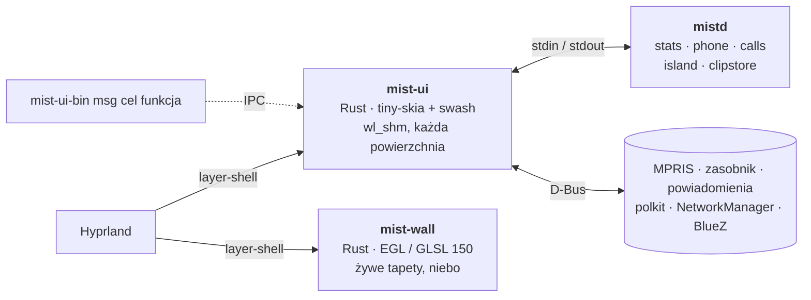

<div align="center">


**Powłoka pulpitu dla Hyprlanda inspirowana macOS, napisana w Rust i rysowana na CPU.**

Pasek, dock, Dynamic Island, widżety pulpitu, wyszukiwarka w stylu Spotlight, centrum sterowania,
powiadomienia, ekran blokady i agent polkit w jednym procesie ~50 MB, bez kontekstu GPU.

[](../../LICENSE)
[](../../native)
[](https://hyprland.org)
[](../../.github/workflows/ci.yml)

[Funkcje](#funkcje) · [Pomiary](#pomiary) · [Instalacja](#instalacja) · [Użycie](#użycie) · [Rozwój](#rozwój)

[English](../../README.md) · [Polski](README.pl.md) · [Deutsch](README.de.md) ·
[Español](README.es.md) · [简体中文](README.zh-CN.md) · [日本語](README.ja.md)

<br>


<table>
  <tr>
    <td width="50%"></td>
    <td width="50%"></td>
  </tr>
  <tr>
    <td align="center"><sub><b>Dynamic Island</b>: powiadomienia, głośność, deszcz za chwilę, następne wydarzenie</sub></td>
    <td align="center"><sub><b>Karta pogody</b>: dane Open-Meteo nad niebem GLSL w czasie rzeczywistym</sub></td>
  </tr>
</table>

<sub>Rendery poza ekranem z danymi demo z <code>docs/demo</code>, odtwarzane przez
<a href="../img/hero.sh">hero.sh</a>, <a href="../img/gifs.sh">gifs.sh</a> i
<a href="../img/panels.sh">panels.sh</a>. W prawdziwej sesji Hyprland rozmywa tło pod szkłem.</sub>

</div>

<br>

<table>
  <tr>
    <td align="center" width="33%"><h3>~50 MB</h3><sub>wszystkie powierzchnie powłoki w jednym procesie<br><code>mist-ui</code>, PSS w spoczynku</sub></td>
    <td align="center" width="33%"><h3>0 kontekstów GL</h3><sub>bufory <code>wl_shm</code> rysowane na CPU;<br>GPU tylko dla żywych tapet</sub></td>
    <td align="center" width="33%"><h3>0 timerów w spoczynku</h3><sub>socket Hyprlanda, D-Bus, inotify:<br>ukryte powierzchnie nic nie robią</sub></td>
  </tr>
</table>

## Dlaczego

Większość powłok dla Hyprlanda działa na Qt Quick (Quickshell), GTK + GJS (AGS) albo WebView. Każda otwiera
kontekst OpenGL, a na NVIDII każdy kontekst GL mapuje sterownik: około **100–160 MB na proces**, zanim
pojawi się pierwszy piksel. Mist zaczynał jako konfiguracja Quickshella (428 MB, 9,5 % CPU) i został
przepisany powierzchnia po powierzchni:

- 🖌️ **Powierzchnie rysowane na CPU.** `mist-ui` maluje do buforów `wl_shm` za pomocą [tiny-skia] i [swash];
  Hyprland je składa i rozmywa. Przerysowywane są tylko zmienione obszary.
- ⚡ **Sterowane zdarzeniami.** Dane płyną z socketu Hyprlanda, D-Bus, `pactl subscribe`, inotify i stale
  działających backendów `mistd`. Gdy ekran stoi, nic nie odpytuje na timerze; ukryte powierzchnie nic nie robią.
- 🎨 **Jeden proces GPU, tylko gdy trzeba.** `mist-wall` (EGL, GLSL 150) rysuje animowane tapety i niebo
  pogody. Przy tapecie ze zdjęcia kończy działanie, a zdjęcie rysuje `mist-ui`. Pauzuje, gdy monitory są
  wyłączone albo sesja zablokowana, a na programowym GL schodzi do połowy rozdzielczości.

<p align="center"></p>

## Pomiary

<p align="center"></p>

Spoczynek, cała powłoka, PSS (strony współdzielone dzielone między procesy), Ryzen 7 5700X + RTX 4060
(sterownik 615.71), Hyprland 0.56.2, 2560x1440 + 1920x1080. Zmierzone przez [bench/measure.sh](../../bench/measure.sh).

| Powłoka | Toolkit | PSS | CPU w spoczynku | Kontekst GL |
|---|---|---|---|---|
| **Mist natywny** | Rust, CPU, `wl_shm` | **87–106 MB** | 0,6 % (gra muzyka) | tylko `mist-wall` |
| Mist natywny, samo `mist-ui` | | 36–50 MB | 0,6 % | nie |
| Noctalia v5 | C++, cairo + EGL | 122 MB | 0,07 % | tak |
| Pusty Quickshell (jeden `PanelWindow`) | Qt Quick | 124 MB | ~0 % | tak |
| Mist na Quickshellu (stara wersja QML) | Qt Quick + QML | 428 MB | 9,5 % | tak |

Liczby podawane przez innych (RSS, inne maszyny, nieporównywalne 1:1): Waybar 50–66 MB
([Waybar#5186](https://github.com/Alexays/waybar/issues/5186)), Caelestia ~650 MB po restarcie
([caelestia-dots/shell#1927](https://github.com/caelestia-dots/shell/issues/1927)). Metoda, surowe wyniki i
zastrzeżenia: [docs/BENCHMARKS.md](../BENCHMARKS.md).

## Funkcje

<table>
  <tr>
    <td width="50%"></td>
    <td width="50%"></td>
  </tr>
  <tr>
    <td align="center"><sub><b>Spotlight</b>: aplikacje, pliki, polecenia, emoji, sieć</sub></td>
    <td align="center"><sub><b>Kalendarz</b>: miesiąc, plan dnia, nowe wydarzenia</sub></td>
  </tr>
  <tr>
    <td width="50%"></td>
    <td width="50%"></td>
  </tr>
  <tr>
    <td align="center"><sub><b>Centrum sterowania</b>: sieć, Bluetooth, telefon, dźwięk, światło nocne</sub></td>
    <td align="center"><sub><b>Emoji</b>: <code>Super + .</code></sub></td>
  </tr>
</table>

| | |
|---|---|
| 🔝 **Górny pasek** | aktywna aplikacja i tytuł, zasobnik systemowy (host StatusNotifierItem + dbusmenu), sieć, Bluetooth, dźwięk, wskaźniki CPU / pamięci, zegar, kalendarz |
| 🚀 **Dock** | przypięte i uruchomione aplikacje, powiększanie, wybór okna z podglądami na żywo (`hyprland_toplevel_export_v1`), klik na aktywną aplikację ją minimalizuje |
| 🏝️ **Dynamic Island** | multimedia (MPRIS) z equalizerem, minutniki, połączenia (KDE Connect / ADB), powiadomienia, głośność |
| 🖼️ **Pulpit** | zegar, wschód / zachód słońca, szklane karty (pogoda, gotowość Garmin, plan biegowy), ustawienia każdej karty |
| 🔍 **Panele** | wyszukiwarka w stylu Spotlight, Start, przełącznik Cmd+Tab, centrum sterowania (strony), centrum powiadomień, historia schowka, emoji, menu sesji, galeria tapet, pasek zrzutów ekranu |
| 🛡️ **System** | serwer powiadomień, agent polkit, ekran blokady (`ext-session-lock-v1` + PAM), bezczynność (`ext-idle-notify-v1`, logind), przyciąganie okien jak w Windows 11 |
| 🌄 **Tapety** | zdjęcia (CPU) albo żywe sceny GLSL i niebo pogody w czasie rzeczywistym (`mist-wall`) |
| 🧪 **mist-comp** *(eksperymentalny)* | własny kompozytor Smithay + greeter, do uruchamiania Mist bez Hyprlanda |

### Karty pulpitu

- **Pogoda**: [Open-Meteo](https://open-meteo.com), bez konta. Krzywa godzinowa, 4 dni, deszcz w najbliższej
  godzinie, okno na bieg, podpowiedź ubioru, słońce i księżyc; żywe niebo za kartą pokazuje bieżącą pogodę.
- **Gotowość Garmin** i **bieganie**: Twoje dane z Garmin Connect przez lokalną InfluxDB. Opcjonalne: bez
  `influx.json` tych kart nie ma. Konfiguracja: [docs/guides/garmin.pl.md](../guides/garmin.pl.md).

### Języki i monitory

Interfejs mówi **po polsku, angielsku, niemiecku i hiszpańsku**. Wybór w *Dostosuj pulpit* (prawy klik na
zegarze pulpitu) → Wygląd → Język albo `MIST_LANG=pl`. *Automatycznie* idzie za `$LANG`, w razie braku
angielski. Tłumaczenia są w jednej tabeli, [native/assets/i18n.tsv](../../native/assets/i18n.tsv): wiersz na
napis, kolumna na język. Nowy język to jedna kolumna więcej.

Dock, wyspa, pulpit i niebo pogody trafiają na pierwszy monitor Hyprlanda. Inny: `"primary": "DP-3"` w
`~/.config/mist/settings.json` albo `MIST_PRIMARY=DP-3`. Miejsce pogody: *Dostosuj pulpit* → Ogólne.
Wszystkie pliki i zmienne: [docs/CONFIG.md](../CONFIG.md).

## Architektura



| Ścieżka | Co |
|---|---|
| `native/mist-ui` | wszystkie powierzchnie powłoki ([native/README.md](../../native/README.md)) |
| `native/mist-wall` | proces tapet na GPU |
| `native/mist-comp` | eksperymentalny kompozytor Smithay, sesja i greeter |
| `native/common` | kod wspólny mist-ui i mist-wall (astronomia, presety) |
| `scripts/mistd` | backendy: statystyki systemu, telefon (KDE Connect, ADB), połączenia, schowek, D-Bus menedżera plików |
| `shaders/` | shadery tapet i nieba (źródła `.frag`, GLSL 150 w `shaders/glsl` czytany przez mist-wall) |
| tag `legacy-qml` | pierwotna wersja na Quickshellu (QML), zachowana dla porównania |

## Instalacja

> [!NOTE]
> Mist to codzienne narzędzie jednej osoby: celuje w Arch / CachyOS, Hyprland 0.55+ z konfiguracją Lua
> i GPU NVIDIA albo Mesa. Licz się z czytaniem kodu.

**Arch (pakiet w stylu AUR):** [packaging/arch/PKGBUILD](../../packaging/arch/PKGBUILD) buduje `mist-shell-git`
(binarki w `/usr/bin`, pliki w `/usr/share/mist`).

```bash
git clone https://github.com/wiktor-jozwiak/mist && cd mist/packaging/arch && makepkg -si
```

**Z checkoutu** (dowolne miejsce; `native/install.sh` linkuje do niego `~/.local/share/mist/shell`):

```bash
git clone https://github.com/wiktor-jozwiak/mist ~/src/mist
```

```bash
~/src/mist/scripts/mistd/install.sh && ~/src/mist/native/install.sh
```

`native/install.sh` instaluje `mist-ui-bin`, `mist-wall-bin`, `mist-comp`, a przy pierwszym uruchomieniu
strażnika `mist-ui`, do `~/.local/bin`. Wydania z tagiem mają też gotowe binarki.

Potem dodaj [examples/hyprland/mist.lua](../../examples/hyprland/mist.lua) do konfiguracji Hyprlanda (autostart,
skróty, reguły rozmycia) i usuń inne paski, demony powiadomień i agentów polkit.

<details>
<summary><b>Zależności</b></summary>

<br>

**Budowanie:** `rust` (stable), `pkgconf`, `libxkbcommon`, `pam`, `wayland`, `mesa` (nagłówki EGL);
dla `mist-comp` także `libinput`, `libseat`, `libdrm`, `mesa` (gbm), `systemd-libs` (udev).

**Działanie:** `hyprland`, `pipewire` + `pipewire-pulse` (`pactl`, `pw-play`, `parec`), `wireplumber` (`wpctl`),
`networkmanager` (`nmcli`), `wl-clipboard`, `grim`, `slurp`, `polkit`, `noto-fonts`, `noto-fonts-emoji`.
Opcjonalnie: `ddcutil` (jasność przez DDC/CI), `kdeconnect` / `android-tools` (telefon), `wf-recorder` (tylko
`scripts/demo-reel.sh`). Co włącza każda z nich: [docs/CONFIG.md](../CONFIG.md#optional-integrations).

**Czcionka:** interfejs projektowano pod SF Pro (zmienny `SF-Pro.ttf` w `~/.local/share/fonts/SF-Pro/`), który
Apple licencjonuje tylko na swoje platformy, więc Mist go nie dołącza. Bez niego Mist używa Inter Variable,
potem Noto Sans.

</details>

## Użycie

| Klawisz | Akcja | | Klawisz | Akcja |
|---|---|---|---|---|
| `Super` | Start | | `Super + A` | centrum powiadomień |
| `Super + Space` | Spotlight | | `Super + V` | historia schowka |
| `Super + Tab` | przełącznik aplikacji | | `Super + .` | emoji |
| `Super + I` | centrum sterowania | | `Super + L` | blokada |
| `Print`, `Super + Shift + S` | zrzut ekranu (obszar) | | | |

Wszystko da się oskryptować: `mist-ui-bin msg mist toggle spotlight`, `mist-ui-bin msg ui stats`,
`mist-ui-bin msg dock click firefox`. Log: `~/.cache/mist/ui.log`. Ustawienia: `~/.config/mist/`, opis w
[docs/CONFIG.md](../CONFIG.md).

## Rozwój

```bash
cd native && cargo build --release && cargo test --release
```

<details>
<summary><b>Sprawdzanie bez ruszania działającej sesji</b></summary>

<br>

| Polecenie | Wynik |
|---|---|
| `mist-ui --png out.png '{"app":"Firefox"}'` | górny pasek jako PNG |
| `mist-ui-bin --desk-png dir` / `--dock-png out.png` | scena pulpitu + karty (+ `layout.json`) / dock |
| `mist-ui-bin --pane-png spotlight 1920 1080 out.png fi` | panel, po ustaniu animacji |
| `mist-ui-bin --island-frames notif out 30 20` | demo wyspy, klatka po klatce |
| `mist-ui --test` | drugi pasek nad prawdziwym na HDMI-A-1 |
| `mist-wall-bin --png out.ppm dunes 1920 1080` | klatka żywej tapety (`MIST_WALL_BENCH=N`: ms na klatkę) |
| `mist-ui-bin msg ui stats` | wybudzenia, malowania i czas malowania na powierzchnię |
| `bench/measure.sh 30 mist-ui-bin mist-wall-bin mistd` | PSS / CPU działającej powłoki w spoczynku |

</details>

Zostaw `lto = false` (rustc z Archa z systemowym LLVM wywraca się przy LTO). Zobacz [CONTRIBUTING.md](../../CONTRIBUTING.md).

## Stan

Codzienne narzędzie jednej osoby, dwa monitory, NVIDIA. Wszystko z tabel powyżej jest natywne i używane
codziennie; `mist-comp` jest eksperymentalny. [docs/PUBLISHING.md](../PUBLISHING.md) wymienia, co zostało
przed publicznym wydaniem.

## Podziękowania

[Hyprland], [Smithay] i [smithay-client-toolkit], [tiny-skia], [swash], [resvg], [zbus], [Tabler Icons]
(MIT). Pierwotna wersja QML powstała na [Quickshell]; [Noctalia] służyła za zaplecze i wzór.

<sub><i>Mist nie jest powiązany z Apple. macOS, Dynamic Island, Spotlight i SF Pro są znakami towarowymi Apple
Inc.; padają tu tylko, by opisać inspirację projektu.</i></sub>

## Licencja

[GPL-3.0](../../LICENSE).

[tiny-skia]: https://github.com/linebender/tiny-skia
[swash]: https://github.com/dfrg/swash
[resvg]: https://github.com/linebender/resvg
[zbus]: https://github.com/dbus2/zbus
[Hyprland]: https://hyprland.org
[Smithay]: https://github.com/Smithay/smithay
[smithay-client-toolkit]: https://github.com/Smithay/client-toolkit
[Tabler Icons]: https://tabler.io/icons
[Quickshell]: https://quickshell.org
[Noctalia]: https://github.com/noctalia-dev/noctalia
