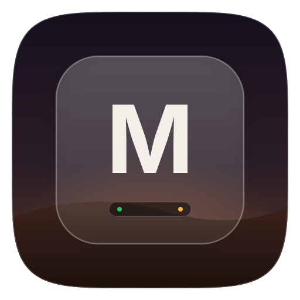
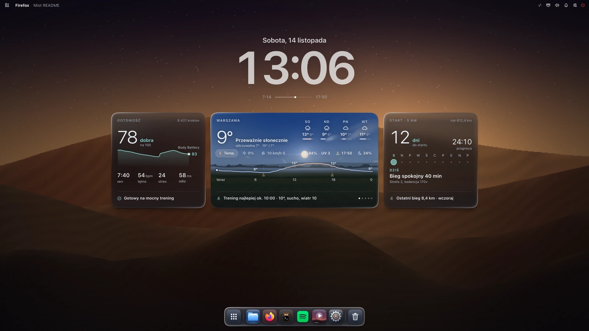
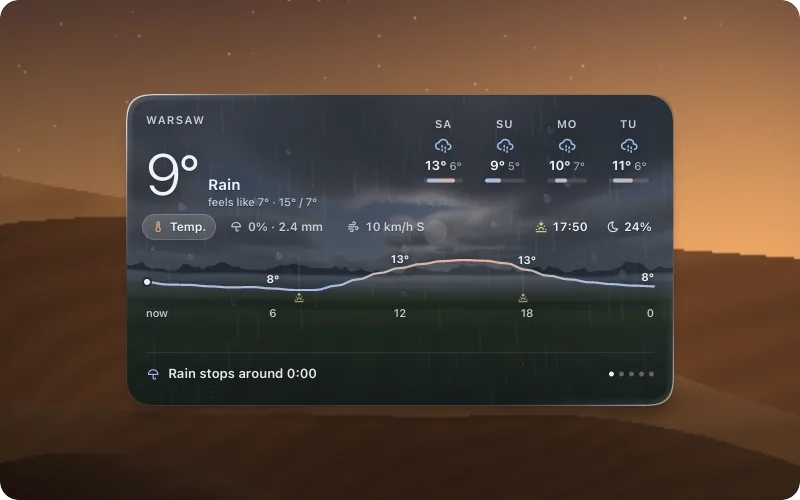
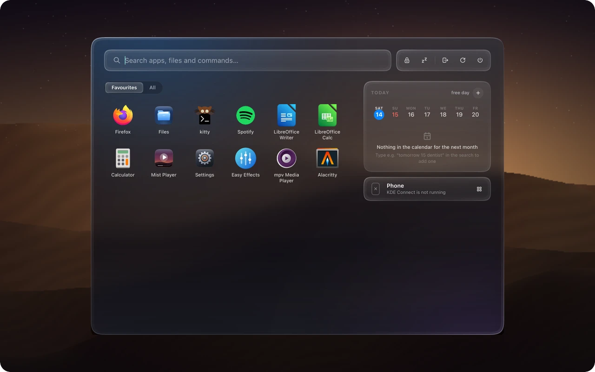
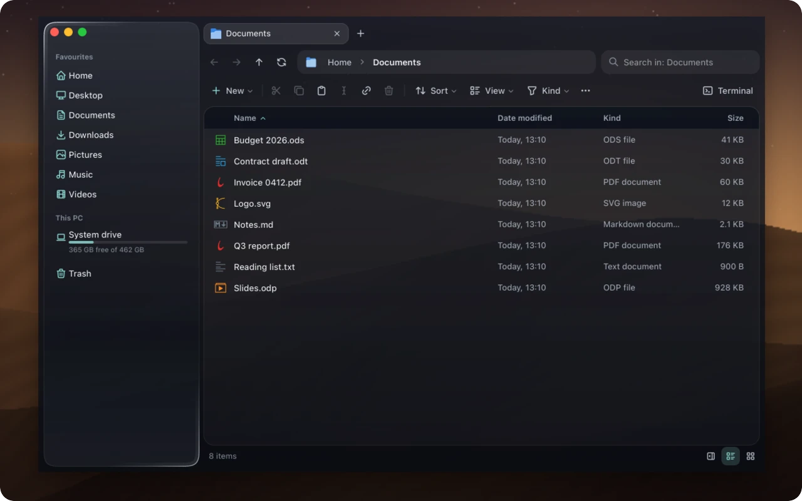
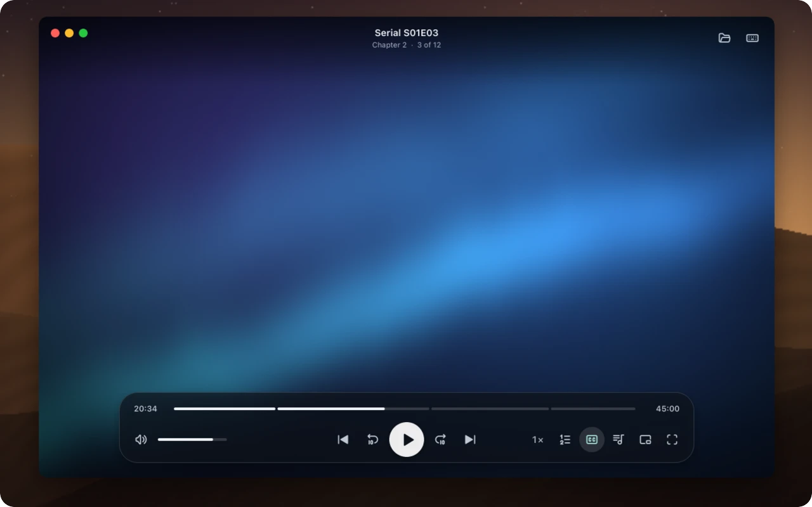
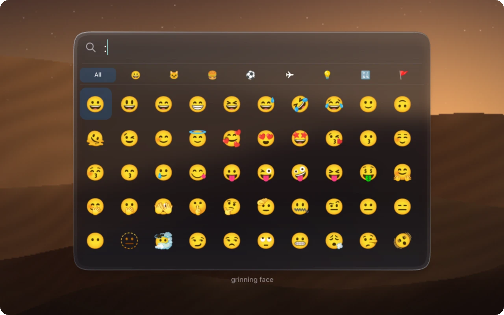
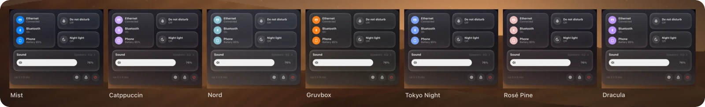

<div align="center">



# Mist

**Powłoka pulpitu i kompozytor Waylanda dla Linuksa, napisane w Rust i rysowane na CPU.**

[](../../.github/workflows/ci.yml)
[](https://github.com/wiktor-jozwiak/mist/releases)
[](https://github.com/wiktor-jozwiak/mist/stargazers)
[](../../LICENSE)
[](https://discord.gg/4rRabwQTPE)

[English](../../README.md) · [Polski](README.pl.md) · [Deutsch](README.de.md) ·
[Español](README.es.md) · [简体中文](README.zh-CN.md) · [日本語](README.ja.md)

<br>



<table>
  <tr>
    <td align="center" width="33%"><h3>44 MB</h3><sub>pamięci zajmuje cała powłoka w bezczynności</sub></td>
    <td align="center" width="33%"><h3>0</h3><sub>kontekstów OpenGL w procesie powłoki</sub></td>
    <td align="center" width="33%"><h3>8 / s</h3><sub>wybudzeń w bezczynności, bez odpytywania</sub></td>
  </tr>
</table>

**[Przegląd](#przegląd) · [Co dostajesz](#co-dostajesz) · [Dlaczego jest lekki](#dlaczego-jest-lekki) · [mist-comp](#mist-comp) ·
[Instalacja](#instalacja) · [Klawisze](#klawisze-i-skrypty) · [Rozwój](#rozwój)**

</div>

Mist to dwa programy i każdy działa bez drugiego:

| | Co to jest | Gdzie działa |
|---|---|---|
| **Powłoka** (`mist-ui`, `mist-wall`) | pasek, dock, Dynamic Island, widżety pulpitu, wyszukiwarka, centrum sterowania, powiadomienia, ekran blokady, agent polkit, menedżer plików i odtwarzacz wideo, w jednym procesie | Hyprland, mist-comp albo [okno](#2-wypróbuj-w-oknie) na pulpicie, którego już używasz |
| **Kompozytor** ([`mist-comp`](#mist-comp)) | kompozytor Waylanda na Smithay, z własnym ekranem logowania | osobna sesja logowania, obok Hyprlanda |

Wygląd celowo pożycza od macOS; pod spodem to zwykły linuksowy pulpit.

> [!NOTE]
> Mist to codzienny pulpit jednej osoby (Arch / CachyOS, dwa monitory, NVIDIA). Jest publiczny, bo działa,
> a nie dlatego, że jest skończony: licz się z czytaniem kodu.

## Przegląd

<div align="center">


<sub>Dynamic Island: powiadomienia, głośność, deszcz w najbliższej godzinie, następne wydarzenie</sub>

<br><br>

<table>
  <tr>
    <td width="50%" align="center"><br><sub>Karta pogody nad żywym niebem, które idzie za pogodą i godziną</sub></td>
    <td width="50%" align="center"><br><sub>Żywe tapety w GLSL, zdjęcia albo niebo aktualnej pogody</sub></td>
  </tr>
  <tr>
    <td align="center"><br><sub>Start: aplikacje, pliki, polecenia, dzisiejszy dzień i telefon</sub></td>
    <td align="center"><br><sub>Spotlight: aplikacje, pliki, polecenia, działania, jednostki, strefy czasowe, emoji, sieć</sub></td>
  </tr>
  <tr>
    <td align="center"><br><sub>Mist Files, także okno wyboru pliku każdej aplikacji</sub></td>
    <td align="center"><br><sub>Mist Player na libmpv: rozdziały, ścieżki, obraz w obrazie</sub></td>
  </tr>
  <tr>
    <td align="center"><br><sub>Ustawienia: wszystkie opcje w jednym oknie, stosowane od razu</sub></td>
    <td align="center"><br><sub>Centrum sterowania: sieć, Bluetooth, telefon, dźwięk, nocne światło</sub></td>
  </tr>
  <tr>
    <td align="center"><br><sub>Kalendarz: miesiąc, agenda, nowe wydarzenia</sub></td>
    <td align="center"><br><sub>Emoji z wyszukiwaniem i kategoriami</sub></td>
  </tr>
</table>



<sub>Mist, Catppuccin, Nord, Gruvbox, Tokyo Night, Rosé Pine, Dracula albo własny plik JSON. Szkło, okna i akcent zmieniają się na żywo.</sub>

<br><br>

<table>
  <tr>
    <td align="center" width="33%"><br><b>Mist Files</b><br><sub>karty, podgląd, inteligentne wyszukiwanie, systemowe okno wyboru pliku</sub></td>
    <td align="center" width="33%"><br><b>Mist Player</b><br><sub>libmpv, MPRIS, obraz w obrazie, równe tempo klatek</sub></td>
    <td align="center" width="33%"><br><b>Ustawienia</b><br><sub>ekran, dźwięk, sieć, pulpit, widżety, język</sub></td>
  </tr>
</table>

<br>

<a href="https://youtu.be/mwisDtz0Yd0"></a>

<sub>40 s demo, nagrane w sesji <code>mist-comp</code> bez monitora, na danych demo. Muzyka: <i>Trap Beat</i>, JonasBlakewood (Pixabay) · <a href="https://github.com/user-attachments/assets/ed8137a5-daf5-488e-8515-686aa54e6e07">MP4</a></sub>

</div>

## Co dostajesz

**Powłoka**

- **Górny pasek:** aktywna aplikacja, zasobnik systemowy (StatusNotifierItem + dbusmenu), sieć, Bluetooth,
  dźwięk, CPU i pamięć, zegar.
- **Dock:** przypięte i uruchomione aplikacje, powiększenie, wybór okna z podglądem na żywo.
- **Dynamic Island:** multimedia z korektorem, minutniki, połączenia telefoniczne, powiadomienia, głośność,
  Caps Lock i informacja o błędzie w pliku konfiguracji (z wierszem i kolumną).
- **Panele:** Start, Spotlight, przełącznik aplikacji, centrum sterowania, centrum powiadomień, kalendarz,
  historia schowka, emoji, menu sesji. Pola wyszukiwania działają jak każde pole tekstowe: kursor, strzałki,
  zaznaczanie Shiftem i Ctrl+A.
- **Zrzuty ekranu:** obszar wybierany na zamrożonym ekranie, pasek narzędzi, tekst z ekranu (OCR), próbnik
  koloru.
- **Przyciąganie okien** jak w Windows 11: przeciągnij do krawędzi lub rogu, Snap Layouts na zielonym
  przycisku albo `Super + Z`, Snap Assist.
- **Ekran blokady** na PAM, z własnym stylem zegara, rozmyciem i przyciemnieniem.

**Pulpit**

- **Zegar i szklane karty:** pogoda, gotowość Garmin, bieganie, muzyka, kalendarz, system, zegary świata,
  notatka z listą zadań, postęp dnia, Słońce i Księżyc, ramka na zdjęcie, baterie urządzeń. Karty Garmin
  pokazują twoje własne dane z Garmin Connect, synchronizowane do lokalnego pliku SQLite, i są ukryte, dopóki
  raz się nie zalogujesz ([poradnik](../guides/garmin.md)).
- **Pogoda** z [Open-Meteo](https://open-meteo.com), bez konta: krzywa godzinowa, cztery dni, deszcz
  w najbliższej godzinie, dzień Słońca i Księżyca. Niebo karty rysuje się na żywo dla pogody i godziny, którą
  wskażesz, nad jednym z pięciu krajobrazów (pola, jezioro, góry, miasto, morze).
- **Tapety:** zdjęcia, żywe sceny GLSL albo niebo aktualnej pogody.
- **Motywy:** Mist, Catppuccin, Nord, Gruvbox, Tokyo Night, Rosé Pine, Dracula albo własny plik JSON. Szkło,
  okna i akcent zmieniają się na żywo w powłoce oraz w Plikach, Odtwarzaczu i Ustawieniach.

**Co zastępuje**

- **Demony:** serwer powiadomień, agent polkit, ekran blokady, bezczynność i usypianie.
- **Aplikacje:** Mist Files, Mist Player i Ustawienia (ekran, dźwięk, Bluetooth, sieć, zasilanie, aplikacje,
  tapeta, pulpit i widżety, ekran blokady, powiadomienia, język).
- **Telefon** przez KDE Connect: bateria, powiadomienia, SMS-y i kontakty w panelu, połączenia w wyspie
  (ADB jako zapas dla połączeń).

Interfejs jest po **polsku, angielsku, niemiecku, hiszpańsku i francusku**, zgodnie z `$LANG` albo wyborem
w Ustawieniach. Język to jeden plik JSON w [native/assets/i18n](../../native/assets/i18n).

## Dlaczego jest lekki

Mist zaczął jako konfiguracja Quickshell, która na bezczynnym pulpicie zajmowała 428 MB i 9,5 % CPU. Został
przepisany powierzchnia po powierzchni według trzech zasad:

- **Rysuj na CPU.** `mist-ui` maluje bufory `wl_shm` przez [tiny-skia] i [swash] i odświeża tylko to, co się
  zmieniło. Na NVIDII każdy kontekst OpenGL kosztuje 100 do 160 MB, zanim pojawi się pierwszy piksel;
  `mist-ui` nie ma żadnego.
- **Czekaj na zdarzenia.** Stan przychodzi z gniazda kompozytora, D-Bus, `pactl subscribe` i inotify, a ukryte
  powierzchnie nie pracują. Bezczynna powłoka budzi się 8 razy na sekundę.
- **Jeden proces GPU i tylko wtedy, gdy coś pokazuje.** `mist-wall` rysuje żywe tapety, niebo karty pogody
  i galerię tapet. Przy tapecie ze zdjęcia i bez tych elementów kończy działanie, a zdjęcie rysuje `mist-ui`.

<p align="center"></p>

<details>
<summary><b>Liczby</b>: powłoki i kompozytory zmierzone w ten sam sposób</summary>

<br>

**Powłoki.** Każda osobno w świeżym sway bez monitora, na GPU (RTX 4060, dwa wyjścia 1080p), z konfiguracją
ze swojego pakietu; 3 przebiegi, mediana ([bench/shells.sh](../../bench/shells.sh)). *Bezczynność*: przez
minutę nic się nie dzieje. *Aktywność*: zmiana obszaru roboczego co 2 s, nowe okno co 6 s, powiadomienie co
10 s. CPU to % jednego rdzenia.

| Powłoka | Co rysuje | Pamięć (PSS) | Pamięć GPU | CPU bezczynnie | CPU aktywnie |
|---|---|---|---|---|---|
| swaybar (sway 1.12) | pasek | 6 MB | – | 0 % | 0,03 % |
| Waybar 0.15 | pasek | 34 MB | – | 0,03 % | 0,38 % |
| **Mist, tapeta ze zdjęcia** | pasek, dock, wyspa, widżety pulpitu, powiadomienia, tapeta | **44 MB** | – | 0,14 % | 0,66 % |
| nwg-panel 0.12 | pasek | 59 MB | – | 0,09 % | 0,23 % |
| **Mist, żywa tapeta** | to samo, a tapetą jest żywa scena GLSL | 144 MB | 50 MiB | 0,79 % | 1,34 % |
| Ironbar 0.19 | pasek | 158 MB | 9 MiB | 0,35 % | 0,42 % |
| Quickshell 0.3, jedno puste `PanelWindow` | pusty pasek | 161 MB | 6 MiB | 0 % | 0 % |
| Noctalia 5.4 | pasek, tapeta ze zdjęcia (i okno pierwszego uruchomienia) | 192 MB | 60 MiB | 0,10 % | 4,01 % |

**Kompozytory.** Bez monitora, na tym samym GPU, 1920×1080 60 Hz, 5 przebiegów
([bench/compositors.sh](../../bench/compositors.sh)). Gdy na ekranie nic nie ma, wszystkie zużywają 0 % CPU.

| Kompozytor | Pamięć (PSS) | CPU, klient rysujący na CPU co klatkę | CPU, pełnoekranowy klient OpenGL | CPU na klatkę OpenGL |
|---|---|---|---|---|
| **mist-comp** | 128 MB | **2,2 %** | 1,5 % | 0,25 ms |
| weston 15 | 129 MB | 3,3 % | **0,8 %** | **0,13 ms** |
| labwc 0.20 | 137 MB | 8,1 % | 8,9 % | 1,5 ms |
| sway 1.12 | 129 MB | 33,6 % | 8,3 % | 1,4 ms |

Hyprland i niri nie mają trybu bez monitora, który da się uruchomić ze skryptu, więc nie ma ich w tabeli.
Metoda, każdy przebieg, wybudzenia, liczby dla każdego procesu i wcześniejsze pomiary na żywej sesji:
[docs/BENCHMARKS.md](../BENCHMARKS.md).

</details>

## mist-comp

Własny kompozytor Waylanda Mista, około 14 000 linii Rusta na [Smithay], z ekranem logowania. Uruchamia tę
samą powłokę i odpowiada na tyle IPC Hyprlanda, że `hyprctl` i skrypty Mista działają bez zmian. Jest
eksperymentalny i jest codzienną sesją autora obok Hyprlanda.

- **Okna:** paski tytułu Mista albo aplikacji, zaokrąglone rogi i cienie, szklane rozmycie pod
  półprzezroczystymi oknami i panelami, Overview (`Super + O`), lupa, zmiana obszaru roboczego podążająca za
  palcami, Win + D pokazuje pulpit.
- **Nie robi pracy, którą może pominąć:** monitor odświeża się tylko wtedy, gdy coś się na nim zmieniło;
  szkło rozmywa się ponownie tylko wtedy, gdy coś za nim się poruszyło; okno zasłonięte przez inne dostaje
  jedną klatkę na sekundę zamiast sześćdziesięciu.
- **Sesja:** DRM / KMS przez logind, podłączanie monitorów w locie, VRR, explicit sync, XWayland,
  udostępnianie ekranu przez portal, około 45 protokołów. Po awarii okna wracają na swoje obszary robocze;
  `mist-session restart` ładuje nową wersję bez wylogowania.
- **Testy:** 66 testów zagnieżdżonych na backendzie bez monitora, uruchamianych w CI na rendererze
  programowym.

Jeszcze nie ma: kafelkowania, sterowania tearingiem, sprawdzonego direct scan-out na NVIDII. Konfiguracja:
[docs/CONFIG.md](../CONFIG.md#compconf-outputs-mist-comp-only); `mist-comp migrate` konwertuje konfigurację Hyprlanda.

## Instalacja

### 1. Pobierz

Arch: [packaging/arch/PKGBUILD](../../packaging/arch/PKGBUILD) buduje `mist-shell-git`.

```bash
git clone https://github.com/wiktor-jozwiak/mist && cd mist/packaging/arch && makepkg -si
```

Gdziekolwiek indziej, z klonu repozytorium. Pierwszy skrypt buduje `mistd` (backendy), drugi umieszcza
`mist-ui-bin`, `mist-wall-bin`, `mist-comp` i `mist-try` w `~/.local/bin`:

```bash
git clone https://github.com/wiktor-jozwiak/mist ~/src/mist
```

```bash
~/src/mist/scripts/mistd/install.sh && ~/src/mist/native/install.sh
```

Gotowe binarki są dołączone do każdego [wydania](https://github.com/wiktor-jozwiak/mist/releases).

<details>
<summary>Zależności</summary>

<br>

**Budowanie:** `rust`, `pkgconf`, `libxkbcommon`, `pam`, `wayland`, `mesa`; dla `mist-comp` także `libinput`,
`libseat`, `libdrm`, `systemd-libs`.

**Działanie:** `pipewire-pulse`, `wireplumber`, `networkmanager`, `wl-clipboard`, `grim`, `slurp`, `polkit`,
`noto-fonts`, `noto-fonts-emoji`. Opcjonalnie: `ddcutil` (jasność monitora), `kdeconnect` albo `android-tools`
(telefon). Co każda z nich włącza: [docs/CONFIG.md](../CONFIG.md#optional-integrations).

**Czcionka:** interfejs jest rysowany pod SF Pro, której Mist nie może dołączyć. Bez niej używa Inter,
potem Noto Sans.

</details>

### 2. Wypróbuj w oknie

```bash
mist-try
```

Cały pulpit (jego kompozytor, pasek, dock, wyspa, widżety) w jednym oknie na Hyprlandzie, Sway, GNOME albo
KDE. Ma własny katalog uruchomieniowy i własną szynę sesji D-Bus, więc twoje powiadomienia, zasobnik i agent
polkit zostają tam, gdzie są; zamknij okno i nie zostaje po nim nic. Opcje: `MIST_TRY_SIZE=1600x1000`,
`MIST_TRY_KEYBOARD=de`, `MIST_THEME=nord`.

### 3. Zrób z niego swój pulpit

- **Na Hyprlandzie:** wczytaj [examples/hyprland/mist.lua](../../examples/hyprland/mist.lua) ze swojej
  konfiguracji i usuń inne paski, demony powiadomień i agentów polkit.
- **Na mist-comp:** `native/mist-comp/session/install-session.sh --greeter` dodaje sesję Mist do ekranu
  logowania; Hyprland zostaje.

## Klawisze i skrypty

| Klawisz | Akcja | | Klawisz | Akcja |
|---|---|---|---|---|
| `Super` | Start | | `Super + A` | centrum powiadomień |
| `Super + Space` | Spotlight | | `Super + V` | historia schowka |
| `Super + Tab` | przełącznik aplikacji | | `Super + .` | emoji |
| `Super + I` | centrum sterowania | | `Super + L` | blokada |
| `Super + Shift + S` | zrzut ekranu | | prawy przycisk na pulpicie | ustawienia |

Wszystko da się oskryptować: `mist-ui-bin msg mist toggle spotlight`, `mist-ui-bin msg ui stats`. Ustawienia
są w `~/.config/mist/`, każdy plik opisuje [docs/CONFIG.md](../CONFIG.md); log to `~/.cache/mist/ui.log`.

## Rozwój

```bash
cd native && cargo build --release && cargo test --release
```

Każda powierzchnia renderuje się poza ekranem, więc zmiany da się sprawdzić bez dotykania działającej sesji:
`mist-ui-bin --pane-png spotlight 1920 1080 out.png`, `mist-ui-bin --desk-png dir`,
`mist-wall-bin --png out.ppm dunes 1920 1080`. `native/mist-comp/tests/run-all.sh` uruchamia testy kompozytora
w zagnieżdżonym oknie. Więcej w [native/README.md](../../native/README.md) i
[CONTRIBUTING.md](../../CONTRIBUTING.md).

Obrazy na tej stronie pochodzą z tych samych renderów poza ekranem, na danych demo: `docs/img/hero.sh`,
`docs/img/panels.sh`, `docs/img/gifs.sh`.

| Ścieżka | Co |
|---|---|
| `native/mist-ui` | wszystkie powierzchnie powłoki |
| `native/mist-wall` | proces GPU tapet |
| `native/mist-comp` | kompozytor, sesja i ekran logowania |
| `scripts/mistd` | backendy: statystyki systemu, telefon, połączenia, schowek, synchronizacja Garmin |
| `shaders/` | shadery tapet i nieba |
| `bench/` | narzędzia do pomiarów i ich wyniki |
| tag `legacy-qml` | pierwotna wersja na Quickshell |

## Historia gwiazdek

<a href="https://star-history.com/#wiktor-jozwiak/mist&Date">
  <picture>
    <source media="(prefers-color-scheme: dark)" srcset="https://api.star-history.com/svg?repos=wiktor-jozwiak/mist&type=Date&theme=dark">
    <source media="(prefers-color-scheme: light)" srcset="https://api.star-history.com/svg?repos=wiktor-jozwiak/mist&type=Date">
    
  </picture>
</a>

## Podziękowania

Zbudowany na [Smithay], [smithay-client-toolkit], [tiny-skia], [swash], [resvg], [zbus] i [Tabler Icons].
Pierwsza wersja działała na [Quickshell], z [Noctalia] jako punktem odniesienia.
W rozwoju projektu pomagają asystenci AI.

<sub>Mist nie jest powiązany z Apple. macOS, Dynamic Island, Spotlight i SF Pro to znaki towarowe Apple Inc.,
wymienione tu wyłącznie po to, by opisać inspirację projektu.</sub>

[GPL-3.0](../../LICENSE)

[tiny-skia]: https://github.com/linebender/tiny-skia
[swash]: https://github.com/dfrg/swash
[resvg]: https://github.com/linebender/resvg
[zbus]: https://github.com/dbus2/zbus
[Smithay]: https://github.com/Smithay/smithay
[smithay-client-toolkit]: https://github.com/Smithay/client-toolkit
[Tabler Icons]: https://tabler.io/icons
[Quickshell]: https://quickshell.org
[Noctalia]: https://github.com/noctalia-dev/noctalia
