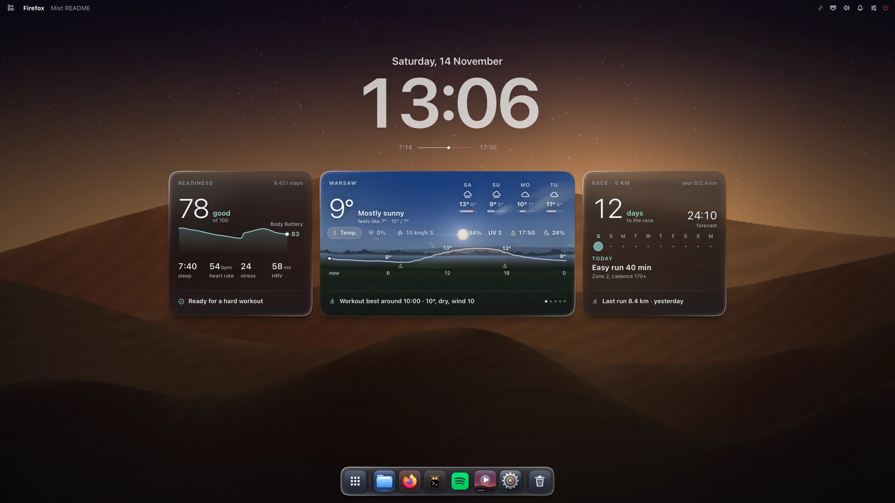
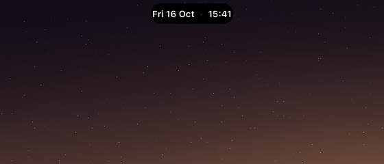
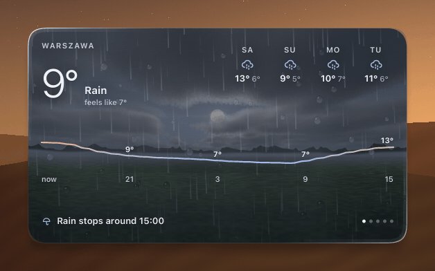

<div align="center">


**受 macOS 启发的 Wayland 桌面外壳，用 Rust 编写，在 CPU 上绘制。**

[](../../.github/workflows/ci.yml)
[](https://github.com/wiktor-jozwiak/mist/releases)
[](../../LICENSE)
[](https://discord.gg/4rRabwQTPE)

[English](../../README.md) · [Polski](README.pl.md) · [Deutsch](README.de.md) ·
[Español](README.es.md) · [简体中文](README.zh-CN.md) · [日本語](README.ja.md)

<br>



<table>
  <tr>
    <td width="50%"></td>
    <td width="50%"></td>
  </tr>
  <tr>
    <td align="center"><sub>灵动岛：通知、音量、一小时内降雨、下一个日程</sub></td>
    <td align="center"><sub>实时 GLSL 天空上的天气卡片</sub></td>
  </tr>
</table>

<a href="https://github.com/user-attachments/assets/ed8137a5-daf5-488e-8515-686aa54e6e07"></a>

<sub>40 秒演示，在无头 <code>mist-comp</code> 会话中使用演示数据录制。音乐：JonasBlakewood 的 <i>Trap Beat</i>（Pixabay）</sub>

</div>

Mist 是一个桌面的顶栏、Dock、灵动岛、桌面小组件、搜索、控制中心、通知、锁屏和 polkit 代理，全部在一个约
50 MB、从不创建 GPU 上下文的进程里。它可以运行在 Hyprland 上，也可以运行在自己的合成器 `mist-comp` 上。

它最初是一个 Quickshell 配置，空闲时占用 428 MB 内存和 9.5 % CPU，之后按照三条原则逐个界面重写：

- **在 CPU 上绘制。** `mist-ui` 用 [tiny-skia] 和 [swash] 绘制 `wl_shm` 缓冲区，只重绘发生变化的部分。在
  NVIDIA 上，每个 OpenGL 上下文在画出第一个像素之前就要占用 100 到 160 MB；Mist 一个也没有。
- **等待事件。** 所有数据来自合成器套接字、D-Bus、`pactl subscribe` 和 inotify。屏幕静止时没有任何轮询，
  隐藏的界面不做任何工作。
- **只有一个 GPU 进程，而且只在需要显示时运行。** `mist-wall` 绘制动态壁纸和天气天空；使用照片壁纸时它会
  退出，由 `mist-ui` 绘制照片。

> [!NOTE]
> Mist 是一个人的日常桌面（Arch / CachyOS、双显示器、NVIDIA）。公开它是因为它能用，而不是因为它已经完成：
> 你可能需要读一些代码。

## 功能

<table>
  <tr>
    <td width="50%"></td>
    <td width="50%"></td>
  </tr>
  <tr>
    <td align="center"><sub>Spotlight：应用、文件、命令、表情、网页</sub></td>
    <td align="center"><sub>设置：所有选项在一个窗口里，立即生效</sub></td>
  </tr>
  <tr>
    <td width="50%"></td>
    <td width="50%"></td>
  </tr>
  <tr>
    <td align="center"><sub>控制中心：网络、蓝牙、手机、声音、夜间模式</sub></td>
    <td align="center"><sub>日历：月视图、日程、新建事件</sub></td>
  </tr>
</table>

| | |
|---|---|
| **顶栏** | 当前应用、系统托盘（StatusNotifierItem + dbusmenu）、网络、蓝牙、音频、CPU 与内存、时钟 |
| **Dock** | 固定与运行中的应用、放大效果、带实时缩略图的窗口选择 |
| **灵动岛** | 带均衡器的媒体、计时器、来电（KDE Connect 或 ADB）、通知、音量 |
| **桌面** | 时钟和玻璃卡片：天气、Garmin 身体准备度、跑步、音乐、日历、系统、世界时钟 |
| **面板** | Spotlight、开始菜单、应用切换、控制中心、通知中心、剪贴板历史、表情、会话菜单、截图 |
| **快速回答** | 在 Spotlight 中边输入边计算：算式（`128*42`）、单位（`212 f to c`、`2 gb to mb`）、时区（`tokyo time`） |
| **手机** | KDE Connect：电量、通知、短信和联系人面板，来电显示在灵动岛 |
| **设置** | 语言、天气地点、壁纸、桌面布局、小组件、夜间模式、锁屏与睡眠、通知 |
| **系统** | 通知服务、polkit 代理、锁屏（PAM）、空闲与睡眠 |
| **应用** | Mist Files（也是所有应用的文件选择器）、Mist Player（libmpv）、系统设置 |
| **窗口贴靠** | 类似 Windows 11：拖到边缘或角落，绿色按钮或 `Super + Z` 打开 Snap Layouts，Snap Assist |
| **壁纸** | 照片、GLSL 动态场景，或跟随当前天气的天空 |

**天气**来自 [Open-Meteo](https://open-meteo.com)，无需账号：逐小时曲线、四天预报、一小时内降雨、日月。
**Garmin 身体准备度**和**跑步**显示你自己的 Garmin Connect 数据，由 `mistd` 同步到本地 SQLite 文件；在你登录
一次之前这两张卡片不会出现（[说明](../guides/garmin.md)）。

界面支持**英语、波兰语、德语、西班牙语和法语**，跟随 `$LANG` 或设置中的选择。每种语言是
[native/assets/i18n](../../native/assets/i18n) 中的一个 JSON 文件。

## 性能

<p align="center"></p>

每个 shell 单独运行在全新的无头 sway 中，由 GPU 渲染 (RTX 4060，两个 1080p 输出)，使用其软件包自带的配置，
运行 3 次取中位数 ([bench/shells.sh](../../bench/shells.sh))。*空闲*：一分钟内什么都不发生。*活动*：每 2 秒切换工作区，
每 6 秒打开一个窗口，每 10 秒一条通知。CPU 为单核百分比。

| Shell | 绘制内容 | 内存 (PSS) | GPU 内存 | CPU 空闲 | CPU 活动 |
|---|---|---|---|---|---|
| swaybar (sway 1.12) | 状态栏 | 7 MB | – | 0 % | 0.03 % |
| Waybar 0.15 | 状态栏 | 32 MB | – | 0.03 % | 0.38 % |
| **不含 `mist-wall` 的 Mist** | 状态栏、Dock、灵动岛、桌面小组件、通知 | **38 MB** | – | 0.19 % | 0.72 % |
| nwg-panel 0.12 | 状态栏 | 56 MB | – | 0.10 % | 0.22 % |
| **Mist** | 以上全部 + GLSL 动态壁纸 | 132 MB | 42 MiB | 0.83 % | 1.35 % |
| Ironbar 0.19 | 状态栏 | 137 MB | 9 MiB | 0.37 % | 0.43 % |
| Quickshell 0.3，一个空 `PanelWindow` | 空状态栏 | 142 MB | 6 MiB | 0 % | 0 % |
| Noctalia 5.4 | 状态栏、照片壁纸 (以及首次运行对话框) | 177 MB | 60 MiB | 0.12 % | 4.50 % |

合成器：在同一 GPU 上无头运行，1920×1080 60 Hz，运行 5 次 ([bench/compositors.sh](../../bench/compositors.sh))。
屏幕上没有内容时全部为 0 % CPU：

| 合成器 | 内存 (PSS) | CPU，每帧用 CPU 绘制的客户端 | CPU，全屏 OpenGL 客户端 | 每个 OpenGL 帧的 CPU |
|---|---|---|---|---|
| **mist-comp** | 100 MB | **1.7 %** | 1.3 % | 0.22 ms |
| weston 15 | 101 MB | 2.7 % | **0.6 %** | **0.11 ms** |
| labwc 0.20 | 109 MB | 6.1 % | 6.0 % | 1.0 ms |
| sway 1.12 | 103 MB | 33.5 % | 6.6 % | 1.1 ms |

Hyprland 和 niri 没有可由脚本启动的无头模式，因此未列入。方法、每次运行、各进程数据以及之前在真实会话中的测量：
[docs/BENCHMARKS.md](../BENCHMARKS.md)。

## mist-comp

Mist 自己的 Wayland 合成器，基于 [Smithay]，约 14 000 行 Rust，带登录界面。它运行同一个外壳，并实现了足够多的
Hyprland IPC，使 `hyprctl` 和 Mist 的脚本无需修改即可工作。它仍是实验性的，也是作者在 Hyprland 之外的日常会话。

- **窗口：** Mist 标题栏或应用自带标题栏、圆角和阴影、半透明窗口与面板下的玻璃模糊、Windows 11 式贴靠、
  Overview（`Super + O`）、放大镜、跟随手指的工作区切换、Win + D 显示桌面。
- **能省的工作都省掉：** 只有内容变化的显示器才重绘；只有背后有东西移动时玻璃才重新模糊；被遮挡的窗口每秒
  只收到一帧，而不是六十帧。
- **会话：** 通过 logind 使用 DRM / KMS、显示器热插拔、VRR、explicit sync、XWayland、通过门户共享屏幕，约 45
  个协议。崩溃后窗口会回到原来的工作区；`mist-session restart` 无需注销即可加载新版本。
- **测试：** 66 个运行在无头后端上的嵌套测试，CI 中使用软件渲染器运行。

尚未支持：平铺、撕裂控制、在 NVIDIA 上验证过的直接扫描输出。配置：
[docs/CONFIG.md](../CONFIG.md#compconf-outputs-mist-comp-only)；`mist-comp migrate` 可转换 Hyprland 配置。

## 安装

Arch：[packaging/arch/PKGBUILD](../../packaging/arch/PKGBUILD) 构建 `mist-shell-git`。

```bash
git clone https://github.com/wiktor-jozwiak/mist && cd mist/packaging/arch && makepkg -si
```

从仓库克隆安装，位置任意：

```bash
git clone https://github.com/wiktor-jozwiak/mist ~/src/mist
```

```bash
~/src/mist/scripts/mistd/install.sh && ~/src/mist/native/install.sh
```

第一个脚本构建 `mistd`，第二个把 `mist-ui-bin`、`mist-wall-bin` 和 `mist-comp` 放进 `~/.local/bin`。每个
[发布版本](https://github.com/wiktor-jozwiak/mist/releases)都附带预编译二进制文件。

- **在 Hyprland 上：** 在配置中加载 [examples/hyprland/mist.lua](../../examples/hyprland/mist.lua)，并移除其他
  状态栏、通知守护进程和 polkit 代理。
- **在 mist-comp 上：** `native/mist-comp/session/install-session.sh --greeter` 会在登录界面添加 Mist 会话；
  Hyprland 保留。

<details>
<summary>依赖</summary>

<br>

**构建：** `rust`、`pkgconf`、`libxkbcommon`、`pam`、`wayland`、`mesa`；`mist-comp` 还需要 `libinput`、
`libseat`、`libdrm`、`systemd-libs`。

**运行：** `pipewire-pulse`、`wireplumber`、`networkmanager`、`wl-clipboard`、`grim`、`slurp`、`polkit`、
`noto-fonts`、`noto-fonts-emoji`。可选：`ddcutil`（显示器亮度）、`kdeconnect` 或 `android-tools`（手机）。
各自启用的功能：[docs/CONFIG.md](../CONFIG.md#optional-integrations)。

**字体：** 界面按 SF Pro 设计，但 Mist 不能附带它。没有它时使用 Inter，其次是 Noto Sans。

</details>

## 使用

| 按键 | 功能 | | 按键 | 功能 |
|---|---|---|---|---|
| `Super` | 开始菜单 | | `Super + A` | 通知中心 |
| `Super + Space` | Spotlight | | `Super + V` | 剪贴板历史 |
| `Super + Tab` | 应用切换 | | `Super + .` | 表情 |
| `Super + I` | 控制中心 | | `Super + L` | 锁屏 |
| `Super + Shift + S` | 截图 | | 桌面右键 | 设置 |

一切都可以脚本化：`mist-ui-bin msg mist toggle spotlight`、`mist-ui-bin msg ui stats`。设置保存在
`~/.config/mist/`，每个文件都在 [docs/CONFIG.md](../CONFIG.md) 中说明；日志位于 `~/.cache/mist/ui.log`。

## 开发

```bash
cd native && cargo build --release && cargo test --release
```

每个界面都能离屏渲染，因此无需动正在运行的会话就能检查改动：
`mist-ui-bin --pane-png spotlight 1920 1080 out.png`、`mist-ui-bin --desk-png dir`、
`mist-wall-bin --png out.ppm dunes 1920 1080`。`native/mist-comp/tests/run-all.sh` 在嵌套窗口中运行合成器测试。
更多内容见 [native/README.md](../../native/README.md) 和 [CONTRIBUTING.md](../../CONTRIBUTING.md)。

| 路径 | 内容 |
|---|---|
| `native/mist-ui` | 外壳的所有界面 |
| `native/mist-wall` | GPU 壁纸进程 |
| `native/mist-comp` | 合成器、会话与登录界面 |
| `scripts/mistd` | 后端：系统状态、手机、来电、剪贴板、Garmin 同步 |
| `shaders/` | 壁纸与天空着色器 |
| 标签 `legacy-qml` | 最初的 Quickshell 版本 |

## 致谢

基于 [Smithay]、[smithay-client-toolkit]、[tiny-skia]、[swash]、[resvg]、[zbus] 和 [Tabler Icons] 构建。
第一个版本运行在 [Quickshell] 上，并以 [Noctalia] 为参考。

<sub>Mist 与 Apple 无关。macOS、Dynamic Island、Spotlight 和 SF Pro 是 Apple Inc. 的商标，此处提及仅用于说明设计灵感。</sub>

[GPL-3.0](../../LICENSE)

[tiny-skia]: https://github.com/linebender/tiny-skia
[swash]: https://github.com/dfrg/swash
[resvg]: https://github.com/linebender/resvg
[zbus]: https://github.com/dbus2/zbus
[Smithay]: https://github.com/Smithay/smithay
[smithay-client-toolkit]: https://github.com/Smithay/client-toolkit
[Tabler Icons]: https://tabler.io/icons
[Quickshell]: https://quickshell.org
[Noctalia]: https://github.com/noctalia-dev/noctalia
