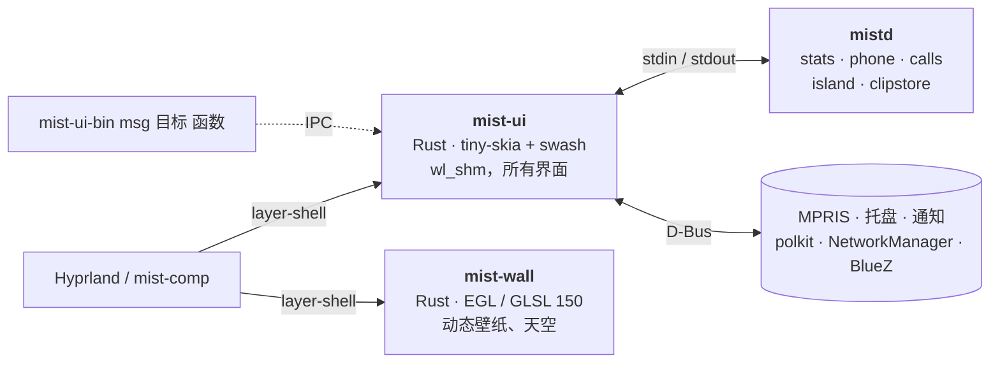

<div align="right">
  🌐 <b>选择语言:</b>
  <a href="../../README.md">English</a> ·
  <a href="README.pl.md">Polski</a> ·
  <a href="README.de.md">Deutsch</a> ·
  <a href="README.es.md">Español</a> ·
  <a href="README.zh-CN.md"><b>简体中文</b></a> ·
  <a href="README.ja.md">日本語</a>
</div>

<div align="center">


**受 macOS 启发的 Hyprland 桌面外壳，用 Rust 编写，在 CPU 上绘制。**

顶栏、程序坞、灵动岛、桌面小组件、Spotlight 式搜索、控制中心、通知、锁屏和 polkit 代理，
全部在一个约 50 MB 的进程里，没有 GPU 上下文。

[](../../LICENSE)
[](../../native)
[](https://hyprland.org)
[](../../.github/workflows/ci.yml)
[](https://discord.gg/4rRabwQTPE)

[功能](#功能) · [测量](#测量) · [安装](#安装) · [使用](#使用) · [开发](#开发)

[English](../../README.md) · [Polski](README.pl.md) · [Deutsch](README.de.md) ·
[Español](README.es.md) · [简体中文](README.zh-CN.md) · [日本語](README.ja.md)

<br>


<table>
  <tr>
    <td width="50%"></td>
    <td width="50%"></td>
  </tr>
  <tr>
    <td align="center"><sub><b>灵动岛</b>：通知、音量、短时降雨、下一个日程</sub></td>
    <td align="center"><sub><b>天气卡片</b>：Open-Meteo 数据，叠在实时 GLSL 天空之上</sub></td>
  </tr>
</table>

<sub>使用 <code>docs/demo</code> 中的演示数据离屏渲染，由
<a href="../img/hero.sh">hero.sh</a>、<a href="../img/gifs.sh">gifs.sh</a> 和
<a href="../img/panels.sh">panels.sh</a> 生成。在真实会话中，Hyprland 会模糊玻璃下方的内容。</sub>

</div>

<br>

<table>
  <tr>
    <td align="center" width="33%"><h3>~50 MB</h3><sub>外壳的所有界面都在一个进程中<br><code>mist-ui</code>，空闲时 PSS</sub></td>
    <td align="center" width="33%"><h3>0 个 GL 上下文</h3><sub>在 CPU 上绘制的 <code>wl_shm</code> 缓冲区；<br>GPU 只用于动态壁纸</sub></td>
    <td align="center" width="33%"><h3>空闲时 0 个定时器</h3><sub>Hyprland 套接字、D-Bus、inotify：<br>隐藏的界面不做任何工作</sub></td>
  </tr>
  <tr>
    <td align="center" width="33%"><h3>0.04 % CPU</h3><sub><code>mist-comp</code> + 外壳空闲时，<br>每秒唤醒 6 次</sub></td>
    <td align="center" width="33%"><h3>1 帧 / 秒</h3><sub>被其他窗口遮住的窗口<br>（帧回调 60 → 1）</sub></td>
    <td align="center" width="33%"><h3>0 次模糊</h3><sub>玻璃后面没有变化时<br>（每 3 秒 362 → 0）</sub></td>
  </tr>
</table>

## 为什么

大多数 Hyprland 外壳运行在 Qt Quick（Quickshell）、GTK + GJS（AGS）或 WebView 上。它们都会打开 OpenGL
上下文，而在 NVIDIA 上每个 GL 上下文都会映射驱动：在第一个像素出现之前，**每个进程约 100 到 160 MB**。
Mist 最初是一套 Quickshell 配置（428 MB，9.5 % CPU），之后被逐个界面重写：

- 🖌️ **在 CPU 上绘制。** `mist-ui` 用 [tiny-skia] 和 [swash] 绘制到 `wl_shm` 缓冲区；由 Hyprland 合成并模糊。
  只重绘发生变化的区域。
- ⚡ **事件驱动。** 数据来自 Hyprland 套接字、D-Bus、`pactl subscribe`、inotify 和常驻的 `mistd` 后端。
  屏幕静止时没有任何定时轮询；隐藏的界面不做任何工作。
- 🎨 **只有一个 GPU 进程，且只在需要时运行。** `mist-wall`（EGL，GLSL 150）绘制动态壁纸和天气天空。
  使用照片壁纸时它会退出，由 `mist-ui` 自己绘制照片。显示器关闭或会话锁定时暂停，在软件 GL 下降到一半分辨率。

<p align="center"></p>

## 测量

<p align="center"></p>

空闲状态，整个外壳，PSS（共享页面在进程间分摊），Ryzen 7 5700X + RTX 4060（驱动 615.71），
Hyprland 0.56.2，2 × 1920x1080 (165 + 75 Hz)。使用 [bench/measure.sh](../../bench/measure.sh) 测量。

| 外壳 | 工具包 | PSS | 空闲 CPU | GL 上下文 |
|---|---|---|---|---|
| **Mist 原生** | Rust，CPU，`wl_shm` | **87 到 106 MB** | 0.6 %（播放音乐） | 仅 `mist-wall` |
| Mist 原生，仅 `mist-ui` | | 36 到 50 MB | 0.6 % | 无 |
| Noctalia v5 | C++，cairo + EGL | 122 MB | 0.07 % | 有 |
| 空 Quickshell（一个 `PanelWindow`） | Qt Quick | 124 MB | ~0 % | 有 |
| Quickshell 上的 Mist（旧 QML 版本） | Qt Quick + QML | 428 MB | 9.5 % | 有 |

他人报告的数字（RSS，不同机器，不能 1:1 比较）：Waybar 50 到 66 MB
（[Waybar#5186](https://github.com/Alexays/waybar/issues/5186)），Caelestia 重启后约 650 MB
（[caelestia-dots/shell#1927](https://github.com/caelestia-dots/shell/issues/1927)）。方法、原始输出和注意事项：
[docs/BENCHMARKS.md](../BENCHMARKS.md)。

### 合成器：mist-comp

**空闲**，[bench/comp.sh](../../bench/comp.sh)：在 Mesa 软件渲染器（llvmpipe，大部分内存和 34 个线程都来自它）上无头运行的 mist-comp，两个 1920x1080 输出，临时 `HOME`，每项 15 秒。

| 状态 | PSS | CPU（单核） | 唤醒 | 帧 |
|---|---|---|---|---|
| 仅 mist-comp | 125 MB | 0.17 % | 5.7 / 秒 | 0.1 / 秒 |
| mist-comp + 整个外壳，空闲 | 173 MB | **0.04 %** | **6.3 / 秒** | 3 / 秒 |
| 其中的 `mist-ui` | 32 MB | 0.33 % | 22.5 / 秒 | 0 |
| 指针持续移动 | 175 MB | 0.83 % | 163 / 秒 | 60 / 秒 |

**真实且繁忙的会话**（2026-10-22，同上机器，NVIDIA，165 + 75 Hz，登录后 35 分钟）：打开网页的 Zen（每秒 272 次提交）、正在流式输出文字的 Claude 桌面应用（每秒 107 次提交）、kitty、Vesktop。[bench/measure.sh](../../bench/measure.sh)，30 秒。

| 进程 | PSS | CPU（单核） |
|---|---|---|
| mist-comp（全部合成、模糊、阴影，两台显示器） | 231 MB | 14 到 16 % |
| 外壳：mist-ui + mist-wall（动态壁纸）+ mistd | 126 MB | 5.1 % |

这是负载下的数字，不是空闲值：这里合成器几乎所有的工作都在跟随这两个繁忙的客户端。同一会话在 Hyprland 下尚未测量。

**合成器省掉了什么**，[native/mist-comp/tests](../../native/mist-comp/tests) 中的嵌套测试（之前 → 之后）：

| 情况 | 结果 |
|---|---|
| 玻璃顶栏和程序坞下方的窗口重绘一个小方块 | 模糊每 3 秒 362 → 0，合成器 CPU 减半 |
| 最大化窗口后面有一个在播放动画的浏览器 | 帧回调每秒 60 → 1（露出后恢复 60） |
| 一台显示器上有客户端在动画，另一台静止 | 静止那台的渲染次数每 3 秒 180 → 0 |
| Zen（每个窗口有多个表面） | 每帧模糊次数 1.92 → 0.96 |
| 面板反复打开关闭 60 秒 | 内存趋于平稳（NVIDIA 上约 80 MB；之前每分钟增长约 4 MB） |
| 客户端在 Mist 标题栏下持续重绘 | 每帧合成器 CPU 0.25 ms |
| 概览打开、放大镜开启、指针不动 | 0 帧 / 秒 |

方法、原始输出和注意事项：[docs/BENCHMARKS.md](../BENCHMARKS.md)。

## 功能

<table>
  <tr>
    <td width="50%"></td>
    <td width="50%"></td>
  </tr>
  <tr>
    <td align="center"><sub><b>Spotlight</b>：应用、文件、命令、表情、网页</sub></td>
    <td align="center"><sub><b>日历</b>：月视图、日程、新建日程</sub></td>
  </tr>
  <tr>
    <td width="50%"></td>
    <td width="50%"></td>
  </tr>
  <tr>
    <td align="center"><sub><b>控制中心</b>：网络、蓝牙、手机、声音、夜间模式</sub></td>
    <td align="center"><sub><b>表情</b>：<code>Super + .</code></sub></td>
  </tr>
</table>

| | |
|---|---|
| 🔝 **顶栏** | 当前应用和标题、系统托盘（StatusNotifierItem 宿主 + dbusmenu）、网络、蓝牙、音频、CPU / 内存指示、时钟、日历 |
| 🚀 **程序坞** | 固定和运行中的应用、放大效果、带实时缩略图的窗口选择（`hyprland_toplevel_export_v1`），点击当前应用将其最小化 |
| 🏝️ **灵动岛** | 媒体（MPRIS）与均衡器、计时器、来电（KDE Connect / ADB）、通知、音量 |
| 🖼️ **桌面** | 时钟、日出 / 日落、玻璃卡片（天气、Garmin 身体状态、跑步计划），每张卡片单独设置 |
| 🔍 **面板** | Spotlight 式搜索、开始菜单、Cmd+Tab 切换器、控制中心（分页）、通知中心、剪贴板历史、表情、会话菜单、壁纸库、截图工具栏 |
| 🛡️ **系统** | 通知服务器、polkit 代理、锁屏（`ext-session-lock-v1` + PAM）、空闲处理（`ext-idle-notify-v1`，logind） |
| 🪟 **窗口贴靠** | Windows 11 式：拖到边缘或角落，在绿色按钮上或用 `Super + Z` 打开 Snap Layouts（7 种布局），Snap Assist 填满其余部分，`Super + 方向键`；各区域间距均为 8 px，预览就是窗口最终落下的位置 |
| 🌄 **壁纸** | 照片（CPU）或 GLSL 动态场景与实时天气天空（`mist-wall`） |
| 🧪 **mist-comp** *（实验性）* | 基于 Smithay 的自有合成器 + 登录界面，可在没有 Hyprland 的情况下运行 Mist：只有背后内容变化时才重新计算的玻璃模糊、按显示器重绘、被遮住的窗口限制为 1 帧/秒、概览（`Super + O`）、1:1 工作区滑动、放大镜、崩溃或 `mist-session restart` 后窗口恢复 |

### 桌面卡片

- **天气**：[Open-Meteo](https://open-meteo.com)，无需账号。逐小时曲线、4 天预报、短时降雨、跑步时段、穿衣建议、
  太阳和月亮；卡片背后的实时天空跟随当前天气。
- **Garmin 身体状态** 和 **跑步**：通过本地 InfluxDB 读取你自己的 Garmin Connect 数据。可选：没有
  `influx.json` 时不显示这些卡片。设置：[docs/guides/garmin.md](../guides/garmin.md)。

### 语言和显示器

界面支持 **波兰语、英语、德语、西班牙语和法语**。在 *自定义桌面*（右键单击桌面时钟）→ 外观 → 语言 中选择，
或设置 `MIST_LANG=en`。*自动* 跟随 `$LANG`，否则使用英语。翻译放在一张表里：
[native/assets/i18n.tsv](../../native/assets/i18n.tsv)，每个字符串一行，每种语言一列。新增语言只需多加一列。

程序坞、灵动岛、桌面和天气天空显示在 合成器的第一个显示器上。换一个：在 `~/.config/mist/settings.json`
中写 `"primary": "DP-3"`，或设置 `MIST_PRIMARY=DP-3`。天气地点：*自定义桌面* → 通用。
全部文件和变量：[docs/CONFIG.md](../CONFIG.md)。

## 架构



| 路径 | 内容 |
|---|---|
| `native/mist-ui` | 外壳的所有界面（[native/README.md](../../native/README.md)） |
| `native/mist-wall` | GPU 壁纸进程 |
| `native/mist-comp` | 实验性 Smithay 合成器、会话和登录界面 |
| `native/common` | mist-ui 与 mist-wall 共用的代码（天文计算、预设） |
| `scripts/mistd` | 后端：系统状态、手机（KDE Connect、ADB）、来电、剪贴板存储、文件管理器 D-Bus |
| `shaders/` | 壁纸和天空着色器（`.frag` 源码，`shaders/glsl` 中的 GLSL 150 由 mist-wall 读取） |
| 标签 `legacy-qml` | 最初的 Quickshell（QML）版本，留作参考 |

## mist-comp

为 Mist 基于 [Smithay] 编写的实验性 Wayland 合成器（约 12 000 行 Rust），带有自己的登录界面。它运行与 Hyprland 下相同的外壳，并实现了足够多的 Hyprland IPC，使 `hyprctl`、Mist 的脚本和外壳的窗口列表无需修改即可工作。作者在 Hyprland 之外每天都在使用它。

- **窗口：** 浮动窗口，使用 Mist 标题栏或应用自带的标题栏，所有窗口都有圆角和统一的柔和阴影，半透明窗口和面板下方有实时玻璃模糊，Windows 11 式贴靠，概览（`Super + O`，三指上滑），放大镜（`Super + =` / `Super + -`，最高 8 倍），工作区随三指 1:1 移动，窗口吞并（swallow），打开、关闭和最小化动画。
- **节省开销的渲染：** 只重绘客户端窗口所在的显示器；只有玻璃后面的内容变化时才重新模糊；被不透明窗口遮住的窗口每秒只收到一次帧回调；被遮住的桌面层会收到通知（`mistcover`）并停止绘制；全屏游戏的帧直接送上屏幕。
- **会话：** 通过 libseat 和 logind 的 DRM / KMS，显示器热插拔，全屏 VRR，explicit sync，XWayland，适用于 greetd 的登录界面，锁屏，空闲，通过 xdg-desktop-portal-hyprland 的屏幕共享和截图。崩溃后 `start-mist` 以安全模式重启它，窗口回到各自的工作区；`mist-session restart` 无需注销即可加载新版本。
- **协议：** 约 45 个，包括 xdg-shell, layer-shell, session-lock, idle-notify, linux-dmabuf, drm-syncobj, presentation-time, fifo + commit-timing, fractional-scale, cursor-shape, tablet, text-input + input-method, pointer-constraints, foreign-toplevel (ext, wlr), ext-workspace, wlr-screencopy, wlr-output-management, data-control, xdg-activation，以及 Hyprland 的顶层窗口导出和全局快捷键。
- **观察：** 在其会话中由 `hyprctl` 应答；它的 IPC 套接字响应 `stats`（帧、提交、唤醒、模糊次数）、`passes`（每台显示器的渲染次数）、`top 5`（谁让屏幕一直忙）、`prof`（每个阶段的 µs）、`mem`。看门狗会记录在隐藏工作区上持续绘制或忙循环的客户端。
- **测试：** 无头后端上的 47 个嵌套测试（`native/mist-comp/tests/run-all.sh`）；CI 在软件渲染器上运行它们，并在任务摘要中输出测量值。

尚未实现：平铺、撕裂控制（Smithay 0.7 没有异步翻页）、在 NVIDIA 上验证过的直接扫描输出。配置：[docs/CONFIG.md](../CONFIG.md#compconf-outputs-mist-comp-only) 中的 `comp.conf`；`mist-comp migrate` 可转换 Hyprland 配置。

## 安装

> [!NOTE]
> Mist 是一个人的日常环境：面向 Arch / CachyOS、使用 Lua 配置的 Hyprland 0.55+，以及 NVIDIA 或 Mesa GPU。
> 请做好阅读代码的准备。

**Arch（AUR 风格的包）：** [packaging/arch/PKGBUILD](../../packaging/arch/PKGBUILD) 构建 `mist-shell-git`
（程序在 `/usr/bin`，文件在 `/usr/share/mist`）。

```bash
git clone https://github.com/wiktor-jozwiak/mist && cd mist/packaging/arch && makepkg -si
```

**从源码目录**（任意位置；`native/install.sh` 会把 `~/.local/share/mist/shell` 链接到它）：

```bash
git clone https://github.com/wiktor-jozwiak/mist ~/src/mist
```

```bash
~/src/mist/scripts/mistd/install.sh && ~/src/mist/native/install.sh
```

`native/install.sh` 会把 `mist-ui-bin`、`mist-wall-bin`、`mist-comp`，以及首次运行时的守护脚本 `mist-ui`
安装到 `~/.local/bin`。带标签的版本也提供预编译程序。

然后把 [examples/hyprland/mist.lua](../../examples/hyprland/mist.lua) 加入 Hyprland 配置（自启动、快捷键、模糊规则），
并移除其他状态栏、通知守护进程和 polkit 代理。

<details>
<summary><b>依赖</b></summary>

<br>

**构建：** `rust`（stable）、`pkgconf`、`libxkbcommon`、`pam`、`wayland`、`mesa`（EGL 头文件）；
`mist-comp` 另需 `libinput`、`libseat`、`libdrm`、`mesa`（gbm）、`systemd-libs`（udev）。

**运行：** `hyprland`、`pipewire` + `pipewire-pulse`（`pactl`、`pw-play`、`parec`）、`wireplumber`（`wpctl`）、
`networkmanager`（`nmcli`）、`wl-clipboard`、`grim`、`slurp`、`polkit`、`noto-fonts`、`noto-fonts-emoji`。
可选：`ddcutil`（通过 DDC/CI 调节亮度）、`kdeconnect` / `android-tools`（手机）、`wf-recorder`（仅用于
`scripts/demo-reel.sh`）。各自开启的功能：[docs/CONFIG.md](../CONFIG.md#optional-integrations)。

**字体：** 界面按 SF Pro 设计（可变字体 `SF-Pro.ttf`，放在 `~/.local/share/fonts/SF-Pro/`）。Apple 只允许在
其平台上使用该字体，因此 Mist 不附带它。没有它时，Mist 使用 Inter Variable，其次是 Noto Sans。

</details>

## 使用

| 按键 | 操作 | | 按键 | 操作 |
|---|---|---|---|---|
| `Super` | 开始菜单 | | `Super + A` | 通知中心 |
| `Super + Space` | Spotlight | | `Super + V` | 剪贴板历史 |
| `Super + Tab` | 应用切换 | | `Super + .` | 表情 |
| `Super + I` | 控制中心 | | `Super + L` | 锁屏 |
| `Print`、`Super + Shift + S` | 截图（区域） | | | |

一切都可以脚本化：`mist-ui-bin msg mist toggle spotlight`、`mist-ui-bin msg ui stats`、
`mist-ui-bin msg dock click firefox`。日志：`~/.cache/mist/ui.log`。设置：`~/.config/mist/`，详见
[docs/CONFIG.md](../CONFIG.md)。

## 开发

```bash
cd native && cargo build --release && cargo test --release
```

<details>
<summary><b>不影响当前会话的检查</b></summary>

<br>

| 命令 | 输出 |
|---|---|
| `mist-ui --png out.png '{"app":"Firefox"}'` | 顶栏 PNG |
| `mist-ui-bin --desk-png dir` / `--dock-png out.png` | 桌面舞台 + 卡片（+ `layout.json`）/ 程序坞 |
| `mist-ui-bin --pane-png spotlight 1920 1080 out.png fi` | 动画结束后的面板（`snapfly:3 640 290`：高亮区域 3 的 Snap Layouts） |
| `mist-ui-bin --island-frames notif out 30 20` | 灵动岛演示，逐帧输出 |
| `mist-ui --test` | 在 HDMI-A-1 上叠加第二个顶栏 |
| `mist-wall-bin --png out.ppm dunes 1920 1080` | 动态壁纸的一帧（`MIST_WALL_BENCH=N`：每帧毫秒数） |
| `mist-ui-bin msg ui stats` | 各界面的唤醒次数、绘制次数和绘制耗时 |
| `native/mist-comp/tests/run-all.sh` | 在嵌套合成器中运行全部 mist-comp 测试（`CI=1`：软件渲染器） |
| `bench/measure.sh 30 mist-ui-bin mist-wall-bin mistd` | 运行中外壳的空闲 PSS / CPU |

</details>

保持 `lto = false`（Arch 的 rustc 搭配系统 LLVM 在 LTO 下会崩溃）。参见 [CONTRIBUTING.md](../../CONTRIBUTING.md)。

## 状态

一个人的日常环境，两台显示器，NVIDIA，现在除了 Hyprland 也在 `mist-comp` 上使用。上表中的一切都是原生实现并每天使用；`mist-comp` 仍是实验性的。
[docs/PUBLISHING.md](../PUBLISHING.md) 列出了公开发布前还剩下的工作。

## Star History

<a href="https://star-history.com/#wiktor-jozwiak/mist&Date">
 <picture>
   <source media="(prefers-color-scheme: dark)" srcset="https://api.star-history.com/svg?repos=wiktor-jozwiak/mist&type=Date&theme=dark" />
   <source media="(prefers-color-scheme: light)" srcset="https://api.star-history.com/svg?repos=wiktor-jozwiak/mist&type=Date" />
   
 </picture>
</a>

## 致谢

[Hyprland]、[Smithay] 和 [smithay-client-toolkit]、[tiny-skia]、[swash]、[resvg]、[zbus]、[Tabler Icons]（MIT）。
最初的 QML 版本基于 [Quickshell]；[Noctalia] 曾作为后备和参考。

<sub><i>Mist 与 Apple 无关。macOS、Dynamic Island、Spotlight 和 SF Pro 是 Apple Inc. 的商标；此处提及仅为说明设计灵感。</i></sub>

## 许可证

[GPL-3.0](../../LICENSE)。

[tiny-skia]: https://github.com/linebender/tiny-skia
[swash]: https://github.com/dfrg/swash
[resvg]: https://github.com/linebender/resvg
[zbus]: https://github.com/dbus2/zbus
[Hyprland]: https://hyprland.org
[Smithay]: https://github.com/Smithay/smithay
[smithay-client-toolkit]: https://github.com/Smithay/client-toolkit
[Tabler Icons]: https://tabler.io/icons
[Quickshell]: https://quickshell.org
[Noctalia]: https://github.com/noctalia-dev/noctalia
